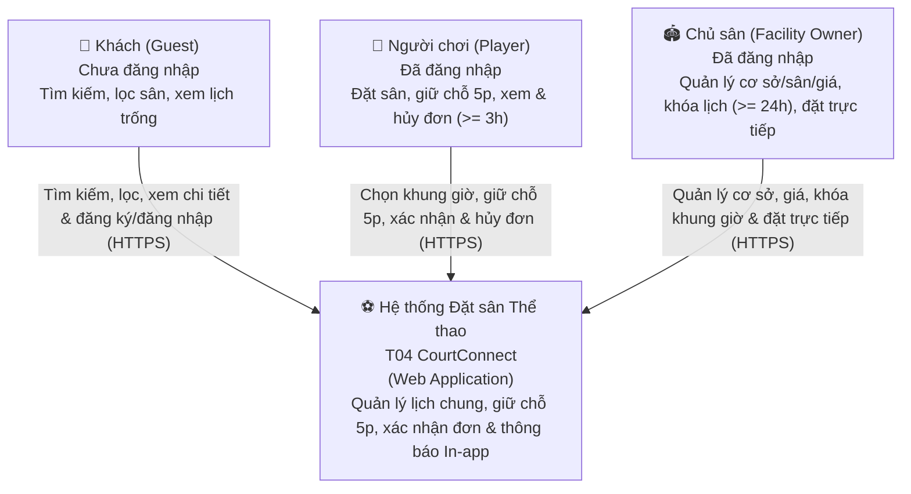
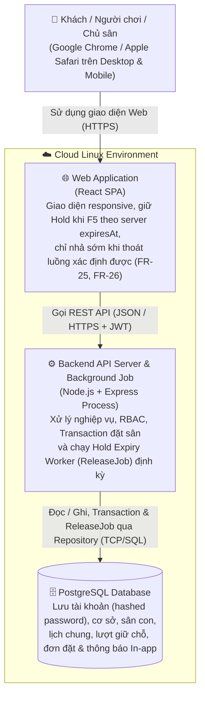
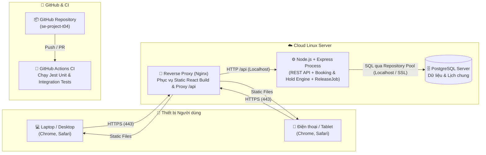

# Thiết kế Kiến trúc và Triển khai Hệ thống (Task 3.1.1 — Issue #9)

- **Mã đối tượng truy vết:** `ARC-01` (Kiến trúc tổng thể), `C4-CTX` (Level 1 Context), `C4-CNT` (Level 2 Container), `C4-CMP` (Level 3 Component), `C4-DEP` (Level 4 Deployment), `ARC-MAP` (Ánh xạ NFR & Quy tắc)
- **Người thực hiện:** Lý Sĩ Vĩ (`@Lysivi2005`)
- **Người kiểm tra:** Khôi (`@KhoiVuong2210` — khả năng hiện thực), Khoa (`@buikhoa130406` — độ bao phủ yêu cầu)
- **Tài liệu đầu vào:** Baseline PA2 (`pa/PA2/T04-PA2-SoftwareRequirementsSpecification.docx`), `docs/design/README.md`, `docs/design/design-overview.md` (`OVW-01`, `ASR-G1`..`ASR-G9`, `CON-01`..`CON-05`)

---

## 1. Kiến trúc tổng thể (`ARC-01`) & Lý do lựa chọn

Hệ thống **T04 CourtConnect** áp dụng mô hình **Client–Server (SPA + REST API)** kết hợp **Modular Monolith (Layered Architecture)** ở phía Backend (tương ứng `ADR-001` của Khoa):

- **Frontend:** **React SPA** (Responsive Web cho Desktop & Mobile trên Google Chrome / Apple Safari — đáp ứng `NFR-01`, `ASR-G8`).
- **Backend:** **Node.js + Express** tổ chức theo kiến trúc **3 lớp (`Controller -> Service -> Repository`)** chia thành các module nghiệp vụ độc lập (*Auth, Facility & Search, Booking & Hold, Owner Schedule, In-App Notification*).
- **Database:** **PostgreSQL** đóng vai trò nguồn dữ liệu chân lý duy nhất (*Single Source of Truth*) cho **Lịch chung (Shared Schedule)** (`ASR-G5`).

### Lý do lựa chọn:
1. **Phù hợp ràng buộc nhân lực & thời gian (`CON-03`, `CON-04`):** Nhóm gồm 4 thành viên (~14 giờ/tuần/người) với hạn tuần 10 (PA5). *Modular Monolith* giúp phát triển, debug, kiểm thử (Jest) và triển khai đơn giản hơn nhiều so với Microservices, nhưng vẫn tách biệt rõ ranh giới module.
2. **Đảm bảo tính nhất quán đặt sân (`NFR-02`, `ASR-G1`, `ADR-002`):** Cơ chế giữ chỗ tạm thời 5 phút (*All-or-Nothing*), kiểm tra lại khi xác nhận và chống đặt trùng đồng thời đòi hỏi **ACID Transaction** và khóa mức dòng/ràng buộc duy nhất (*Row-level Lock / Exclusion Constraint*) trên cùng một cơ sở dữ liệu PostgreSQL.
3. **Đáp ứng hiệu năng (`NFR-06`, `ASR-G7`):** Với 50 người dùng đồng thời và mục tiêu P95 $\le 2$ giây khi tìm kiếm/xem lịch, kiến trúc Stateless REST API + Connection Pooling trên PostgreSQL xử lý nhẹ nhàng mà không cần tầng message broker phức tạp.
4. **Tuân thủ phạm vi Out-of-Scope (`CON-05`, `BR-15`):** Không tích hợp cổng thanh toán trực tuyến hay dịch vụ gửi Email/SMS bên ngoài; mọi thông báo trạng thái và hủy lịch lưu trực tiếp trong PostgreSQL và trả về qua API trong ứng dụng (`NFR-09`, `ASR-G9`).

---

## 2. Sơ đồ C4 Level 1 — System Context Diagram (`C4-CTX`)

Mô tả hệ thống **CourtConnect** trong mối quan hệ với 3 tác nhân chính và giới hạn phạm vi (không kết nối hệ thống thanh toán hay Email/SMS bên ngoài).

---

## 3. Sơ đồ C4 Level 2 — Container Diagram (`C4-CNT`)

Mô tả các thành phần chạy độc lập (*Containers*) cấu thành hệ thống và cách chúng giao tiếp.

---

## 4. Sơ đồ C4 Level 3 — Component Diagram (`C4-CMP` — Backend API Server)

Mô tả cấu trúc các module bên trong **Node.js + Express Process** theo kiến trúc phân tầng (`Controller -> Service -> Repository`).

```mermaid
flowchart LR
    SPA["🌐 React SPA"]

    subgraph Backend["⚙️ Node.js + Express Process"]
        MW["🛡️ Auth & RBAC Middleware<br/>Xác thực JWT, kiểm tra vai trò & bảo vệ API (NFR-04)"]
        Job["⏱️ Hold Expiry Worker (ReleaseJob)<br/>Tác vụ nền định kỳ (tham số thiết kế <= 1s)"]

        subgraph Modules["Các Module Nghiệp vụ (Controller → Service)"]
            AuthMod["🔐 Auth Module<br/>Đăng ký, Đăng nhập, Hash mật khẩu (NFR-05)"]
            FacMod["🔍 Facility & Search Module<br/>Tìm kiếm theo môn/vị trí, lọc tiện ích, xem giá & lịch trống"]
            BookMod["📅 Booking & Hold Engine<br/>Kiểm tra 2 khung, giữ chỗ 5p All-or-Nothing,<br/>recheck & tự động xác nhận, hủy đơn >= 3h,<br/>hàm releaseExpiredHolds(now)"]
            OwnerMod["🏟️ Owner Schedule Module<br/>Kiểm tra quyền sở hữu cơ sở, quản lý cơ sở/sân/giá,<br/>đặt trực tiếp, chặn lịch/đổi giờ >= 24h & chờ Hold ảnh hưởng"]
            NotiMod["🔔 In-App Notification Module<br/>Lưu & truy xuất thông báo hủy đơn trong ứng dụng"]
        end

        Repo["📦 Data Access Layer (Repositories)<br/>Quản lý Transaction, Row Lock / Ràng buộc & Query tối ưu"]
    end

    DB[("🗄️ PostgreSQL")]

    SPA -- "HTTPS / JSON" --> MW
    MW --> AuthMod & FacMod & BookMod & OwnerMod & NotiMod
    Job -- "Gọi releaseExpiredHolds(now)" --> BookMod
    AuthMod & FacMod & BookMod & OwnerMod & NotiMod --> Repo
    OwnerMod -. "Tái sử dụng luồng giữ/xác nhận (đặt trực tiếp)" .-> BookMod
    OwnerMod -. "Tạo thông báo hủy đơn (trong Transaction)" .-> NotiMod
    Repo -- "SQL / Pool" --> DB
```

> **Thống nhất vị trí & đường gọi của `ReleaseJob` (`Hold Expiry Worker`) giữa `C4-CNT`, `C4-CMP`, `C4-DEP` và `SEQ-02B`:** `Hold Expiry Worker` (`ReleaseJob`) là một **tác vụ nền chạy trong tiến trình Node.js + Express** (không tách container gọi thẳng DB). Theo chu kỳ thiết kế, `ReleaseJob` gọi vào phương thức `releaseExpiredHolds(now)` của **`Booking & Hold Engine`**, đi qua **`Data Access Layer (Repositories)`** để thực thi Transaction cập nhật PostgreSQL — khớp 1–1 với đường gọi `ReleaseJob -> HoldService/BookingService -> Database` trong `SEQ-02B`.

---

## 5. Sơ đồ C4 Level 4 / Deployment Diagram (`C4-DEP`)

Mô tả môi trường triển khai thực tế phục vụ kiểm thử nhóm, CI/CD và demo môn học.

---

## 6. Ánh xạ Kiến trúc với Yêu cầu Phi chức năng & Quy tắc (`ARC-MAP`)

| Yêu cầu / Quy tắc | Cách kiến trúc đáp ứng | Đối chiếu ADR / ASR |
|---|---|---|
| **Nhất quán & Chống trùng slot (`NFR-02`, `FR-13`)** | Xử lý trong PostgreSQL Transaction (*All-or-Nothing*) qua `Booking & Hold Engine` và `Repositories`; cơ chế chống trùng chi tiết (khóa dòng hoặc ràng buộc duy nhất theo sân/giờ) đang chờ chốt đồng bộ với `#10` / `ADR-002`. | `ADR-002`, `ASR-G1`, `ASR-G3` |
| **Giữ chỗ 5 phút, F5, Đóng tab & Mục tiêu nhả $\le 5\text{s}$ (`NFR-03`, `FR-14`, `FR-25`, `FR-26`)** | Thời điểm hết hạn `expires_at` lưu ở PostgreSQL. Khi F5, React SPA **không** tự gửi nhả Hold qua `beforeunload`/`pagehide` mà gọi API lấy lại `expires_at` nên không mất giữ chỗ hay reset 5 phút (`FR-25`). Với đóng tab/mất kết nối (`FR-26`), chỉ nhả sớm ở hành động thoát luồng phân biệt được với F5; các trường hợp còn lại do **`Hold Expiry Worker` (`ReleaseJob`)** xử lý sau khi hết hạn. **Mục tiêu đo & Xử lý lỗi nhả:** Chu kỳ quét $\le 1\text{s}$ là tham số thiết kế; mốc $\le 5\text{s}$ (`NFR-03`) là **mục tiêu hiệu năng cần đo kiểm chứng** từ thời điểm `expires_at` đến khi PostgreSQL hoàn tất ghi `RELEASED` và mở lại slot. Khi nhả thất bại ở DB, **`Booking & Hold Engine` + `ReleaseJob`** giữ Hold ở trạng thái `EXPIRED` (vẫn từ chối xác nhận tức thì theo `now >= expires_at`), ghi log lỗi và **tự động thử lại ở chu kỳ kế tiếp**; API trả lỗi thực tế nếu UI truy vấn để người dùng không thao tác như đã nhả (`FR-14`). | `ADR-002`, `ASR-G2` |
| **Phân quyền & Bảo mật (`NFR-04`, `NFR-05`)** | `Auth & RBAC Middleware` kiểm tra JWT và vai trò ở lớp dùng chung; kiểm tra quyền sở hữu (`facility.owner_id === user.id`, `hold/booking.user_id === user.id`) tại Backend trước mọi thao tác. Mật khẩu được băm (bcrypt/argon2) trước khi lưu DB. | `ADR-003`, `ASR-G4`, `ASR-G9` |
| **Hiệu năng 50 người dùng (`NFR-06`)** | React SPA giảm tải render server; Backend stateless dùng Connection Pool tới PostgreSQL kết hợp đánh Index cho tìm kiếm sân và truy vấn lịch theo ngày (P95 $\le 2$ giây). | `ADR-001`, `ASR-G7` |
| **Thông báo In-app (`NFR-09`, `FR-30`)** | Khi Chủ sân hủy đơn do chặn lịch/đổi giờ/xóa sân ($\ge 24$ giờ), `Owner Schedule Module` gọi `In-App Notification Module` ghi trực tiếp bản ghi thông báo vào DB trong cùng Transaction, không gọi dịch vụ Email/SMS bên ngoài. | `CON-05`, `ASR-G6`, `ASR-G9` |

---

## 7. Thông tin gửi kèm Review (Theo Working Agreement Mục 5.3)

- **Danh sách sản phẩm:** `docs/design/architecture/architecture-design.md` (Mã đối tượng: `ARC-01`, `C4-CTX`, `C4-CNT`, `C4-CMP`, `C4-DEP`, `ARC-MAP`).
- **Kết quả tự kiểm tra:**
  - [x] Bao phủ đủ Architecture Style + lý do, 4 cấp C4 (Context, Container, Component, Deployment) và ánh xạ NFR/quy tắc PA2.
  - [x] Khớp hoàn toàn với `ADR-001`, `ADR-002`, `ADR-003` và mục tiêu `ASR-G1`..`ASR-G9`, `CON-01`..`CON-05`.
  - [x] Làm rõ ranh giới `Hold Expiry Worker` (`ReleaseJob`) và cơ chế phát hiện đóng tab `FR-26`.
- **Điểm cần người kiểm tra xác nhận:**
  - `@KhoiVuong2210`: xác nhận khả năng triển khai `Hold Expiry Worker` (chu kỳ $\le 1\text{s}$), Connection Pool và ranh giới Transaction với PostgreSQL (`3.1.2`, `3.1.4`).
  - `@buikhoa130406`: xác nhận độ bao phủ yêu cầu PA2 và ánh xạ mã đối tượng `ARC-*`, `C4-*` trong bảng truy vết (`#15`, `#11`).
