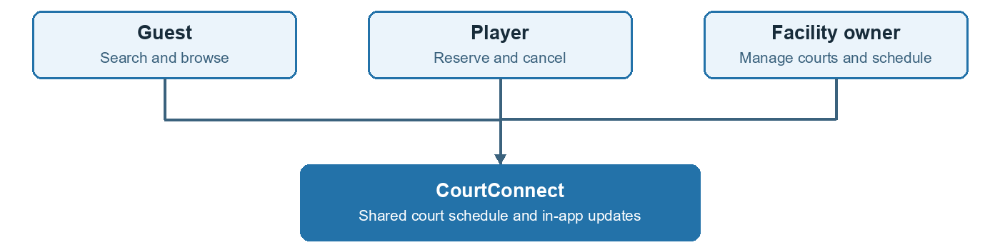
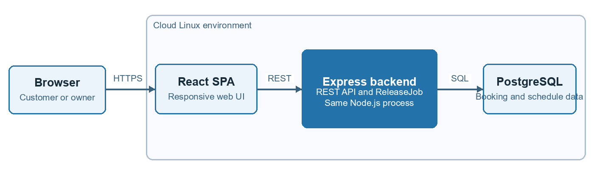
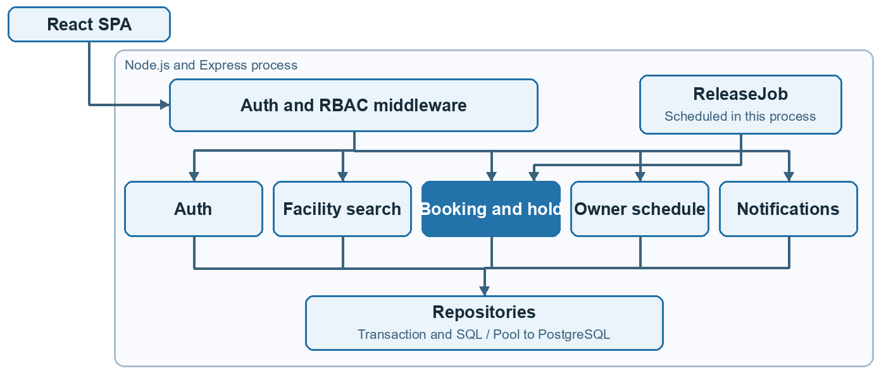
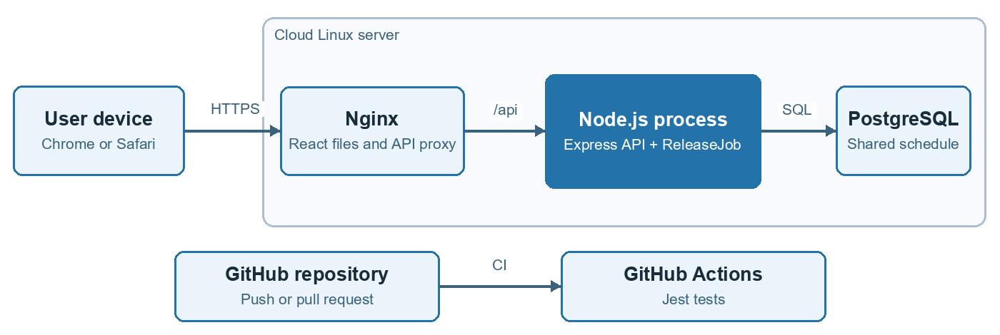

# Architectural Design

## Architectural Style

CourtConnect uses a client–server architecture. A React single-page application calls an Express REST API over HTTPS, and one PostgreSQL database supports shared schedule consistency. The backend is a modular monolith organized into controller, service and repository layers. This deployment keeps operations manageable for the course team and supports atomic schedule updates within one database.

## System Context Diagram (C4 level 1)

Guests use public search and facility views. Players reserve and cancel their own bookings. Facility owners manage their own facilities, courts and shared schedules, including in-person bookings.

Figure 3.1. C4-CTX • System context.

## Container Diagram (C4 level 2)

The React interface calls the Express process. The Express process serves its API and runs the hold-expiry task. Repositories access the PostgreSQL schedule and account data.

Figure 3.2. C4-CNT • CourtConnect containers.

## Component Diagram

The backend separates authentication, facility search, booking and hold management, owner scheduling and in-app notifications. ReleaseJob calls the booking component, which uses repositories to write PostgreSQL. Owner scheduling reuses booking operations for in-person reservations and creates notifications for owner-initiated cancellations.

Figure 3.3. C4-CMP • Express components.

## Deployment Diagram

Nginx serves the React build and forwards API requests to the Node.js process on cloud Linux. PostgreSQL stores the shared schedule. GitHub Actions runs the Jest checks on repository changes.

Figure 3.4. C4-DEP • Deployment and continuous integration.

The worker’s polling interval of at most one second is a design parameter. NFR-03 is measured from the hold’s expiry until the database release completes and the schedule reflects the available slot. If release fails, the backend records the failure, refuses confirmation and retries. The five-second target remains to be measured.

## ARC-MAP Design drivers

| Driver | Design element |
|---|---|
| ASR-G1, ASR-G3, ASR-G5 | Booking/hold and owner-schedule modules use PostgreSQL transactions and a shared schedule (ADR-002, DB-ATOM). |
| ASR-G2 | ReleaseJob in the Express process; immutable five-minute expiry, retry on release failure (STM-01, API-HOLD). |
| ASR-G4, ASR-G9 | Authentication and ownership checks in backend middleware/services (ADR-003, API-AUTH). |
| ASR-G6 | Owner preview/apply operations revalidate holds, affected bookings and the 24-hour boundary (API-OWN, SEQ-04). |
| ASR-G7, ASR-G8 | Responsive React web client with REST API; performance and Chrome/Safari checks remain implementation validation (C4-CTX, C4-CNT, UI-ACC-01). |
