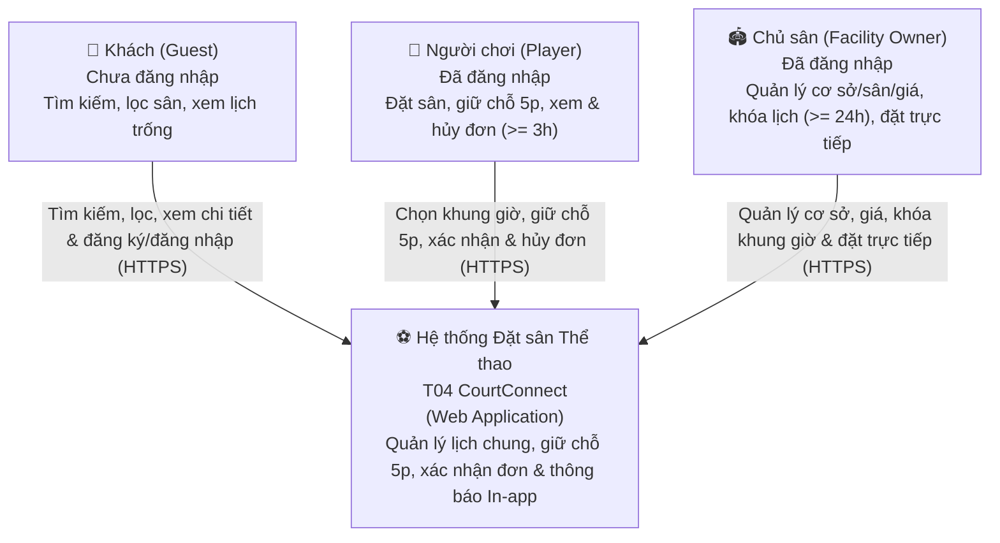
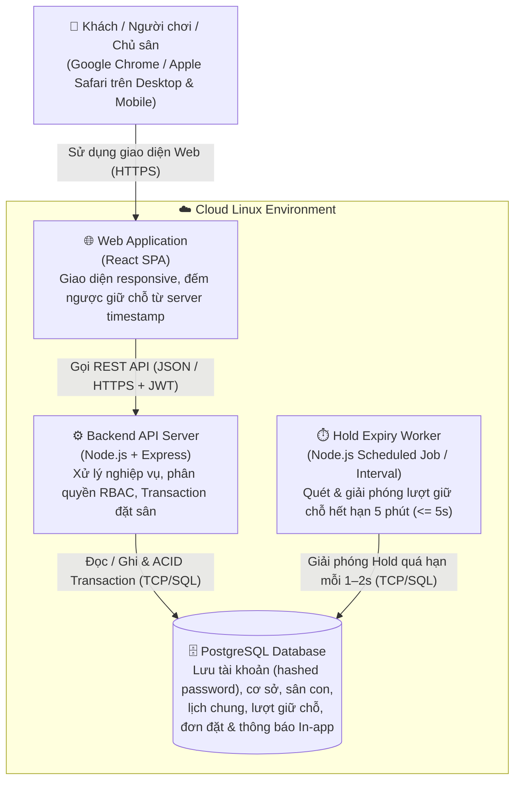
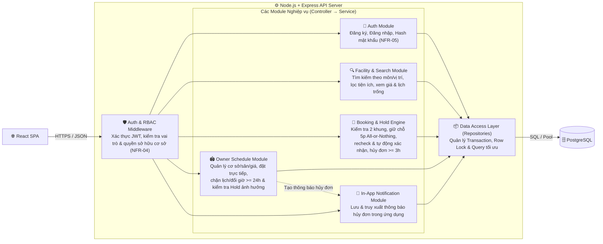
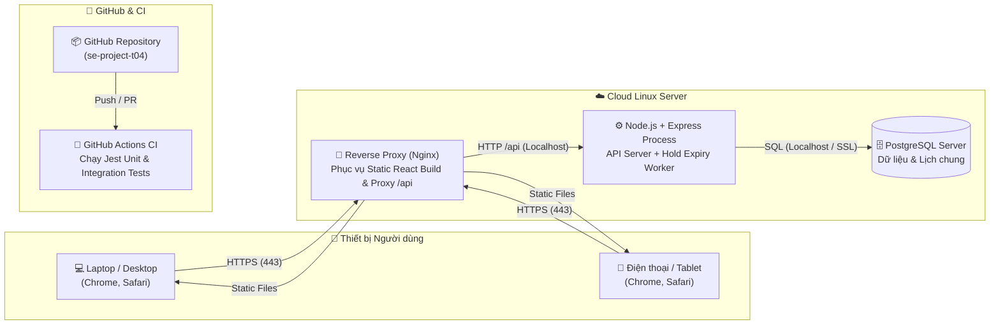

# Thiết kế Kiến trúc và Triển khai Hệ thống (Task 3.1.1 — Issue #9)

- **Người thực hiện:** Lý Sĩ Vĩ (`@Lysivi2005`)
- **Người kiểm tra:** Khôi (`@KhoiVuong2210` — khả năng hiện thực), Khoa (`@buikhoa130406` — độ bao phủ yêu cầu)
- **Tài liệu đầu vào:** Baseline PA2 (`T04-PA2-SoftwareRequirementsSpecification.docx`), `docs/design/README.md`

---

## 1. Kiến trúc tổng thể (Architecture Style) & Lý do lựa chọn

Hệ thống **T04 CourtConnect** áp dụng mô hình **Client–Server (SPA + REST API)** kết hợp **Modular Monolith (Layered Architecture)** ở phía Backend:

- **Frontend:** **React SPA** (Responsive Web cho Desktop & Mobile trên Chrome/Safari — đáp ứng `NFR-01`).
- **Backend:** **Node.js + Express** tổ chức theo kiến trúc **3 lớp (Controller $\rightarrow$ Service $\rightarrow$ Repository)** chia thành các module nghiệp vụ độc lập (*Auth, Facility & Search, Booking & Hold, Owner Schedule, Notification*).
- **Database:** **PostgreSQL** đóng vai trò nguồn dữ liệu chân lý duy nhất (*Single Source of Truth*) cho **Lịch chung (Shared Schedule)**.

### Lý do lựa chọn:
1. **Phù hợp ràng buộc nhân lực & thời gian:** Nhóm gồm 4 thành viên (~14 giờ/tuần/người) với hạn tuần 10 (PA5). *Modular Monolith* giúp phát triển, debug, kiểm thử (Jest) và triển khai đơn giản hơn nhiều so với Microservices, nhưng vẫn tách biệt rõ ràng ranh giới module.
2. **Đảm bảo tính nhất quán đặt sân (`NFR-02`):** Cơ chế giữ chỗ tạm thời 5 phút (*All-or-Nothing*), kiểm tra lại khi xác nhận và chống đặt trùng đồng thời đòi hỏi **ACID Transaction** và khóa mức dòng/ràng buộc duy nhất (*Row-level Lock / Exclusion Constraint*) trên cùng một cơ sở dữ liệu PostgreSQL.
3. **Đáp ứng hiệu năng (`NFR-06`):** Với 50 người dùng đồng thời và mục tiêu P95 $\le 2$ giây khi tìm kiếm/xem lịch, kiến trúc Stateless REST API + Connection Pooling trên PostgreSQL xử lý nhẹ nhàng mà không cần tầng message broker phức tạp.
4. **Tuân thủ phạm vi Out-of-Scope:** Không tích hợp cổng thanh toán trực tuyến hay dịch vụ gửi Email/SMS bên ngoài; mọi thông báo trạng thái và hủy lịch lưu trực tiếp trong PostgreSQL và trả về qua API trong ứng dụng (`NFR-09`).

---

## 2. Sơ đồ C4 Level 1 — System Context Diagram

Mô tả hệ thống **CourtConnect** trong mối quan hệ với 3 tác nhân chính và giới hạn phạm vi (không kết nối hệ thống bên ngoài).

---

## 3. Sơ đồ C4 Level 2 — Container Diagram

Mô tả các thành phần chạy độc lập (*Containers*) cấu thành hệ thống và cách chúng giao tiếp.

---

## 4. Sơ đồ C4 Level 3 — Component Diagram (Backend API Server)

Mô tả cấu trúc các module bên trong **Node.js + Express API Server** theo kiến trúc phân tầng (*Controller $\rightarrow$ Service $\rightarrow$ Repository*).

---

## 5. Sơ đồ C4 Level 4 / Deployment Diagram

Mô tả môi trường triển khai thực tế phục vụ kiểm thử nhóm, CI/CD và demo môn học.

---

## 6. Ánh xạ Kiến trúc với Các Yêu cầu Phi chức năng & Quy tắc Nghiệp vụ

| Yêu cầu / Quy tắc | Cách kiến trúc đáp ứng |
|---|---|
| **Nhất quán & Chống trùng slot (`NFR-02`, `FR-13`)** | Xử lý trong PostgreSQL Transaction kết hợp khóa bi quan (*Pessimistic Lock*) hoặc ràng buộc duy nhất theo `(court_id, slot_time)` trên lịch chung; đảm bảo *All-or-Nothing* và chỉ 1 yêu cầu giữ chỗ thành công khi tranh chấp đồng thời. |
| **Giữ chỗ 5 phút & Nhả $\le 5s$ (`NFR-03`, `FR-14`, `FR-25`)** | Thời điểm hết hạn `expires_at` lưu ở Backend/DB. Khi F5, Frontend lấy lại `expires_at` từ API nên không bị reset 5 phút. Kết hợp **kiểm tra điều kiện hết hạn ngay khi truy vấn/xác nhận** (*lazy check*) và **Hold Expiry Worker** quét mỗi 1–2 giây để đảm bảo hoàn tất nhả chỗ trong tối đa 5 giây. |
| **Phân quyền & Bảo mật (`NFR-04`, `NFR-05`)** | Middleware kiểm tra JWT và quyền sở hữu (`facility.owner_id === user.id`) tại Backend trước mọi thao tác của Chủ sân. Mật khẩu được băm (bcrypt/argon2) trước khi lưu DB. |
| **Hiệu năng 50 người dùng (`NFR-06`)** | React SPA giảm tải render server; Backend stateless dùng Connection Pool tới PostgreSQL kết hợp đánh Index cho tìm kiếm sân và truy vấn lịch theo ngày. |
| **Thông báo In-app (`NFR-09`, `FR-30`)** | Khi Chủ sân hủy đơn do chặn lịch/đổi giờ ($\ge 24$ giờ), `Owner Schedule Module` gọi `Notification Module` ghi trực tiếp bản ghi thông báo vào DB trong cùng Transaction, không gọi dịch vụ Email/SMS bên ngoài. |
