# Thiết kế Lớp và Đặc tả các Lớp Quan trọng (Task 3.3.2 — Issue #18)

- **Mã đối tượng truy vết:** `CLS-DIAG` (Biểu đồ lớp), `CLS-01`..`CLS-08` (Đặc tả 8 lớp trọng yếu), `CLS-MAP` (Ánh xạ Domain Model `3.3.1` & Sequence `3.3.3`)
- **Người thực hiện:** Lý Sĩ Vĩ (`@Lysivi2005`)
- **Người kiểm tra:** Khôi (`@KhoiVuong2210` — khả năng hiện thực, kiểu dữ liệu, thao tác), Trí (`@nmt1206` — trách nhiệm nghiệp vụ)
- **Tài liệu đầu vào:** Baseline PA2 (`pa/PA2/T04-PA2-SoftwareRequirementsSpecification.docx`), Kiến trúc `docs/design/architecture/architecture-design.md` (`3.1.1`), Domain Model `docs/design/domain/domain-model.md` (`3.3.1`), Sequence & State (`3.3.3`, `3.3.4`)

> **Lưu ý đồng bộ:** Thiết kế lớp bám sát kiến trúc **Modular Monolith (`Controller -> Service -> Repository`)** đã chốt ở `3.1.1`, đồng bộ khái niệm với Domain Model `DM-01` (`3.3.1`) và giữ chặt phạm vi PA2 (khung 30 phút, giữ chỗ 5 phút All-or-Nothing, tự động xác nhận, hủy $\ge 3$ giờ, chặn lịch $\ge 24$ giờ, thông báo In-app không có `isRead`, mỗi cơ sở 1 môn thể thao, không thanh toán trực tuyến).

---

## 1. Biểu đồ Lớp (`CLS-DIAG`)

Biểu đồ gồm **các lớp thực thể miền (Domain Entities / Value Objects)** và **các lớp dịch vụ điều phối nghiệp vụ cốt lõi (Application/Domain Services)** ở tầng Backend:

```mermaid
classDiagram
    class UserRole {
        <<enumeration>>
        PLAYER
        OWNER
    }

    class BookingStatus {
        <<enumeration>>
        CONFIRMED
        CANCELLED_BY_PLAYER
        CANCELLED_BY_OWNER
    }

    class HoldStatus {
        <<enumeration>>
        ACTIVE
        CONFIRMED
        RELEASED
        EXPIRED
    }

    class User {
        +UUID id
        +String fullName
        +String phoneOrEmail
        +String passwordHash
        +UserRole role
        +DateTime createdAt
        +verifyPassword(rawPassword: String) Boolean
        +isOwner() Boolean
    }

    class OperatingHours {
        +Integer dayOfWeek
        +Time openTime
        +Time closeTime
        +contains(startTime: Time, endTime: Time) Boolean
    }

    class Facility {
        +UUID id
        +UUID ownerId
        +String name
        +String address
        +String district
        +String sportType
        +String[] amenities
        +OperatingHours[] operatingHours
        +Boolean isActive
        +isOwnedBy(userId: UUID) Boolean
        +isWithinOperatingHours(startTime: DateTime, endTime: DateTime) Boolean
    }

    class Court {
        +UUID id
        +UUID facilityId
        +String courtCode
        +Decimal pricePerSlot30m
        +Boolean isActive
        +calculatePrice(slotCount: Integer) Decimal
    }

    class SlotHold {
        +UUID id
        +UUID userId
        +UUID facilityId
        +HoldStatus status
        +DateTime createdAt
        +DateTime expiresAt
        +isExpired(now: DateTime) Boolean
        +remainingSeconds(now: DateTime) Integer
        +belongsTo(userId: UUID) Boolean
    }

    class HoldSlotItem {
        +UUID id
        +UUID holdId
        +UUID courtId
        +DateTime slotStart
        +DateTime slotEnd
    }

    class Booking {
        +UUID id
        +String bookingCode
        +UUID userId
        +UUID facilityId
        +BookingStatus status
        +Boolean isDirectBooking
        +Decimal totalAmount
        +DateTime earliestStartTime
        +DateTime latestEndTime
        +String cancelReason
        +DateTime createdAt
        +canCancelByPlayer(now: DateTime) Boolean
        +isAffectedUnder24Hours(now: DateTime) Boolean
        +isCompleted(now: DateTime) Boolean
    }

    class BookingItem {
        +UUID id
        +UUID bookingId
        +UUID courtId
        +DateTime slotStart
        +DateTime slotEnd
        +Decimal unitPrice
    }

    class ScheduleBlock {
        +UUID id
        +UUID facilityId
        +UUID courtId
        +UUID ownerId
        +DateTime startTime
        +DateTime endTime
        +DateTime createdAt
        +isAtLeast24HoursAhead(now: DateTime) Boolean
        +overlaps(slotStart: DateTime, slotEnd: DateTime) Boolean
    }

    class Notification {
        +UUID id
        +UUID userId
        +UUID relatedBookingId
        +String message
        +DateTime createdAt
    }

    class BookingService {
        -BookingRepository bookingRepo
        -HoldRepository holdRepo
        -ScheduleRepository scheduleRepo
        +createHold(userId: UUID, facilityId: UUID, selections: CourtSlotSelection[]) SlotHold
        +confirmBooking(userId: UUID, holdId: UUID) Booking
        +releaseHold(userId: UUID, holdId: UUID) void
        +releaseExpiredHolds(now: DateTime) Integer
        +cancelBookingByPlayer(userId: UUID, bookingId: UUID, reason: String) Booking
        -validateConsecutive30MinSlots(selections: CourtSlotSelection[]) Boolean
        -validateLeadTime(earliestSlot: DateTime, isDirect: Boolean, now: DateTime) Boolean
    }

    class OwnerScheduleService {
        -FacilityRepository facilityRepo
        -BookingRepository bookingRepo
        -HoldRepository holdRepo
        -ScheduleRepository scheduleRepo
        -BookingService bookingService
        -NotificationService notificationService
        +updateCourtPrice(ownerId: UUID, courtId: UUID, newPrice: Decimal) Court
        +createScheduleBlock(ownerId: UUID, dto: BlockInput) ScheduleBlock
        +updateOperatingHours(ownerId: UUID, facilityId: UUID, hours: OperatingHours[]) Facility
        +deleteCourt(ownerId: UUID, courtId: UUID) void
        +createDirectBooking(ownerId: UUID, facilityId: UUID, selections: CourtSlotSelection[]) Booking
        -assertNoActiveHoldConflict(courtIds: UUID[], start: DateTime, end: DateTime) void
        -assertAllAffectedBookingsOver24h(bookings: Booking[], now: DateTime) void
    }

    User "1" --> "0..*" Facility : owns (if OWNER)
    Facility "1" *-- "1..*" OperatingHours : opens
    Facility "1" *-- "1..*" Court : contains
    User "1" --> "0..*" SlotHold : creates
    Facility "1" --> "0..*" SlotHold : scoped to
    SlotHold "1" *-- "1..*" HoldSlotItem : holds
    Court "1" --> "0..*" HoldSlotItem : reserved in
    User "1" --> "0..*" Booking : places
    Facility "1" --> "0..*" Booking : receives
    Booking "1" *-- "1..*" BookingItem : consists of
    Court "1" --> "0..*" BookingItem : booked in
    Court "1" --> "0..*" ScheduleBlock : blocked by
    User "1" --> "0..*" Notification : receives in-app
    Booking "0..1" --> "0..*" Notification : triggers cancellation notice

    BookingService ..> SlotHold : manages
    BookingService ..> Booking : creates/cancels
    OwnerScheduleService --> BookingService : reuses hold/confirm
    OwnerScheduleService ..> ScheduleBlock : manages
    OwnerScheduleService ..> Booking : cancels affected / creates direct
    OwnerScheduleService ..> Notification : creates on owner cancel
```

> **Ghi chú kiểu dữ liệu phụ trợ:** `CourtSlotSelection` (`courtId`, `slotStart[]`) và `BlockInput` (`courtId`, `startTime`, `endTime`, `reason`) là các DTO đầu vào tại tầng Controller/Service. Các `*Repository` là interface truy cập dữ liệu ở tầng Repository (`3.1.1`). `NotificationService` và `AuthService` thuộc các module tương ứng đã nêu ở `C4-CMP` (`3.1.1`).

---

## 2. Đặc tả chi tiết 8 Lớp Quan trọng (`CLS-01`..`CLS-08`)

### 2.1. [`CLS-01`] Lớp `User`
- **Vai trò:** Đại diện tài khoản đã đăng ký (`PLAYER` hoặc `OWNER`), phục vụ xác thực và phân quyền theo vai trò (`FR-01`, `NFR-04`, `NFR-05`).
- **Thuộc tính chính:**
  - `id: UUID` — Khóa chính định danh tài khoản.
  - `fullName: String` — Họ và tên người dùng.
  - `phoneOrEmail: String` — Thông tin đăng nhập duy nhất (`UNIQUE`).
  - `passwordHash: String` — Mật khẩu đã băm (bcrypt/argon2), tuyệt đối không lưu plaintext (`NFR-05`).
  - `role: UserRole` — `PLAYER` hoặc `OWNER`.
- **Phương thức & Trách nhiệm:**
  - `verifyPassword(rawPassword: String): Boolean` — Đối chiếu mật khẩu khi đăng nhập (`UC-02`).
  - `isOwner(): Boolean` — Kiểm tra nhanh vai trò chủ sân trước khi vào luồng quản lý (`FR-03`).

---

### 2.2. [`CLS-02`] Lớp `Facility` (kèm `OperatingHours`)
- **Vai trò:** Đại diện một cụm sân / chi nhánh thể thao thuộc một chủ sân duy nhất (`BR-10`, `FR-03`).
- **Thuộc tính chính:**
  - `id: UUID` — Mã cơ sở.
  - `ownerId: UUID` — Chủ sở hữu (`FK -> User.id`). Chưa hỗ trợ chia sẻ quyền quản lý chéo (`BR-10`).
  - `name: String`, `address: String`, `district: String` — Tên và vị trí phục vụ tìm kiếm (`FR-04`).
  - `sportType: String` — Môn thể thao chính của cơ sở (1 cơ sở hỗ trợ đúng 1 môn, khớp `DM-ENT-02`).
  - `amenities: String[]` — Danh sách tiện ích để lọc (`FR-05`).
  - `operatingHours: OperatingHours[]` — Giờ mở cửa / đóng cửa theo ngày trong tuần (`dayOfWeek`, `openTime`, `closeTime` — `FR-18`, khớp `DM-ENT-05`).
- **Phương thức & Trách nhiệm:**
  - `isOwnedBy(userId: UUID): Boolean` — Xác minh quyền sở hữu ở tầng Backend (`NFR-04`).
  - `isWithinOperatingHours(startTime: DateTime, endTime: DateTime): Boolean` — Chặn đặt khung giờ ngoài giờ mở cửa (`FR-32`).

---

### 2.3. [`CLS-03`] Lớp `Court`
- **Vai trò:** Đại diện từng sân con được định danh riêng biệt thuộc một cơ sở (`FR-06`, `FR-07`).
- **Thuộc tính chính:**
  - `id: UUID` — Khóa chính sân con.
  - `facilityId: UUID` — Cơ sở chứa sân (`FK -> Facility.id`).
  - `courtCode: String` — Số/mã định danh hiển thị (ví dụ: `S1`, `Sân 2`).
  - `pricePerSlot30m: Decimal` — Đơn giá theo mỗi khung 30 phút (`FR-07`, `FR-19`).
  - `isActive: Boolean` — Trạng thái hoạt động (phục vụ ẩn/xóa mềm sân con khi không còn sử dụng mà vẫn giữ lịch sử đơn cũ).
- **Phương thức & Trách nhiệm:**
  - `calculatePrice(slotCount: Integer): Decimal` — Tính tạm tính theo số lượng khung 30 phút đã chọn.

---

### 2.4. [`CLS-04`] Lớp `SlotHold` (kèm `HoldSlotItem`)
- **Vai trò:** Quản lý lượt giữ chỗ tạm thời tối đa **5 phút** theo nguyên tắc *All-or-Nothing* (`FR-10`, `FR-13`, `FR-14`, `BR-01`).
- **Thuộc tính chính:**
  - `id: UUID`, `userId: UUID`, `facilityId: UUID` — Gắn chặt người giữ và đúng một cơ sở (`BR-03`).
  - `status: HoldStatus` — `ACTIVE`, `CONFIRMED`, `RELEASED`, `EXPIRED`.
  - `createdAt: DateTime`, `expiresAt: DateTime` — `expiresAt = createdAt + 5 phút`. Không bao giờ cộng thêm giờ khi F5 hoặc thao tác lại (`FR-25`, `FR-31`).
- **Phương thức & Trách nhiệm:**
  - `isExpired(now: DateTime): Boolean` — Trả `true` nếu `now >= expiresAt` hoặc `status !== ACTIVE` (`FR-14`).
  - `remainingSeconds(now: DateTime): Integer` — Tính số giây còn lại gửi về Frontend hiển thị đồng hồ đếm ngược khi tải lại trang (`FR-25`).
  - `belongsTo(userId: UUID): Boolean` — Ngăn người dùng khác xác nhận hộ lượt giữ (`FR-11`, `AC-36`).

---

### 2.5. [`CLS-05`] Lớp `Booking` (kèm `BookingItem`)
- **Vai trò:** Đại diện đơn đặt sân đã được hệ thống tự động xác nhận (qua ứng dụng hoặc đặt trực tiếp tại quầy) trên **Lịch chung** (`FR-09`, `FR-12`, `FR-21`, `BR-03`).
- **Thuộc tính chính:**
  - `id: UUID`, `bookingCode: String` — Mã đơn hiển thị cho người dùng.
  - `userId: UUID` — Người chơi đặt đơn hoặc Chủ sân tạo đơn trực tiếp.
  - `facilityId: UUID` — Một đơn chỉ thuộc đúng một cơ sở (`AC-14`).
  - `status: BookingStatus` — Lưu đúng 3 trạng thái trong DB: `CONFIRMED`, `CANCELLED_BY_PLAYER`, `CANCELLED_BY_OWNER` (`STM-03`).
  - `isDirectBooking: Boolean` — Phân biệt đơn đặt trực tiếp (`in-person`) với đặt qua ứng dụng (`app`) (`FR-21`).
  - `earliestStartTime: DateTime`, `latestEndTime: DateTime` — Mốc đầu sớm nhất và mốc cuối muộn nhất trong toàn bộ đơn.
  - `cancelReason: String` — Lý do hủy (nếu có).
- **Phương thức & Trách nhiệm:**
  - `canCancelByPlayer(now: DateTime): Boolean` — Trả `true` chỉ khi `status === CONFIRMED` và `earliestStartTime - now >= 3 giờ` (`BR-09`, `AC-26`). Đúng mốc 3 giờ vẫn cho phép hủy.
  - `isAffectedUnder24Hours(now: DateTime): Boolean` — Trả `true` nếu `earliestStartTime - now < 24 giờ` để `OwnerScheduleService` từ chối thao tác đổi/chặn lịch (`BR-11`, `AC-29`).
  - `isCompleted(now: DateTime): Boolean` — Suy diễn nhãn *"Đã hoàn thành"* khi `status === CONFIRMED && now >= latestEndTime` (đồng bộ `STM-03` và `OVW-01`, không cần lưu trạng thái `Completed` trong DB).

---

### 2.6. [`CLS-06`] Lớp `ScheduleBlock`
- **Vai trò:** Khoảng thời gian chủ sân khóa không khả dụng (bảo trì, sự kiện nội bộ) trên lịch chung (`FR-20`, `FR-22`, `BR-12`).
- **Thuộc tính chính:**
  - `id: UUID`, `facilityId: UUID`, `courtId: UUID`, `ownerId: UUID`.
  - `startTime: DateTime`, `endTime: DateTime` — Khoảng thời gian bị khóa (căn theo bội số 30 phút). Lý do khóa được truyền qua `BlockInput.reason` để đưa vào thông báo In-app nếu có đơn bị hủy (`FR-30`).
- **Phương thức & Trách nhiệm:**
  - `isAtLeast24HoursAhead(now: DateTime): Boolean` — Kiểm tra `startTime - now >= 24 giờ` (`FR-20`, `AC-31`).
  - `overlaps(slotStart: DateTime, slotEnd: DateTime): Boolean` — Xác định giao cắt với các khung giờ đang chọn hoặc đơn đặt hiện có.

---

### 2.7. [`CLS-07`] Lớp `Notification`
- **Vai trò:** Lưu trữ thông báo **chỉ hiển thị trong ứng dụng web** (`FR-30`, `NFR-09`, `BR-16`).
- **Thuộc tính chính:**
  - `id: UUID`, `userId: UUID` — Người nhận thông báo.
  - `relatedBookingId: UUID` — Mã đơn liên quan.
  - `message: String` — Nội dung bắt buộc nêu rõ: lý do hủy, mã đơn, sân con và khung giờ bị ảnh hưởng (`FR-30`).
  - `createdAt: DateTime` — Thời điểm tạo thông báo (không thêm `isRead` để bám sát baseline PA2 như `DM-ENT-12`).

---

### 2.8. [`CLS-08`] Lớp `BookingService` và `OwnerScheduleService` (Lớp Điều phối Nghiệp vụ)
- **Trách nhiệm của `BookingService`:**
  - `createHold(...)`: Chạy trong PostgreSQL Transaction; kiểm tra toàn bộ khung giờ đều thuộc cùng 1 cơ sở, chia 30 phút liên tiếp trên từng sân (`BR-03`), cách hiện tại tối thiểu 2 khung (60 phút) (`BR-08`), và không xung đột với `Booking`, `ScheduleBlock`, hoặc `SlotHold` còn hiệu lực (`FR-13`, `FR-32`). Nếu có bất kỳ 1 khung lỗi $\rightarrow$ rollback toàn bộ, không giữ khung nào (`BR-05`).
  - `confirmBooking(userId, holdId)`: Kiểm tra quyền sở hữu `SlotHold`, kiểm tra chưa hết hạn (`now < expiresAt`), recheck lại tình trạng trống trên lịch chung, chuyển trạng thái `SlotHold -> CONFIRMED` và tạo `Booking` tự động (`FR-11`, `FR-12`).
  - `releaseExpiredHolds(now)`: Được `Hold Expiry Worker` (`ReleaseJob`) gọi định kỳ ($\le 1\text{s}$) để giải phóng các `SlotHold` có `expiresAt <= now`, đảm bảo hoàn tất trong $\le 5$ giây (`FR-14`, `NFR-03`).
- **Trách nhiệm của `OwnerScheduleService`:**
  - Kiểm tra quyền sở hữu cơ sở trước mọi thao tác (`NFR-04`).
  - `updateCourtPrice(ownerId, courtId, newPrice)`: Cập nhật giá thuê theo khung 30 phút cho sân con thuộc quyền quản lý (`FR-19`, `UC-10`).
  - Với `createScheduleBlock`, `updateOperatingHours`, `deleteCourt`:
    1. Nếu có `SlotHold` đang `ACTIVE` bị ảnh hưởng $\rightarrow$ từ chối và yêu cầu chủ sân chờ lượt giữ kết thúc rồi thử lại (`FR-29`, `AC-30`).
    2. Tìm toàn bộ `Booking` bị ảnh hưởng; nếu bất kỳ đơn nào có `isAffectedUnder24Hours(now) === true` $\rightarrow$ từ chối toàn bộ thao tác (`FR-29`, `AC-29`).
    3. Nếu tất cả đều $\ge 24$ giờ và chủ sân xác nhận $\rightarrow$ hủy toàn bộ đơn bị ảnh hưởng trong cùng Transaction, cập nhật lịch chung và tạo `Notification` In-app cho từng người chơi bị ảnh hưởng (`FR-30`).
  - `createDirectBooking(...)`: Tái sử dụng cơ chế hold/confirm nguyên tử của `BookingService` trên Lịch chung, được miễn giới hạn đặt trước 2 khung (`FR-21`, `BR-08`), nhưng tuyệt đối không ghi đè lên `SlotHold` đang giữ hoặc `Booking` đã đặt (`BR-13`).

---

## 3. Bảng Truy vết & Ánh xạ chéo (`CLS-MAP`)

### 3.1. Truy vết yêu cầu PA2

| Mã đối tượng | Lớp thiết kế | Yêu cầu / Quy tắc đáp ứng |
|---|---|---|
| `CLS-01` | `User`, `UserRole` | FR-01, FR-24, NFR-04, NFR-05 |
| `CLS-02` | `Facility`, `OperatingHours` | FR-03, FR-04, FR-05, FR-17, FR-18, BR-10 |
| `CLS-03` | `Court` | FR-06, FR-07, FR-17, FR-19 |
| `CLS-04` | `SlotHold`, `HoldSlotItem`, `HoldStatus` | FR-10, FR-11, FR-13, FR-14, FR-25, BR-01, BR-02, NFR-03 |
| `CLS-05` | `Booking`, `BookingItem`, `BookingStatus` | FR-02, FR-09, FR-12, FR-15, FR-16, FR-21, FR-28, BR-03, BR-09 |
| `CLS-06` | `ScheduleBlock` | FR-20, FR-22, BR-11, BR-12, BR-13 |
| `CLS-07` | `Notification` | FR-30, NFR-09, BR-16 |
| `CLS-08` | `BookingService`, `OwnerScheduleService` | FR-13, FR-21, FR-27, FR-29, FR-32, NFR-02, BR-05, BR-08 |

### 3.2. Ánh xạ đồng bộ với Domain Model (`3.3.1`) và Sequence (`SEQ-OPS` — `3.3.3`)

| Khái niệm / Operation của Trí (`3.3.1`, `3.3.3`) | Lớp / Phương thức tương ứng trong `3.3.2` |
|---|---|
| `Hold`, `HoldItem`, `BlockedPeriod` (`DM-ENT`) | `SlotHold`, `HoldSlotItem`, `ScheduleBlock` (`CLS-04`, `CLS-06`) |
| `TimeSlot.derivedStatus` (`DM-ENT-07`, `STM-02`) | Giá trị truy vấn tổng hợp tại `ScheduleRepository` từ `OperatingHours`, `ScheduleBlock`, `BookingItem` và `HoldSlotItem` |
| `HoldService` (`SEQ-OPS`) | Nhóm phương thức `createHold`, `releaseHold`, `releaseExpiredHolds` trong `BookingService` (`CLS-08`) |
| `ScheduleService` (`SEQ-OPS`) | `validateConsecutive30MinSlots` / `validateLeadTime` trong `BookingService` và `assertNoActiveHoldConflict` / `assertAllAffectedBookingsOver24h` trong `OwnerScheduleService` |
| `BookingService` (`SEQ-OPS`) | `confirmBooking`, `cancelBookingByPlayer` trong `BookingService`; `OwnerScheduleService` điều phối hủy hàng loạt khi đổi lịch |
| `ReleaseJob` (`SEQ-OPS`) | `Hold Expiry Worker` (`3.1.1`) gọi `BookingService.releaseExpiredHolds(now)` |

---

## 4. Thông tin gửi kèm Review (Theo Working Agreement Mục 5.3)

- **Danh sách sản phẩm:** `docs/design/classes/class-design.md` (Mã đối tượng: `CLS-DIAG`, `CLS-01`..`CLS-08`, `CLS-MAP`).
- **Kết quả tự kiểm tra:**
  - [x] Khớp thuật ngữ và phạm vi baseline với `DM-01` (bỏ `isRead`, mỗi `Facility` 1 `sportType`, có `OperatingHours`, suy diễn `isCompleted`).
  - [x] Đầy đủ đặc tả 8 lớp quan trọng kèm thuộc tính, kiểu dữ liệu, phương thức và ánh xạ sang `SEQ-OPS` (`3.3.3`).
- **Điểm cần người kiểm tra xác nhận:**
  - `@KhoiVuong2210`: xác nhận kiểu dữ liệu, tập Enum (`HoldStatus`, `BookingStatus`) và chữ ký thao tác khớp ERD/API (`3.1.2`, `3.1.4`).
  - `@nmt1206`: xác nhận bảng ánh xạ `CLS-MAP` giữa `DM-01` / `SEQ-OPS` và lớp phần mềm `CLS-01`..`CLS-08`.
