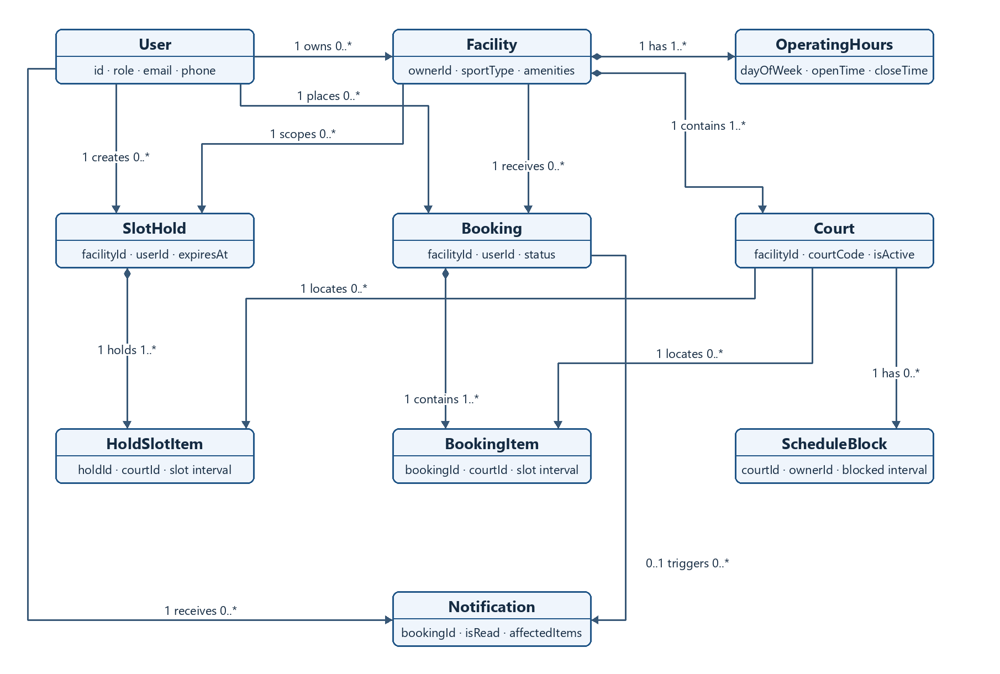
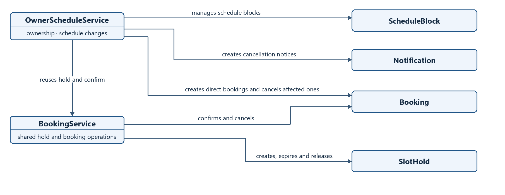

## Class Diagram

The class model separates accounts, facilities and courts from reservations, schedule blocks and in-app notices. Each hold and booking belongs to one facility and contains one or more consecutive slot ranges.

Figure 4.2. CLS-DIAG • Entity classes and associations.

Figure 4.3. CLS-DIAG • Booking and owner-schedule services.

## Class Specifications

Logical identifiers map to PostgreSQL bigint values and decimal strings in JSON/URLs. The account roles are PLAYER and FACILITY_OWNER.

| ID | Class | Key members | Responsibility |
| --- | --- | --- | --- |
| CLS-01 | User | id, fullName, email, phone, passwordHash, role, createdAt | Represents a registered account. verifyPassword validates credentials and isOwner identifies the owner role. Ownership of a particular facility is checked separately. |
| CLS-02 | Facility, OperatingHours | id, ownerId, name, address, district, sportType, amenities, operatingHours, isActive. An hours entry has dayOfWeek, openTime and closeTime. | One owner manages the facility. isOwnedBy checks ownership and isWithinOperatingHours validates the proposed interval. Each facility has one sport. |
| CLS-03 | Court | id, facilityId, courtCode, pricePerSlot30m, isActive | Identifies a court inside a facility. calculatePrice uses the selected number of slots. The activity flag represents removal from availability while preserving history. |
| CLS-04 | SlotHold, HoldSlotItem | id, userId, facilityId, status, createdAt, expiresAt. Each item identifies the court and slot start and end. | Holds the full valid selection for five minutes. isExpired, remainingSeconds and belongsTo support expiry, reload and ownership checks. States are ACTIVE, CONFIRMED, RELEASED and EXPIRED. |
| CLS-05 | Booking, BookingItem | id, bookingCode, userId, facilityId, status, isDirectBooking, earliestStartTime, latestEndTime and optional cancelReason. Items identify the court and time range. | Represents a booking in the shared schedule. Checks the player's three-hour cancellation limit and the owner's 24-hour condition. Derives the display label Completed from the latest end time of a confirmed booking. |
| CLS-06 | ScheduleBlock | id, facilityId, courtId, ownerId, startTime, endTime, createdAt | Represents an unavailable interval on the shared schedule. Checks the 24-hour lead time and whether intervals overlap. |
| CLS-07 | Notification | id, userId, bookingId, reason, message, isRead, affectedItems, createdAt | Stores an in-app owner-cancellation notice, read state and a historical snapshot of the courts and ranges that actually caused the cancellation. |
| CLS-08 | BookingService, OwnerScheduleService | Booking, hold, schedule and facility repositories. OwnerScheduleService uses BookingService and the notification module. | Coordinates the booking transactions and the owner operations. The owner service checks ownership, manages prices, previews changes and revalidates the affected bookings before applying them. |

### Shared booking operations (CLS-08 and SEQ-OPS)

The calling service supplies userId first for all four user-initiated booking operations. ReleaseJob calls releaseExpiredHolds(now). The logical schedule service validates selections and the owner service coordinates schedule changes.

| Operation | BookingService call | Business outcome |
| --- | --- | --- |
| Acquire hold | createHold(userId, actorRole, facilityId, selections, isDirect) | Creates one active hold for the complete selection, or rejects the whole selection on validation failure or conflict. |
| Confirm | confirmBooking(userId, holdId, isDirect) | Checks ownership, server-side expiry and availability. Creates a confirmed booking or keeps booking data unchanged on rejection. |
| Release | releaseHold(userId, holdId) | Frees the held slots. UI waits during Releasing, shows the failure for ReleaseFailed and opens slot selection after Released. |
| Cancel | cancelBookingByPlayer(userId, bookingId, reason?) | Cancels the entire confirmed booking when the earliest slot is at least three hours away. The reason is optional. |

Cancellation accepts an optional reason, persisted as booking.cancel_note for player cancellation. Counter bookings retain source = IN_PERSON through both hold and confirmation. Notification.isRead maps to notification.is_read; affectedItems records the courts and time ranges that caused an owner cancellation.
