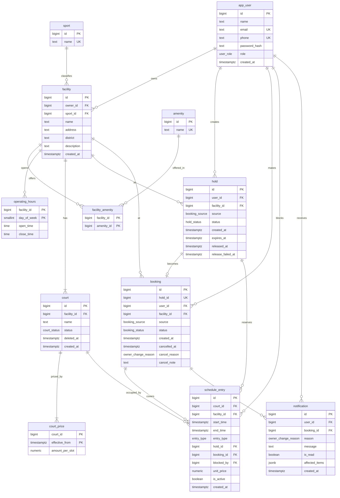

# Thiết kế dữ liệu và ràng buộc lịch đặt sân (3.1.2)

- **Mã đối tượng truy vết:** `DB-01` (ERD), `DB-MAP` (ánh xạ miền → bảng), `DB-DEC-01`..`DB-DEC-06` (quyết định), `DB-ATOM-01`..`DB-ATOM-06` (cơ chế chống trùng và nguyên tử), `DB-BV` (biên thời gian), `DB-NF` (chuẩn hóa), `DB-Q01`..`DB-Q10` (truy vấn và chỉ mục), `DB-HIS` (bảo toàn lịch sử), `DB-EVD` (bằng chứng đã chạy)
- **Issue liên quan:** `#10` — 3.1.2 Thiết kế dữ liệu và ràng buộc lịch đặt sân
- **Người chịu trách nhiệm chính:** Nguyễn Minh Trí (`@nmt1206`), tiếp nhận tạm thời từ 15/11/2026; Khôi là người phụ trách ban đầu
- **Người kiểm tra:** Vĩ (`@Lysivi2005` — đối chiếu ERD và ràng buộc lịch với kiến trúc, thiết kế lớp `#31` và đặc tả API `#34`, đã xác nhận đồng bộ 3 điểm chung tại commit `fe55c40` trên `#34`); Khoa (`@buikhoa130406` — đối chiếu quy tắc lịch với PA2, khi review chung `#14`)
- **Sản phẩm trong thư mục này:** `README.md` (tài liệu này), `data-dictionary.md` (từ điển dữ liệu, sinh từ CSDL đã nạp), `schema.sql` (DDL nguồn của ERD), `schema-check.sql` (kiểm tra ràng buộc), `erd.png` (ảnh xuất từ khối Mermaid ở mục 2)

Đầu vào đã dùng: SRS PA2, `design-overview.md`, `domain/domain-model.md`, `states/state-machines.md`, `sequences/sequence-diagrams.md`, thiết kế lớp `#31` và đặc tả API `#34` (đã đồng bộ commit `fe55c40`). **Chưa nhận** bản thiết kế dữ liệu Khôi có thể đã làm; nếu có, người phụ trách mới đối chiếu cùng nhóm, tích hợp phần dùng được và ghi nhận đóng góp theo file, commit hoặc PR thực tế (theo mô tả Issue #10).

---

## 1. Tóm tắt thiết kế

- **12 bảng** trong PostgreSQL 16. Phần cốt lõi là bảng `schedule_entry` (lịch chung): mỗi dòng là một sân cùng một dải slot 30 phút liên tiếp đang bị chiếm bởi một hold, một booking hoặc một khoảng khóa (kèm `unit_price` chụp tại thời điểm tạo hold để tính `totalPrice`).
- **Không trùng slot được bảo đảm bởi chính cơ sở dữ liệu**, bằng một ràng buộc loại trừ (`EXCLUDE USING gist`) trên `(court_id, khoảng thời gian)` cho các dòng đang hoạt động. Hai yêu cầu cùng tranh một slot: một bên ghi được, bên kia nhận lỗi `23P01` (đã kiểm chứng ở mục 10).
- **Tất cả hoặc không có gì** nhờ ghi hold và mọi dải của nó trong **một transaction**: một dải xung đột hoặc nằm ngoài giờ mở cửa mới (đọc lại sau khi lấy khóa `FOR SHARE`) thì rollback cả transaction.
- **Giữ ngữ cảnh đặt tại quầy (`UC-13`) qua hai bước:** `hold` lưu trực tiếp `source ('APP' | 'IN_PERSON')` và truyền sang `booking` qua khóa ngoại ghép `(hold_id, facility_id, source)`.
- **Giữ lịch sử:** không xóa vật lý sân, cơ sở, người dùng, booking; hủy booking là đổi trạng thái và đánh dấu dòng lịch không còn hoạt động.

---

## 2. ERD (`DB-01`)

Nguồn chỉnh sửa là khối Mermaid dưới đây (nguồn đầy đủ nhất là `schema.sql`). Khi xuất ảnh, lưu thành `erd.png` cùng thư mục.

*Hình 3.1.2.1 — ERD (`DB-01`)*

---

## 3. Ánh xạ từ domain model, thiết kế lớp (`#31`) và đặc tả API (`#34`) sang bảng (`DB-MAP`)

| Domain model / Lớp (`#31`) / API (`#34`) | Bảng & Cột trong DB | Ghi chú đồng bộ |
| :--- | :--- | :--- |
| `User` (`CLS-01`, `API-AUTH`) | `app_user` (`email`, `phone`, `role`) | Tách `email` (đăng nhập chính) và `phone` bắt buộc, đều `UNIQUE`. `role` lưu `PLAYER` / `FACILITY_OWNER` (đã chốt thống nhất `FACILITY_OWNER` giữa `#34` và `#35`). |
| Định dạng ID trên API (`#34`, commit `fe55c40`) | Khóa chính `bigint` | Nội bộ DB dùng `bigint` để chỉ mục GiST đạt `0,05 ms`. Trên JSON/URL API `#34`, các khóa ID truyền dưới dạng chuỗi số nguyên (`string`, ví dụ `"courtId": "1"`, `"expectedBookingIds": ["201"]`) để tránh mất độ chính xác 64-bit trên JS và được tầng API/Controller chuyển đổi với `bigint` trong DB. |
| `Facility`, `Sport`, `Amenity` | `facility`, `sport`, `amenity`, `facility_amenity` | `district` dùng để lọc theo vị trí (FR-04). |
| `OperatingHours` | `operating_hours` | Mức facility, một khoảng mỗi thứ (`DB-ASM-10`). |
| `Court` (`CLS-06`) | `court` | `status` (`ACTIVE`/`DELETED`) + `deleted_at` (xóa mềm, `DM-INV-07`). |
| `Price` | `court_price` + `schedule_entry.unit_price` | `court_price` lưu lịch sử bảng giá theo `effective_from`; khi tạo hold, đơn giá của **từng slot** là giá mới nhất có `effective_from <= slot.startTime`, chụp vào `schedule_entry.unit_price`. Lựa chọn đi qua mốc đổi giá được tách thành nhiều dải để `totalPrice` nhất quán ở `#34` (§2.2, §2.5.1; `DB-DEC-03`, `DB-ATOM-02`, `DB-Q03`). |
| `Hold` / `SlotHold` (`CLS-03`) | `hold` (`source`, `status`, `expires_at`, `release_failed_at`) | Lưu `source` (`APP` / `IN_PERSON`) ngay lúc tạo hold để giữ ngữ cảnh đặt tại quầy (`UC-13`) qua hai bước; mỗi user tối đa 1 hold `ACTIVE` nhờ `hold_user_active_idx`. |
| `HoldItem` / `HoldSlotItem` (`CLS-04`) | `schedule_entry` (`entry_type = HOLD`) | Một dòng = một sân + một dải liên tiếp cùng một `unit_price`; lựa chọn đi qua mốc đổi giá được tách thành nhiều dòng cùng sân, cùng hold (`DB-DEC-03`). |
| `Booking` (`CLS-05`) | `booking` (`hold_id`, `source`, `cancel_reason`, `cancel_note`) | Kế thừa `source` từ `hold`; `cancel_reason` bắt buộc khi chủ sân hủy (`CANCELLED_BY_OWNER`), `cancel_note` tùy chọn khi người chơi hủy (`reason?` ở `#31`/`#34`). |
| `BookingItem` | `schedule_entry` (`entry_type = BOOKING`) | Cùng dòng với `HoldItem`, đổi `entry_type` khi xác nhận. |
| `BlockedPeriod` / `ScheduleBlock` | `schedule_entry` (`entry_type = BLOCK`) | Cùng bảng để ràng buộc chống chồng lấn bao phủ cả khóa lịch (`DM-INV-08`). |
| `Notification` (`CLS-07`, `API-NTF`) | `notification` (`reason`, `message`, `is_read`, `affected_items`) | Đã chốt thống nhất `isRead`, `unreadOnly`, `unreadCount` và `PATCH /notifications/:notificationId/read` trên `API-NTF` (`#34` §2.6) với cột `is_read` (`DEFAULT false`) bên `#35`. Cột `affected_items jsonb` chụp danh sách `{ courtId (chuỗi, ví dụ "1"), courtName, startTime, endTime }` thực sự bị tác động lúc áp dụng thay đổi, khớp `affectedSummary.affectedItems` ở `#34` (§2.6; `DB-ATOM-06`, `DB-Q09`). |
| `TimeSlot` (`derivedStatus`) | Không có bảng | Suy ra khi truy vấn: giờ mở cửa trừ các dòng đang hoạt động của `schedule_entry` (`DB-Q03`). |

---

## 4..13. Quy tắc, Ràng buộc, Truy vấn & Bằng chứng (`DB-DEC` .. `DB-EVD`)

- **Kiểu ID & Vai trò & Thông báo đã đọc (đồng bộ `fe55c40` trên `#34`):** DB lưu `bigint`; JSON/URL API `#34` dùng chuỗi số nguyên (ví dụ `"courtId": "1"`, `"expectedBookingIds": ["201"]`); vai trò thống nhất `FACILITY_OWNER`; thông báo đồng bộ `isRead`, `unreadOnly`, `unreadCount` và `PATCH /notifications/:notificationId/read` với cột `notification.is_read`.
- **Kiểm tra slot liền nhau (`BR-03`):** Kiểm tra trên từng sân trước khi tách dải theo mốc đổi giá (`DB-ATOM-02` bước 2b, `DB-BV-01`, cụm `K10`..`K10d`).
- **Kết quả kiểm tra ràng buộc (`schema-check.sql`):** **29/29** đạt trên PostgreSQL 16 (`K3e` -> `23P01`, `K3e2` -> `23505`, `K8`/`K8b`, `K9`/`K9b`/`K9c` với `courtId` kiểu chuỗi JSON, `K10`..`K10d`, và bảng `Q3`).
