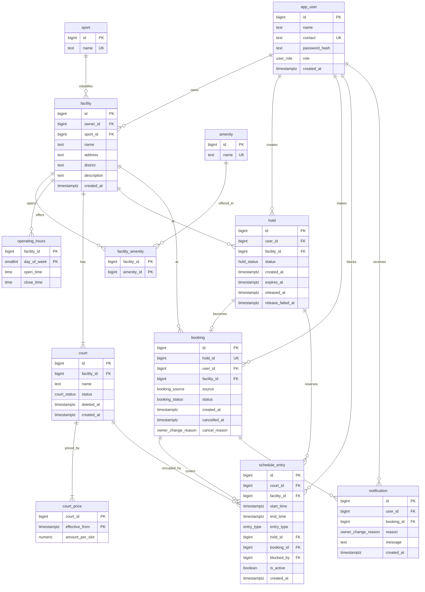

# Thiết kế dữ liệu và ràng buộc lịch đặt sân (3.1.2)

- **Mã đối tượng truy vết:** `DB-01` (ERD), `DB-MAP` (ánh xạ miền → bảng), `DB-DEC-01`..`DB-DEC-06` (quyết định), `DB-ATOM-01`..`DB-ATOM-06` (cơ chế chống trùng và nguyên tử), `DB-BV` (biên thời gian), `DB-NF` (chuẩn hóa), `DB-Q01`..`DB-Q10` (truy vấn và chỉ mục), `DB-HIS` (bảo toàn lịch sử), `DB-EVD` (bằng chứng đã chạy)
- **Issue liên quan:** `#10` — 3.1.2 Thiết kế dữ liệu và ràng buộc lịch đặt sân
- **Người chịu trách nhiệm chính:** Nguyễn Minh Trí (`@nmt1206`), tiếp nhận tạm thời từ 15/11/2026; Khôi là người phụ trách ban đầu
- **Người kiểm tra:** Vĩ (`@Lysivi2005` — đối chiếu ERD và ràng buộc lịch với kiến trúc và thiết kế lớp); Khoa (`@buikhoa130406` — đối chiếu quy tắc lịch với PA2, khi review chung #14)
- **Sản phẩm trong thư mục này:** `README.md` (tài liệu này), `data-dictionary.md` (từ điển dữ liệu, sinh từ CSDL đã nạp), `schema.sql` (DDL nguồn của ERD), `schema-check.sql` (kiểm tra ràng buộc), `erd.png` (ảnh xuất từ khối Mermaid ở mục 2, bạn tự xuất)

Đầu vào đã dùng: SRS PA2, `design-overview.md`, `domain/domain-model.md`, `states/state-machines.md`, `sequences/sequence-diagrams.md`. **Chưa nhận** bản thiết kế dữ liệu Khôi có thể đã làm; nếu có, người phụ trách mới đối chiếu cùng nhóm, tích hợp phần dùng được và ghi nhận đóng góp theo file, commit hoặc PR thực tế (theo mô tả Issue #10).

---

## 1. Tóm tắt thiết kế

- **12 bảng** trong PostgreSQL 16. Phần cốt lõi là bảng `schedule_entry` (lịch chung): mỗi dòng là một sân cùng một dải slot 30 phút liên tiếp đang bị chiếm bởi một hold, một booking hoặc một khoảng khóa.
- **Không trùng slot được bảo đảm bởi chính cơ sở dữ liệu**, bằng một ràng buộc loại trừ (`EXCLUDE USING gist`) trên `(court_id, khoảng thời gian)` cho các dòng đang hoạt động. Hai yêu cầu cùng tranh một slot: một bên ghi được, bên kia nhận lỗi `23P01` (đã kiểm chứng ở mục 10).
- **Tất cả hoặc không có gì** nhờ ghi hold và mọi dải của nó trong **một transaction**: một dải xung đột thì rollback cả transaction.
- **Giữ lịch sử:** không xóa vật lý sân, cơ sở, người dùng, booking; hủy booking là đổi trạng thái và đánh dấu dòng lịch không còn hoạt động.

---

## 2. ERD (`DB-01`)


*Hình 3.1.2.1 — ERD (`DB-01`)*



Các khóa ngoại **ghép** không vẽ được trong Mermaid: `schedule_entry (court_id, facility_id) → court`, `(hold_id, facility_id) → hold`, `(booking_id, facility_id) → booking` và `booking (hold_id, facility_id) → hold`. Mục đích của chúng ở `DB-ATOM-01`. Ràng buộc loại trừ `schedule_entry_no_overlap` cũng không vẽ được; xem `schema.sql` và mục 4.

---

## 3. Ánh xạ từ domain model sang bảng (`DB-MAP`)

Domain model và ERD chỉ cần khớp ý nghĩa, không cần trùng từng đối tượng. Ba thực thể của domain model được **gộp** vào một bảng vì chúng cùng một ý nghĩa vật lý: "một sân bị chiếm một khoảng thời gian".

| Domain model | Bảng | Ghi chú |
| :--- | :--- | :--- |
| `User` | `app_user` | `role` là kiểu liệt kê |
| `Facility`, `Sport`, `Amenity` | `facility`, `sport`, `amenity`, `facility_amenity` | `district` thêm để lọc theo vị trí (FR-04) |
| `OperatingHours` | `operating_hours` | Mức facility, một khoảng mỗi thứ (DB-ASM-10) |
| `Court` | `court` | `status` + `deleted_at` (xóa mềm, `DM-INV-07`) |
| `Price` | `court_price` | Theo `effective_from` (DB-ASM-09) |
| `Hold` | `hold` | 4 trạng thái, `expires_at`, `release_failed_at` |
| `HoldItem` | `schedule_entry` (`entry_type = HOLD`) | Một dòng = một sân + một dải liên tiếp |
| `Booking` | `booking` | `hold_id` duy nhất |
| `BookingItem` | `schedule_entry` (`entry_type = BOOKING`) | Cùng dòng với HoldItem, đổi loại khi xác nhận |
| `BlockedPeriod` | `schedule_entry` (`entry_type = BLOCK`) | Cùng bảng để ràng buộc chống chồng lấn bao phủ cả khóa lịch (`DM-INV-08`) |
| `Notification` | `notification` | Không có trạng thái đã đọc (DB-ASM-08) |
| `TimeSlot` (`derivedStatus`) | Không có bảng | Suy ra khi truy vấn: giờ mở cửa trừ các dòng đang hoạt động của `schedule_entry` (Q3) |

---

## 4. Các quyết định thiết kế (`DB-DEC`)

### `DB-DEC-01`: Chọn cách chặn trùng slot

| Phương án | Cách làm | Ưu | Nhược |
| :--- | :--- | :--- | :--- |
| A. Sinh sẵn dòng slot | Bảng `court_slot` mỗi 30 phút, khóa dòng khi giữ | Dễ hình dung | Phải sinh trước hàng loạt dòng; đổi giờ mở cửa phải sinh/xóa lại |
| B. Bảng chiếm theo từng slot | `UNIQUE (court_id, slot_start)`, mỗi slot một dòng | Dùng UNIQUE thông thường | Khóa lịch nhiều tuần cần hàng nghìn dòng; một booking nhiều slot = nhiều dòng |
| **C. Dòng theo dải + EXCLUDE (chọn)** | Một dòng = một sân + dải slot liên tiếp; `EXCLUDE USING gist (court_id WITH =, tstzrange(start_time, end_time) WITH &&) WHERE (is_active)` | Một dòng khớp `HoldItem`/`BookingItem`; khóa nhiều tuần là một dòng; DB tự chặn chồng lấn kể cả khi dải khác độ dài | Cần extension `btree_gist` (extension "trusted" từ PostgreSQL 13, tạo được không cần superuser); cần quy ước thứ tự chèn để tránh deadlock (`DB-ATOM-03`) |

### `DB-DEC-02`: Gộp hold, booking và khóa lịch vào `schedule_entry`
Ràng buộc loại trừ chỉ hoạt động trong **một bảng**. Nếu `BlockedPeriod` nằm ở bảng riêng thì không có gì ngăn một hold chồng lên khoảng khóa ở tầng DB. Gộp lại, `DM-INV-03` và `DM-INV-08` cùng được một ràng buộc bảo đảm. `entry_type` kèm CHECK bắt buộc đúng bộ khóa ngoại cho từng loại.

### `DB-DEC-03`: Xác nhận là đổi loại dòng, không sao chép
Xác nhận hold = tạo `booking`, đổi `hold.status` thành `CONFIRMED`, đổi `schedule_entry.entry_type` từ `HOLD` sang `BOOKING` và gán `booking_id`. Dòng vẫn hoạt động nên slot **không bao giờ rảnh giữa chừng**; không cần xóa rồi chèn lại.

### `DB-DEC-04`: Không xóa vật lý, nhả/hủy bằng `is_active = false`
Nhả hold hoặc hủy booking chỉ đặt `is_active = false` và giữ nguyên dòng. Ràng buộc loại trừ chỉ xét dòng `is_active`, nên slot được nhả ngay còn lịch sử vẫn còn (`DB-HIS`). Dòng `BLOCK` luôn `is_active = true` (không có thao tác gỡ khóa, `DB-ASM-07`).

### `DB-DEC-05`: Thời gian
Lưu `timestamptz` (UTC). Giờ mở cửa lưu kiểu `time` theo giờ địa phương Asia/Ho_Chi_Minh; ứng dụng đổi sang ngày/giờ cụ thể khi truy vấn. Độ dài và căn lề slot dùng `EXTRACT(EPOCH FROM ...) % 1800 = 0`, đúng với mọi múi giờ lệch nguyên 30 phút (giờ Việt Nam là UTC+7, không có giờ mùa hè).

### `DB-DEC-06`: Mức cô lập
Dùng mức mặc định `READ COMMITTED`. An toàn không dựa vào mức cô lập mà dựa vào (1) ràng buộc loại trừ và (2) khóa dòng ở các bước ghi quan trọng (`DB-ATOM`). Vì vậy không cần `SERIALIZABLE` và không cần cơ chế thử lại toàn bộ cho lỗi tuần tự hóa.

---

## 5. Cơ chế chống trùng và nguyên tử (`DB-ATOM`)

### `DB-ATOM-01`: Ràng buộc nào bảo vệ cái gì

| Mã | Ràng buộc DB | Bảo vệ | Truy vết |
| :--- | :--- | :--- | :--- |
| `DB-CON-01` | `EXCLUDE (court_id =, tstzrange(start,end) &&) WHERE is_active` | Không hai dòng đang hoạt động của một sân chồng thời gian: không hai hold, không hold và booking, không hold và khóa, không hai booking | NFR-02, BR-02, BR-13, `DM-INV-03`, `DM-INV-08` |
| `DB-CON-02` | `UNIQUE (hold_id, court_id)` | Mỗi hold có tối đa một dải trên mỗi sân (dải liên tiếp) | BR-03, `DM-INV-02` |
| `DB-CON-03` | Khóa ngoại ghép `(court_id, facility_id)`, `(hold_id, facility_id)`, `(booking_id, facility_id)`; `booking (hold_id, facility_id)` | Sân, hold, booking của một dòng lịch cùng một cơ sở | BR-03, `DM-INV-01` |
| `DB-CON-04` | CHECK `expires_at = created_at + interval '5 minutes'` | Hạn hold cố định 5 phút, không gia hạn | BR-01, BR-07, `DM-INV-04` |
| `DB-CON-05` | CHECK bội 30 phút và `end_time > start_time` | Slot 30 phút liên tiếp | FR-08, `DM-INV-01` |
| `DB-CON-06` | CHECK `entry_type` ↔ bộ khóa (HOLD/BOOKING/BLOCK) | Mỗi dòng đúng một loại, khóa ngoại nhất quán | `DM-INV-06`, `DM-INV-08` |
| `DB-CON-07` | `booking.hold_id` duy nhất, không NULL; CHECK trạng thái ↔ `cancelled_at`, `cancel_reason` | Booking sinh từ đúng một hold; hủy bởi chủ sân phải có lý do | BR-06, FR-30, `DM-INV-06` |
| `DB-CON-08` | CHECK `is_active OR entry_type <> 'BLOCK'` | Không thao tác gỡ khóa | `DB-ASM-07` |
| `DB-CON-09` | `ON DELETE RESTRICT` trên khóa ngoại của lịch sử | Không xóa vật lý sân, cơ sở, người dùng đã có lịch sử | FR-16 |

Hai điều DB **không** tự bảo đảm được vì cần đọc nhiều bảng, nên do dịch vụ làm **trong cùng transaction** và được kiểm tra ở PA4: (a) dòng `BOOKING` đang hoạt động phải ứng với `booking.status = CONFIRMED`; (b) dải nằm trong giờ hoạt động và sân còn hoạt động.

### `DB-ATOM-02`: Thao tác `createHold`
Đây là `createHoldAtomically` trong `SEQ-01`, `SEQ-05`. Mọi tham số `court_id` phải được ràng buộc kiểu `bigint` (xem cảnh báo ở `DB-Q03`).

```sql
BEGIN;                                   -- READ COMMITTED
-- 1. khóa chia sẻ các sân, theo thứ tự id. Sân đã xóa hoặc không thuộc cơ sở => thiếu dòng => SelectionInvalid
SELECT id FROM court
 WHERE id = ANY($1::bigint[]) AND facility_id = $2::bigint AND status = 'ACTIVE'
 ORDER BY id FOR SHARE;
-- 2. tạo hold (expires_at = created_at + 5 phút do giá trị mặc định và CHECK)
INSERT INTO hold (user_id, facility_id) VALUES ($3, $2) RETURNING id, expires_at;
-- 3. chèn các dải, theo thứ tự court_id tăng dần
INSERT INTO schedule_entry (court_id, facility_id, start_time, end_time, entry_type, hold_id)
VALUES (...), (...);
COMMIT;                                  -- 23P01 hoặc 40P01 ở bước 3 => ROLLBACK cả hold
```

- **Tất cả hoặc không có gì:** hold và mọi dải cùng một transaction; một dải xung đột thì `ROLLBACK` xóa cả hold và các dải đã chèn (kiểm chứng `K2`).
- **Một người thắng:** nếu hai transaction chèn dải chồng nhau, transaction sau **chờ** transaction trước kết thúc. Trước `COMMIT` thì sau nhận `23P01`; trước `ROLLBACK` thì sau được ghi (kiểm chứng `C1`, `C1b`).
- **Báo slot có vấn đề (FR-13):** sau khi rollback vì `23P01`, dịch vụ chạy một truy vấn đọc để liệt kê các dải đang hoạt động chồng với lựa chọn và trả `SelectionInvalid(slots)`:

```sql
SELECT e.court_id, e.start_time, e.end_time, e.entry_type
  FROM schedule_entry e
 WHERE e.is_active AND e.court_id = ANY($1::bigint[])
   AND tstzrange(e.start_time, e.end_time, '[)') && tstzrange($2::timestamptz, $3::timestamptz, '[)');
```

### `DB-ATOM-03`: Thứ tự chèn và deadlock
Hold nhiều sân chèn nhiều dòng. Nếu hai transaction chèn **ngược thứ tự** sân (một bên sân 1 rồi sân 2, bên kia sân 2 rồi sân 1) có thể xảy ra deadlock; PostgreSQL phát hiện và hủy một transaction với `40P01`. Kết quả đã đo: transaction còn lại vẫn thắng cả hai dải, transaction bị hủy không để lại dòng nào (`C2`). Khi **cùng thứ tự** (sân 1 rồi sân 2) không có deadlock: bên sau chờ rồi nhận `23P01` (`C3`). Quy tắc: **luôn chèn theo `court_id` tăng dần**, và dịch vụ coi `40P01` giống `23P01` (trả `SelectionInvalid`, không báo lỗi hệ thống).

### `DB-ATOM-04`: Thao tác `confirmBooking` và hết hạn
Đây là `SEQ-02` và `SEQ-02B`. Mốc hết hạn dùng `clock_timestamp()` (giờ thực), **không dùng `now()`**, vì `now()` là giờ bắt đầu transaction và sẽ cũ nếu transaction phải chờ khóa.

```sql
BEGIN;
-- khóa hold để xác nhận và tác vụ nhả không cùng thắng; thiếu dòng => HoldNotFound / NotOwner
SELECT * FROM hold WHERE id = $1 AND user_id = $2 FOR UPDATE;
-- điều kiện: status = 'ACTIVE' AND clock_timestamp() < expires_at, ngược lại => ConfirmRejected(HoldExpired), ROLLBACK
-- kiểm tra lại: sân còn hoạt động và còn đủ dải đang hoạt động của hold
SELECT id FROM court WHERE id IN (SELECT court_id FROM schedule_entry WHERE hold_id = $1) AND status = 'ACTIVE' FOR SHARE;
INSERT INTO booking (hold_id, user_id, facility_id, source) VALUES ($1, $2, $3, $4) RETURNING id;
UPDATE hold SET status = 'CONFIRMED' WHERE id = $1;
UPDATE schedule_entry SET entry_type = 'BOOKING', booking_id = $5 WHERE hold_id = $1 AND is_active;
COMMIT;
```

Tác vụ nền (`ReleaseJob`, chu kỳ không quá 1 giây) làm hai bước, mỗi bước một transaction:

```sql
-- bước 1: chuyển ACTIVE -> EXPIRED. Từ lúc này xác nhận bị từ chối dù slot chưa nhả
UPDATE hold SET status = 'EXPIRED'
 WHERE status = 'ACTIVE' AND expires_at <= clock_timestamp() RETURNING id;
-- bước 2, từng hold: nhả slot
UPDATE schedule_entry SET is_active = false WHERE hold_id = $1 AND is_active;
UPDATE hold SET status = 'RELEASED', released_at = now(), release_failed_at = NULL
 WHERE id = $1 AND status = 'EXPIRED';
-- nếu bước 2 lỗi: transaction riêng ghi lại để API trả ReleaseFailed
UPDATE hold SET release_failed_at = now() WHERE id = $1 AND status = 'EXPIRED';
```

- Câu `UPDATE ... WHERE status = 'ACTIVE'` bỏ qua hold vừa được xác nhận (đã `CONFIRMED`) nhờ khóa dòng: **đúng một bên thắng**.
- Slot vẫn `Held` cho tới khi hold sang `RELEASED`, khớp `STM-01` và `STM-02`.
- API suy ra ba kết quả của `getHoldStatus`: `RELEASED` → `Released`; `EXPIRED` và (`release_failed_at` có giá trị hoặc `clock_timestamp() - expires_at > 5 giây`) → `ReleaseFailed`; `EXPIRED` còn lại → `Releasing`.
- Mốc nhả ≤ 5 giây (NFR-03) phụ thuộc chu kỳ job; **cần bằng chứng đo riêng ở Issue #7**, không được chứng minh bằng thiết kế này.

### `DB-ATOM-05`: Thao tác hủy bởi người chơi
Đây là `SEQ-03`.

```sql
BEGIN;
SELECT * FROM booking WHERE id = $1 AND user_id = $2 FOR UPDATE;           -- không có dòng => NotFoundOrNotOwner
-- điều kiện: status = 'CONFIRMED', và (giờ bắt đầu sớm nhất) - clock_timestamp() >= interval '3 hours'  (đúng 3 giờ được phép)
SELECT min(start_time) FROM schedule_entry WHERE booking_id = $1;          -- Q5
UPDATE booking SET status = 'CANCELLED_BY_PLAYER', cancelled_at = now() WHERE id = $1 AND status = 'CONFIRMED';
UPDATE schedule_entry SET is_active = false WHERE booking_id = $1;         -- nhả toàn bộ các sân của booking
COMMIT;
```

### `DB-ATOM-06`: Thay đổi lịch của chủ sân (khóa slot, đổi giờ, xóa sân)
Đây là `previewChange`/`applyChange` trong `SEQ-04`. Xem trước chỉ đọc. Khi áp dụng:

```sql
BEGIN;
-- 1. khóa dòng sân (nhiều sân thì ORDER BY id). Hold đang được tạo giữ FOR SHARE trên sân => chờ nhau, không hold nào chen vào lúc áp dụng
SELECT id FROM court WHERE id = ANY($1::bigint[]) AND facility_id IN (SELECT id FROM facility WHERE owner_id = $2) ORDER BY id FOR UPDATE;
-- 2. tính lại các dòng bị ảnh hưởng (READ COMMITTED: chụp dữ liệu mới sau khi có khóa)
SELECT e.id, e.entry_type, e.hold_id, e.booking_id FROM schedule_entry e
 WHERE e.court_id = ANY($1::bigint[]) AND e.is_active
   AND tstzrange(e.start_time, e.end_time, '[)') && tstzrange($3::timestamptz, $4::timestamptz, '[)') FOR UPDATE;
-- có dòng HOLD                                   => ROLLBACK, HoldsPending
-- giờ bắt đầu sớm nhất của MỖI booking bị ảnh hưởng (min trên TẤT CẢ dải của booking, không chỉ dải trong khoảng chặn):
SELECT booking_id, min(start_time) FROM schedule_entry WHERE booking_id = ANY($5::bigint[]) GROUP BY booking_id;
-- booking nào có (start sớm nhất) - clock_timestamp() < interval '24 hours' => ROLLBACK, AffectedTooSoon
-- tập booking bị ảnh hưởng khác confirmedBookings chủ sân đã xác nhận     => ROLLBACK, ListChanged(danh sách mới)
-- 3. hủy toàn bộ booking bị ảnh hưởng, ghi thay đổi, thông báo
UPDATE booking SET status = 'CANCELLED_BY_OWNER', cancelled_at = now(), cancel_reason = $6 WHERE id = ANY($5::bigint[]);
UPDATE schedule_entry SET is_active = false WHERE booking_id = ANY($5::bigint[]);
INSERT INTO schedule_entry (court_id, facility_id, start_time, end_time, entry_type, blocked_by) VALUES (...);  -- khóa lịch; hoặc UPDATE operating_hours / xóa mềm court
INSERT INTO notification (user_id, booking_id, reason, message) SELECT ... FROM booking WHERE id = ANY($5::bigint[]);
COMMIT;
```

- Ràng buộc loại trừ là **lớp bảo vệ cuối**: nếu vì lý do nào đó vẫn còn dòng hold chồng, `INSERT` khóa lịch nhận `23P01` và transaction rollback.
- Khóa `FOR UPDATE` của chủ sân xung đột với `FOR SHARE` của người tạo hold: người tạo hold chờ chủ sân xong rồi mới chèn (kiểm chứng `C4`); hai người tạo hold không chặn nhau (`C5`).
- Với đổi giờ hoặc xóa sân: tập bị ảnh hưởng là các dòng `BOOKING` đang hoạt động ngoài giờ mới hoặc của sân bị xóa; ghi cuối là cập nhật `operating_hours` hoặc `court.status = 'DELETED'` kèm `deleted_at`.

---

## 6. Biên thời gian và quy tắc chủ sân (`DB-BV`)

Đồng hồ của dữ liệu là đồng hồ máy chủ DB (`clock_timestamp()` cho so sánh biên, `now()` cho nhãn thời gian ghi).

| Mã | Quy tắc | DB bảo đảm bằng | Dịch vụ kiểm tra trong transaction | Truy vết |
| :--- | :--- | :--- | :--- | :--- |
| `DB-BV-01` | Slot dài 30 phút, liên tiếp | CHECK bội 30 phút, một dải mỗi dòng | — | FR-08, BR-03 |
| `DB-BV-02` | Hold 5 phút, không gia hạn | CHECK `expires_at = created_at + 5 phút` | `clock_timestamp() < expires_at` khi xác nhận | BR-01, BR-07, FR-31 |
| `DB-BV-03` | Nhả sau khi hết hạn ≤ 5 giây | `hold_expiry_idx`, trạng thái `EXPIRED`, `release_failed_at` | `ReleaseJob` chu kỳ ≤ 1 giây; cần đo ở #7 | NFR-03, FR-14 |
| `DB-BV-04` | Cutoff Proceed của người chơi: `clock_timestamp() <= start_sớm_nhất - 60 phút`; owner tại quầy được miễn | — (không thể CHECK vì phụ thuộc giờ hiện tại và vai trò) | `validateSelection` trước khi ghi | FR-27, BR-08 |
| `DB-BV-05` | Hủy bởi người chơi: `start_sớm_nhất - clock_timestamp() >= 3 giờ` | — | `DB-ATOM-05` | FR-28, BR-09 |
| `DB-BV-06` | Khoảng khóa bắt đầu sau ít nhất 24 giờ | — | `previewChange`, kiểm tra lại ở `applyChange` | FR-20, BR-12 |
| `DB-BV-07` | Mọi booking bị ảnh hưởng có `start_sớm_nhất - clock_timestamp() >= 24 giờ`, đúng 24 giờ được phép; còn dưới 24 giờ thì từ chối cả thay đổi | — | `DB-ATOM-06` | FR-29, BR-11 |
| `DB-BV-08` | Chờ hold bị ảnh hưởng kết thúc rồi thử lại | Ràng buộc loại trừ; khóa dòng sân | `HoldsPending` | FR-29, BR-11 |
| `DB-BV-09` | Dải nằm trong giờ hoạt động; sân còn hoạt động | `court.status`; khóa `FOR SHARE` chặn xóa sân đồng thời | `validateSelection` | FR-18, FR-32 |
| `DB-BV-10` | Quyền sở hữu cơ sở và booking | `facility.owner_id`, `booking.user_id` | Điều kiện `WHERE ... owner_id = $` trong từng thao tác | BR-10, NFR-04 |

---

## 7. Chuẩn hóa (`DB-NF`)

Mọi bảng đạt **3NF**, trừ các ngoại lệ có lý do ở cuối.

| Bảng | Khóa | Thuộc tính không khóa phụ thuộc vào | Kết luận |
| :--- | :--- | :--- | :--- |
| `app_user`, `sport`, `amenity` | `id` | chỉ khóa | 3NF |
| `facility` | `id` | chỉ khóa (`owner_id`, `sport_id` là khóa ngoại) | 3NF |
| `facility_amenity` | `(facility_id, amenity_id)` | không có thuộc tính khác | 3NF |
| `operating_hours` | `(facility_id, day_of_week)` | `open_time`, `close_time` phụ thuộc cả khóa | 3NF |
| `court` | `id` | chỉ khóa | 3NF |
| `court_price` | `(court_id, effective_from)` | `amount_per_slot` phụ thuộc cả khóa | 3NF |
| `hold`, `booking` | `id` | chỉ khóa | 3NF, trừ ngoại lệ NE-2, NE-3 |
| `schedule_entry` | `id` | trừ ngoại lệ NE-1 | 3NF, trừ ngoại lệ NE-1 |
| `notification` | `id` | chỉ khóa | 3NF |

- **NE-1: `schedule_entry.facility_id`** phụ thuộc bắc cầu vào `court_id`. Cố ý lặp để các khóa ngoại ghép (`DB-CON-03`) buộc sân, hold, booking cùng một cơ sở ngay ở tầng DB (`DM-INV-01`). Giá trị luôn được kiểm soát bởi khóa ngoại nên không thể lệch.
- **NE-2: `booking.facility_id`** lặp `hold.facility_id`; cũng được khóa ngoại ghép bảo đảm.
- **NE-3: `hold.expires_at`** xác định hoàn toàn bởi `created_at`. Vẫn lưu để đánh chỉ mục truy vấn hết hạn (`DB-Q07`); CHECK `DB-CON-04` bảo đảm không lệch.
- **Bảng cha chung `schedule_entry`** có các cột `hold_id`, `booking_id`, `blocked_by` tùy loại dòng (NULL ở những loại không dùng); CHECK `DB-CON-06` buộc đúng bộ khóa cho từng `entry_type`. Đánh đổi này để ràng buộc loại trừ bao phủ cả ba loại (`DB-DEC-02`).
- Trạng thái "Đã hoàn thành" và `TimeSlot.derivedStatus` **không lưu** (suy ra), tránh lệch dữ liệu.

---

## 8. Truy vấn thường dùng và chỉ mục (`DB-Q`)

| Mã | Truy vấn | Chỉ mục | Truy vết |
| :--- | :--- | :--- | :--- |
| `DB-Q01` | Tìm cơ sở theo môn và khu vực: `WHERE sport_id = $1 AND district = $2` | `facility_sport_area_idx (sport_id, district)` | FR-04, NFR-06 |
| `DB-Q02` | Lọc theo tiện ích | `facility_amenity` PK và `facility_amenity_rev_idx (amenity_id, facility_id)` | FR-05 |
| `DB-Q03` | **Khả dụng theo sân và ngày** (xem dưới) | Chỉ mục GiST của `schedule_entry_no_overlap` (từng phần `is_active`) và `court_facility_active_idx` | FR-08, NFR-06, NFR-08 |
| `DB-Q04` | Danh sách booking của người chơi; booking theo cơ sở và trạng thái | `booking_user_idx (user_id, created_at DESC)`, `booking_facility_idx (facility_id, status)` | FR-02, FR-16 |
| `DB-Q05` | Dải của một booking và giờ bắt đầu sớm nhất: `WHERE booking_id = $1` | `schedule_entry_booking_idx` | FR-28 |
| `DB-Q06` | Dòng bị ảnh hưởng bởi thay đổi lịch: chồng thời gian với một sân | GiST như `DB-Q03` | FR-29 |
| `DB-Q07` | Tìm hold hết hạn và hold cần thử nhả lại | `hold_expiry_idx` (`WHERE status = 'ACTIVE'`), `hold_release_retry_idx` (`WHERE status = 'EXPIRED'`) | FR-14, NFR-03 |
| `DB-Q08` | Hold đang hoạt động của người dùng (tải lại trang) | `hold_user_active_idx` (`WHERE status = 'ACTIVE'`) | FR-25 |
| `DB-Q09` | Thông báo của người dùng | `notification_user_idx (user_id, created_at DESC)` | FR-30 |
| `DB-Q10` | Cơ sở của chủ sân | `facility_owner_idx` | FR-03, BR-10 |

**Q3 (khả dụng theo sân, theo ngày):**

```sql
SELECT s.slot, e.entry_type
  FROM court c
 CROSS JOIN LATERAL generate_series($2::timestamptz, $3::timestamptz - interval '30 minutes', interval '30 minutes') AS s(slot)
  LEFT JOIN schedule_entry e
         ON e.court_id = c.id AND e.is_active
        AND tstzrange(e.start_time, e.end_time, '[)') && tstzrange(s.slot, s.slot + interval '30 minutes', '[)')
 WHERE c.id = $1::bigint AND c.status = 'ACTIVE';
-- $2, $3 = giờ mở và giờ đóng của ngày (từ operating_hours, đổi sang timestamptz)
-- entry_type NULL => Available; HOLD => Held; BOOKING => Booked; BLOCK hoặc ngoài giờ/sân đã xóa => Unavailable
```

**Cảnh báo về kiểu tham số:** chỉ mục GiST chỉ dùng được điều kiện `court_id` khi tham số có kiểu `bigint`. Nếu `court_id` bị gửi dạng `integer` (hằng số gõ tay hoặc ORM ép kiểu), bộ tối ưu bỏ qua `court_id` và quét cả ngày của mọi sân: đo được **9,6 ms** thay vì **0,05 ms** trên 216.000 dòng (mục 10). Luôn ràng buộc kiểu `bigint` (`$1::bigint`) ở tầng truy vấn.

---

## 9. Bảo toàn lịch sử booking khi thay đổi hoặc xóa dữ liệu sân (`DB-HIS`)

| Thay đổi | Lịch sử booking được giữ như thế nào |
| :--- | :--- |
| Xóa sân | Xóa mềm: `court.status = 'DELETED'`, `deleted_at`; dòng sân và các dòng `schedule_entry` của nó còn nguyên. `ON DELETE RESTRICT` chặn xóa vật lý. Booking tương lai bị hủy theo `DB-ATOM-06` (`CANCELLED_BY_OWNER`, lý do `COURT_DELETED`) |
| Đổi giờ hoạt động | Chỉ sửa `operating_hours`; booking đã có không bị sửa. Booking tương lai nằm ngoài giờ mới bị hủy (`HOURS_CHANGED`); booking đã hủy và booking quá khứ giữ nguyên |
| Đổi giá | Thêm dòng `court_price` mới (`effective_from`); dòng cũ giữ nguyên. Booking không lưu tổng tiền (không thanh toán, BR-15) |
| Đổi tên sân hoặc cơ sở | Tên hiện tại được hiển thị cho cả booking cũ (chấp nhận được; không có yêu cầu giữ tên tại thời điểm đặt) |
| Hủy booking | Đổi `status`, ghi `cancelled_at`, `cancel_reason` (nếu do chủ sân); dòng lịch `is_active = false`, vẫn còn để hiển thị lịch sử (FR-16) |
| Xóa người dùng hoặc cơ sở | Không có thao tác xóa trong baseline; `ON DELETE RESTRICT` ngăn xóa khi còn lịch sử |

---

## 10. Bằng chứng đã chạy (`DB-EVD`)

Chạy trên PostgreSQL 16.15 (Ubuntu 24.04). Đây là **kiểm tra ràng buộc dữ liệu**, không thay cho thử kết nối React–API–PostgreSQL (Issue #7) và **không đo mốc 5 giây**.

**Kiểm tra ràng buộc (`schema-check.sql`):** 16/16 kiểm tra đạt, gồm chồng lấn bị chặn (`K1`), tất cả hoặc không có gì (`K2`), căn lề 30 phút, khóa ngoại ghép, một dải mỗi sân (`K3`), hạn hold (`K4`), booking đã xác nhận không đặt đè và hủy xong thì đặt lại được (`K5`), khóa lịch cùng cơ chế và không gỡ khóa (`K6`).

**Kiểm tra song song (hai phiên psql):**

| Mã | Tình huống | Kết quả đo |
| :--- | :--- | :--- |
| `C1` | Hai phiên tranh cùng sân, phiên 1 `COMMIT` sau 3 giây | Phiên 2 chờ khoảng 2,06 giây rồi nhận `23P01`: một bên thắng |
| `C1b` | Như `C1` nhưng phiên 1 `ROLLBACK` | Phiên 2 chờ khoảng 1,07 giây rồi giữ được chỗ |
| `C2` | Hold hai sân, hai phiên chèn **ngược** thứ tự sân | Một phiên bị `40P01` (deadlock), phiên kia thắng cả hai dải; còn đúng 2 dòng hoạt động |
| `C3` | Như `C2` nhưng **cùng** thứ tự sân | Không deadlock; phiên sau nhận `23P01`; còn đúng 2 dòng hoạt động |
| `C4` | Chủ sân `FOR UPDATE` trên sân, người tạo hold `FOR SHARE` | Người tạo hold chờ khoảng 1,56 giây (đến khi chủ sân xong) |
| `C5` | Hai phiên cùng `FOR SHARE` trên sân | Không chặn nhau (khoảng 0,04 giây) |

**Quy mô (NFR-06):** nạp 216.000 dòng `schedule_entry` (400 sân, 90 ngày, 6 booking mỗi sân mỗi ngày). `Q03` cho một sân một ngày chạy khoảng **0,05 ms** (quét chỉ mục GiST); `Q03` cho cả cơ sở 10 sân một ngày khoảng **0,7 ms**. Chưa phải kiểm thử tải 50 người dùng đồng thời của NFR-06; đó là việc của PA4.

---

## 11. Giả định của thiết kế dữ liệu (`DB-ASM`)

Các giả định dưới đây là chỗ PA2 chưa nói rõ; thiết kế chọn phương án tạm để không dừng việc. Đây là **làm rõ, không đổi baseline**; phần nào được nhóm chấp nhận và làm khác PA2 thì ghi vào `requirements-changes.md`.

| Mã | Nội dung | Căn cứ trong PA2 | Cần xác nhận |
| :--- | :--- | :--- | :--- |
| `DB-ASM-01` | `facility.district` do chủ sân nhập, dùng lọc theo vị trí | FR-04 lọc theo vị trí, PA2 không nêu cấu trúc địa chỉ | Vĩ (UI) |
| `DB-ASM-02` | `contact` (điện thoại hoặc email) là định danh đăng nhập, duy nhất | FR-01, FR-24 không nêu định danh | Khoa |
| `DB-ASM-03` | Triển khai cần extension `btree_gist` trên PostgreSQL | Ràng buộc môi trường PA2 mục 3 | Khoa (phụ trách hạ tầng thử kết nối #7) |
| `DB-ASM-04` | Tập lý do hủy của chủ sân: `BLOCKED_PERIOD`, `HOURS_CHANGED`, `COURT_DELETED` | FR-30 yêu cầu nêu lý do nhưng không liệt kê tập lý do | Khoa |
| `DB-ASM-05` | Mỗi tài khoản có đúng một vai trò (`PLAYER` hoặc `FACILITY_OWNER`) | PA2 nêu hai vai trò, không nói một tài khoản có nhiều vai trò hay không | Khoa |
| `DB-ASM-06` | Mỗi cơ sở hỗ trợ đúng một môn thể thao | Bảng thuật ngữ PA2: cơ sở có "một môn thể thao" | Khoa |
| `DB-ASM-07` | Không có thao tác gỡ hoặc sửa khoảng khóa; slot chỉ khả dụng lại khi giờ hoạt động được mở rộng và không còn nằm trong khoảng khóa | PA2 không có use case gỡ khóa | Khoa |
| `DB-ASM-08` | Thông báo không có trạng thái "đã đọc" | PA2 không yêu cầu | Khoa |
| `DB-ASM-09` | Giá theo sân, có lịch sử `effective_from`; chưa có khung giờ trong ngày | PA2 không nêu cấu trúc giá | Vĩ (UI), Khoa |
| `DB-ASM-10` | Giờ mở cửa ở mức cơ sở, một khoảng mỗi thứ, không qua đêm | UC-12 nói "sân hoặc lịch hoạt động", chưa rõ mức nào | Vĩ |
| `DB-ASM-11` | Xóa sân là xóa mềm, giữ lịch sử booking | UC-12 xóa sân; FR-16 xem lịch sử booking | Khoa |

**Tác động sang sản phẩm khác (không đổi yêu cầu):**
- **Vĩ (3.3.2 lớp, 3.2.1 UI, #12 API):** `HoldItem`, `BookingItem`, `BlockedPeriod` là ba khái niệm miền nhưng cùng một bảng; lớp có thể giữ ba lớp riêng ánh xạ vào một bảng hoặc một lớp `ScheduleEntry` có loại. Bảng ánh xạ lỗi `SQLSTATE` sang kết quả nghiệp vụ ở bên dưới dùng cho hợp đồng API.
- **`SEQ-01..SEQ-05`:** `createHoldAtomically`, `confirmBooking`, `cancelBooking`, `applyChange` nay có SQL cụ thể ở `DB-ATOM-02..06`; ranh giới transaction khớp sơ đồ.
- **`STM-01`:** `Releasing`/`ReleaseFailed` được suy ra như `DB-ATOM-04`; cột `release_failed_at` là yêu cầu dữ liệu tương ứng.

**Ánh xạ lỗi cơ sở dữ liệu sang kết quả nghiệp vụ:**

| `SQLSTATE` | Tình huống | Kết quả nghiệp vụ |
| :--- | :--- | :--- |
| `23P01` (exclusion) | Chèn dải của hold hoặc booking trực tiếp | `SelectionInvalid(slots)` |
| `23P01` | Chèn khoảng khóa ở `applyChange` | `HoldsPending` (sau rollback, đọc lại tập bị ảnh hưởng) |
| `40P01` (deadlock) | Tạo hold nhiều sân | Như `23P01` của hold, an toàn để báo lại người dùng |
| `23505` (unique), `23503` (khóa ngoại), `23514` (CHECK) | Dữ liệu không hợp lệ | Lỗi do lựa chọn sai cấu trúc; lẽ ra đã bị `validateSelection` chặn, ghi log và trả `SelectionInvalid` |

---

## 12. Bảng bao phủ yêu cầu PA2 (`DB-TRC`)

| Yêu cầu PA2 | Thiết kế dữ liệu |
| :--- | :--- |
| NFR-02, FR-13, BR-02, BR-05 | `DB-CON-01`, `DB-ATOM-02`, `DB-ATOM-03` |
| BR-01, BR-07, FR-14, FR-25, FR-31 | `DB-CON-04`, `DB-ATOM-04`, `DB-Q07`, `DB-Q08` |
| FR-09, FR-10, FR-11, FR-12, BR-03, BR-06 | `DB-CON-02`, `DB-CON-03`, `DB-CON-06`, `DB-CON-07`, `DB-DEC-03` |
| FR-21, FR-22, BR-13 | `schedule_entry` gộp ba nguồn, `DB-CON-01` |
| FR-20, FR-29, FR-30, BR-11, BR-12, BR-16 | `DB-ATOM-06`, `DB-BV-06..08`, `notification` |
| FR-28, BR-09 | `DB-ATOM-05`, `DB-BV-05` |
| FR-16, FR-17, FR-18, FR-19 | `DB-HIS`, `court`, `operating_hours`, `court_price` |
| FR-04, FR-05, FR-07, FR-08, NFR-06, NFR-08 | `DB-Q01..Q03`, `DM` suy ra `derivedStatus` |
| BR-10, NFR-04, NFR-05 | `facility.owner_id`, `booking.user_id`, `app_user.password_hash`, `DB-BV-10` |
| BR-15, BR-16 | Không có bảng thanh toán; `notification` chỉ trong ứng dụng |

---

## 13. Thông tin gửi kèm Review (Theo Working Agreement Mục 5.3)

- **Danh sách sản phẩm:** `docs/design/data/README.md`, `data-dictionary.md`, `schema.sql`, `schema-check.sql`, `erd.png` (mã đối tượng ở đầu file).
- **Kết quả tự kiểm tra:**
  - [x] Đủ cấu trúc lưu dữ liệu và quan hệ cho `Facility`, `Court`, giá, giờ hoạt động, booking nhiều sân/slot trong một cơ sở, hold, lịch chặn, thông báo.
  - [x] Giải thích cụ thể cách ngăn trùng slot và tính nguyên tử bằng SQL và kết quả chạy (`DB-ATOM`, `DB-EVD`), không chỉ ghi tên UNIQUE hay transaction.
  - [x] Biên thời gian 5 phút, 5 giây, 60 phút, 3 giờ, 24 giờ có điều kiện cụ thể và nơi bảo đảm (`DB-BV`), khớp `SEQ`, `STM`, domain model.
  - [x] Chuẩn hóa 3NF, ngoại lệ có lý do; chỉ mục gắn từng truy vấn; tác động của thay đổi dữ liệu (`DB-NF`, `DB-Q`, `DB-HIS`).
  - [x] `schema.sql` nạp được vào PostgreSQL 16; 16/16 kiểm tra ràng buộc đạt; 6 kiểm tra song song (`C1`..`C5`, kèm `C1b`) cho kết quả như mô tả.
  - [x] Đã mở khối Mermaid ERD trên preview GitHub và xuất `erd.png`.
  - [x] Đã đối chiếu mọi số liệu và biên (5 phút, 5 giây, 2 slot, 3 giờ, 24 giờ) với SRS PA2 bản nộp.
- **Các quyết định thiết kế chính:**
  1. Một bảng lịch chung `schedule_entry` gộp hold, booking và khóa lịch, với ràng buộc loại trừ trên `(court_id, khoảng thời gian)` (`DB-DEC-01`, `DB-DEC-02`).
  2. Hold nhiều sân ghi trong một transaction theo thứ tự `court_id`; `23P01` và `40P01` đều là kết quả xung đột (`DB-ATOM-03`).
  3. Hủy và nhả bằng `is_active = false`, xóa mềm sân, không xóa vật lý (`DB-DEC-04`, `DB-HIS`).
  4. Chỉ lưu `Confirmed`, `CancelledByPlayer`, `CancelledByOwner` cho booking; `Completed` suy ra từ thời gian.
- **Điểm còn mở cần người kiểm tra xác nhận:**
  - `@Lysivi2005`: ánh xạ ba khái niệm miền vào `schedule_entry` có hợp với lớp và kiến trúc không; xác nhận bảng lỗi `SQLSTATE` cho hợp đồng API #12; `DB-ASM-09`, `DB-ASM-10`, `DB-ASM-01`.
  - `@buikhoa130406`: đối chiếu quy tắc lịch (`DB-BV`) với PA2; `DB-ASM-11`, `DB-ASM-02..04`; mốc nhả ≤ 5 giây cần bằng chứng đo ở Issue #7, và triển khai phải có extension `btree_gist`.
