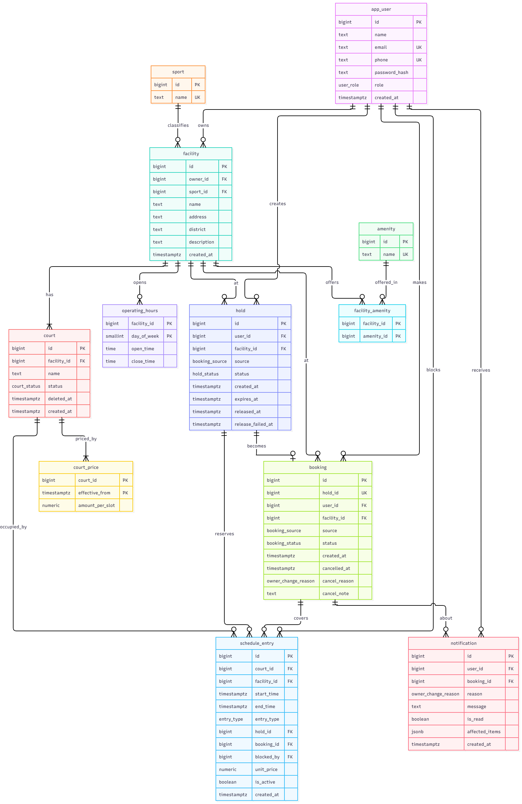
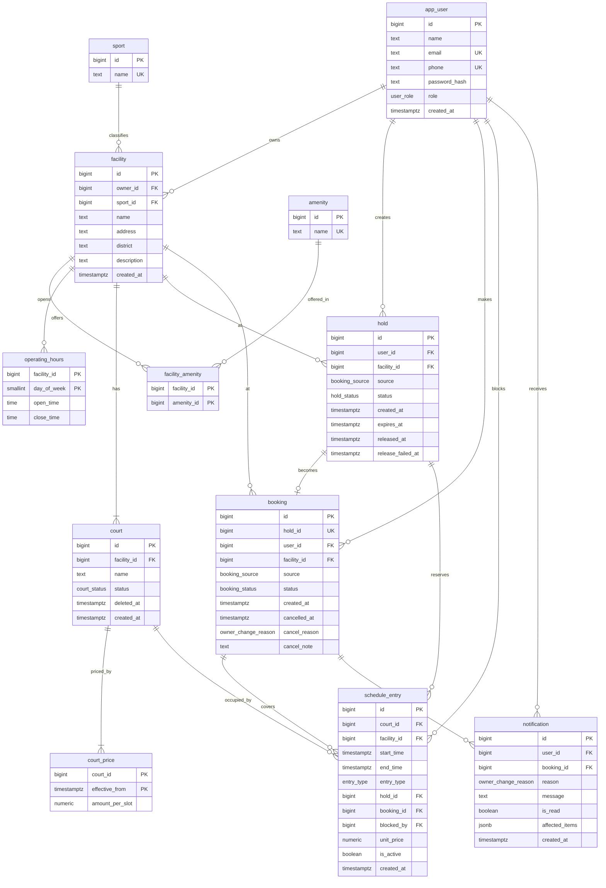

# Thiết kế dữ liệu và ràng buộc lịch đặt sân (3.1.2)

- **Mã đối tượng truy vết:** `DB-01` (ERD), `DB-MAP` (ánh xạ miền → bảng), `DB-DEC-01`..`DB-DEC-06` (quyết định), `DB-ATOM-01`..`DB-ATOM-06` (cơ chế chống trùng và nguyên tử), `DB-BV` (biên thời gian), `DB-NF` (chuẩn hóa), `DB-Q01`..`DB-Q10` (truy vấn và chỉ mục), `DB-HIS` (bảo toàn lịch sử), `DB-EVD` (bằng chứng đã chạy)
- **Issue liên quan:** `#10` — 3.1.2 Thiết kế dữ liệu và ràng buộc lịch đặt sân
- **Người chịu trách nhiệm chính:** Nguyễn Minh Trí (`@nmt1206`), tiếp nhận tạm thời từ 15/11/2026; Khôi là người phụ trách ban đầu
- **Người kiểm tra:** Vĩ (`@Lysivi2005` — đối chiếu ERD và ràng buộc lịch với kiến trúc, thiết kế lớp `#31` và đặc tả API `#34`); Khoa (`@buikhoa130406` — đối chiếu quy tắc lịch với PA2, khi review chung `#14`)
- **Sản phẩm trong thư mục này:** `README.md` (tài liệu này), `data-dictionary.md` (từ điển dữ liệu, sinh từ CSDL đã nạp), `schema.sql` (DDL nguồn của ERD), `schema-check.sql` (kiểm tra ràng buộc), `erd.png` (ảnh xuất từ khối Mermaid ở mục 2)

Đầu vào đã dùng: SRS PA2, `design-overview.md`, `domain/domain-model.md`, `states/state-machines.md`, `sequences/sequence-diagrams.md`, thiết kế lớp `#31` và đặc tả API `#34`. **Chưa nhận** bản thiết kế dữ liệu Khôi có thể đã làm; nếu có, người phụ trách mới đối chiếu cùng nhóm, tích hợp phần dùng được và ghi nhận đóng góp theo file, commit hoặc PR thực tế (theo mô tả Issue #10).

---

## 1. Tóm tắt thiết kế

- **12 bảng** trong PostgreSQL 16. Phần cốt lõi là bảng `schedule_entry` (lịch chung): mỗi dòng là một sân cùng một dải slot 30 phút liên tiếp đang bị chiếm bởi một hold, một booking hoặc một khoảng khóa (kèm `unit_price` chụp tại thời điểm tạo hold để tính `totalPrice`).
- **Không trùng slot được bảo đảm bởi chính cơ sở dữ liệu**, bằng một ràng buộc loại trừ (`EXCLUDE USING gist`) trên `(court_id, khoảng thời gian)` cho các dòng đang hoạt động. Hai yêu cầu cùng tranh một slot: một bên ghi được, bên kia nhận lỗi `23P01` (đã kiểm chứng ở mục 10).
- **Tất cả hoặc không có gì** nhờ ghi hold và mọi dải của nó trong **một transaction**: một dải xung đột hoặc nằm ngoài giờ mở cửa mới (đọc lại sau khi lấy khóa `FOR SHARE`) thì rollback cả transaction.
- **Giữ ngữ cảnh đặt tại quầy (`UC-13`) qua hai bước:** `hold` lưu trực tiếp `source ('APP' | 'IN_PERSON')` và truyền sang `booking` qua khóa ngoại ghép `(hold_id, facility_id, source)`.
- **Giữ lịch sử:** không xóa vật lý sân, cơ sở, người dùng, booking; hủy booking là đổi trạng thái và đánh dấu dòng lịch không còn hoạt động.

---

## 2. ERD (`DB-01`)

Nguồn chỉnh sửa là khối Mermaid dưới đây (nguồn đầy đủ nhất là `schema.sql`). Khi xuất ảnh, lưu thành `erd.png` cùng thư mục.


*Hình 3.1.2.1 — ERD (`DB-01`)*



Các khóa ngoại **ghép** không vẽ được trong Mermaid: `schedule_entry (court_id, facility_id) → court`, `(hold_id, facility_id) → hold`, `(booking_id, facility_id) → booking` và `booking (hold_id, facility_id, source) → hold`. Mục đích của chúng ở `DB-ATOM-01`. Ràng buộc loại trừ `schedule_entry_no_overlap` cũng không vẽ được; xem `schema.sql` và mục 4.

---

## 3. Ánh xạ từ domain model, thiết kế lớp (`#31`) và đặc tả API (`#34`) sang bảng (`DB-MAP`)

Domain model và ERD chỉ cần khớp ý nghĩa, không cần trùng từng đối tượng. Ba thực thể của domain model được **gộp** vào một bảng vì chúng cùng một ý nghĩa vật lý: "một sân bị chiếm một khoảng thời gian".

| Domain model / Lớp (`#31`) / API (`#34`) | Bảng & Cột trong DB | Ghi chú đồng bộ |
| :--- | :--- | :--- |
| `User` (`CLS-01`, `API-AUTH`) | `app_user` (`email`, `phone`, `role`) | Tách `email` (đăng nhập chính) và `phone` bắt buộc, đều `UNIQUE`. `role` lưu `PLAYER` / `FACILITY_OWNER` (API `#34` dùng thống nhất `FACILITY_OWNER`, không đổi tên). |
| Định dạng ID trên API (`#34`) | Khóa chính `bigint` | Nội bộ DB dùng `bigint` để chỉ mục GiST đạt `0,05 ms`. Trên API `#34`, các mã `facilityId`, `courtId`, `holdId`, `bookingId`, `notificationId`, `userId` và `affectedItems[].courtId` truyền dạng chuỗi số nguyên dương (`string` biểu diễn `bigint`, ví dụ `"101"`) trên URL/JSON và được Controller parse sang `bigint` (đang trao đổi chốt đồng bộ trên `#34`). |
| `Facility`, `Sport`, `Amenity` | `facility`, `sport`, `amenity`, `facility_amenity` | `district` dùng để lọc theo vị trí (FR-04). |
| `OperatingHours` | `operating_hours` | Mức facility, một khoảng mỗi thứ (`DB-ASM-10`). |
| `Court` (`CLS-06`) | `court` | `status` (`ACTIVE`/`DELETED`) + `deleted_at` (xóa mềm, `DM-INV-07`). |
| `Price` | `court_price` + `schedule_entry.unit_price` | `court_price` lưu lịch sử bảng giá theo `effective_from`; khi tạo hold, đơn giá của **từng slot** là giá mới nhất có `effective_from <= slot.startTime`, chụp vào `schedule_entry.unit_price`. Lựa chọn đi qua mốc đổi giá được tách thành nhiều dải để `totalPrice` nhất quán ở `#34` (§2.2, §2.5.1; `DB-DEC-03`, `DB-ATOM-02`, `DB-Q03`). |
| `Hold` / `SlotHold` (`CLS-03`) | `hold` (`source`, `status`, `expires_at`, `release_failed_at`) | Lưu `source` (`APP` / `IN_PERSON`) ngay lúc tạo hold để giữ ngữ cảnh đặt tại quầy (`UC-13`) qua hai bước; mỗi user tối đa 1 hold `ACTIVE` nhờ `hold_user_active_idx`. |
| `HoldItem` / `HoldSlotItem` (`CLS-04`) | `schedule_entry` (`entry_type = HOLD`) | Một dòng = một sân + một dải liên tiếp cùng một `unit_price`; lựa chọn đi qua mốc đổi giá được tách thành nhiều dòng cùng sân, cùng hold (`DB-DEC-03`). |
| `Booking` (`CLS-05`) | `booking` (`hold_id`, `source`, `cancel_reason`, `cancel_note`) | Kế thừa `source` từ `hold`; `cancel_reason` bắt buộc khi chủ sân hủy (`CANCELLED_BY_OWNER`), `cancel_note` tùy chọn khi người chơi hủy (`reason?` ở `#31`/`#34`). |
| `BookingItem` | `schedule_entry` (`entry_type = BOOKING`) | Cùng dòng với `HoldItem`, đổi `entry_type` khi xác nhận. |
| `BlockedPeriod` / `ScheduleBlock` | `schedule_entry` (`entry_type = BLOCK`) | Cùng bảng để ràng buộc chống chồng lấn bao phủ cả khóa lịch (`DM-INV-08`). |
| `Notification` (`CLS-07`, `API-NTF`) | `notification` (`reason`, `message`, `is_read`, `affected_items`) | Có cột `is_read` (`DEFAULT false`) hỗ trợ lọc `unreadOnly` và đánh dấu đã đọc trên `API-NTF` (`#34`). Cột `affected_items jsonb` chụp danh sách `{ courtId, courtName, startTime, endTime }` thực sự bị tác động lúc áp dụng thay đổi, khớp `affectedSummary.affectedItems` ở `#34` (§2.6; `DB-ATOM-06`, `DB-Q09`). |
| `TimeSlot` (`derivedStatus`) | Không có bảng | Suy ra khi truy vấn: giờ mở cửa trừ các dòng đang hoạt động của `schedule_entry` (`DB-Q03`). |

---

## 4. Các quyết định thiết kế (`DB-DEC`)

### `DB-DEC-01`: Chọn cách chặn trùng slot

| Phương án | Cách làm | Ưu | Nhược |
| :--- | :--- | :--- | :--- |
| A. Sinh sẵn dòng slot | Bảng `court_slot` mỗi 30 phút, khóa dòng khi giữ | Dễ hình dung | Phải sinh trước hàng loạt dòng; đổi giờ mở cửa phải sinh/xóa lại |
| B. Bảng chiếm theo từng slot | `UNIQUE (court_id, slot_start)`, mỗi slot một dòng | Dùng UNIQUE thông thường | Khóa lịch nhiều tuần cần hàng nghìn dòng; một booking nhiều slot = nhiều dòng |
| **C. Dòng theo dải + EXCLUDE (chọn)** | Một dòng = một sân + dải slot liên tiếp; `EXCLUDE USING gist (court_id WITH =, tstzrange(start_time, end_time) WITH &&) WHERE (is_active)` | Một dòng khớp `HoldItem`/`BookingItem`; khóa nhiều tuần là một dòng; DB tự chặn chồng lấn kể cả khi dải khác độ dài | Cần extension `btree_gist` (extension "trusted" từ PostgreSQL 13, tạo được không cần superuser); cần quy ước thứ tự chèn để tránh deadlock (`DB-ATOM-03`) |

### `DB-DEC-02`: Gộp hold, booking và khóa lịch vào `schedule_entry`
Ràng buộc loại trừ chỉ hoạt động trong **một bảng**. Nếu `BlockedPeriod` nằm ở bảng riêng thì không có gì ngăn một hold chồng lên khoảng khóa ở tầng DB. Gộp lại, `DM-INV-03` và `DM-INV-08` cùng được một ràng buộc bảo đảm. `entry_type` kèm CHECK bắt buộc đúng bộ khóa ngoại và `unit_price` cho từng loại.

### `DB-DEC-03`: Xác nhận là đổi loại dòng, không sao chép; giữ ngữ cảnh `source` từ `hold`
- Khi tạo hold (`createHold`), hệ thống ghi ngay `hold.source = 'IN_PERSON'` (nếu `isDirect = true` sau khi đã kiểm tra `facility.owner_id = userId`) hoặc `'APP'` (nếu `isDirect = false`), đồng thời chụp đơn giá vào `schedule_entry.unit_price` theo **giờ bắt đầu từng slot** (bullet cuối của mục này).
- Khi xác nhận (`confirmBooking`), hệ thống tạo `booking` với `source = hold.source` (được bảo vệ bởi khóa ngoại ghép `booking (hold_id, facility_id, source) → hold (id, facility_id, source)`), đổi `hold.status` thành `CONFIRMED`, đổi `schedule_entry.entry_type` từ `HOLD` sang `BOOKING` và gán `booking_id`. Dòng vẫn hoạt động nên slot **không bao giờ rảnh giữa chừng**, và giá cũng như ngữ cảnh đặt tại quầy không bao giờ bị lệch dù tải lại trang hay gửi lại yêu cầu xác nhận.
- **Quy tắc tính giá (chốt với `#34`, §2.2 và §2.5.1):** đơn giá của **từng slot** là `amount_per_slot` của dòng `court_price` mới nhất có `effective_from <= slot.startTime`, chụp vào `schedule_entry.unit_price` lúc tạo hold. Khi các slot liên tiếp trên cùng một sân đi qua mốc đổi giá, lựa chọn được **tách thành nhiều dải** cùng `hold_id` và cùng `court_id` (mỗi dải một đơn giá), nên ràng buộc duy nhất là `UNIQUE (hold_id, court_id, start_time)` thay cho `UNIQUE (hold_id, court_id)`. Ví dụ: `18:00-18:30` giá 100.000 và `18:30-19:00` giá 120.000 là hai dải, `totalPrice = 100.000 + 120.000 = 220.000` (kiểm chứng `K8`); lựa chọn không đi qua mốc đổi giá vẫn là một dải (`K8b`). Giá hiển thị trên lịch ở `DB-Q03` dùng cùng quy tắc nên khớp với giá lúc giữ chỗ và tổng tiền lúc xác nhận. Các slot trên từng sân phải liền nhau (`BR-03`) được dịch vụ kiểm tra **trước khi** tách dải (`DB-ATOM-02` bước 2b, `K10`).

### `DB-DEC-04`: Không xóa vật lý, nhả/hủy bằng `is_active = false`
Nhả hold hoặc hủy booking chỉ đặt `is_active = false` và giữ nguyên dòng. Ràng buộc loại trừ chỉ xét dòng `is_active`, nên slot được nhả ngay còn lịch sử và đơn giá vẫn còn (`DB-HIS`). Dòng `BLOCK` luôn `is_active = true` (không có thao tác gỡ khóa, `DB-ASM-07`).

### `DB-DEC-05`: Thời gian
Lưu `timestamptz` (UTC). Giờ mở cửa lưu kiểu `time` theo giờ địa phương Asia/Ho_Chi_Minh; ứng dụng đổi sang ngày/giờ cụ thể khi truy vấn. Căn lề slot dùng CHECK `start_time = date_trunc('minute', start_time) AND EXTRACT(MINUTE FROM start_time)::int % 30 = 0` (tương tự `end_time`): cả giờ bắt đầu và giờ kết thúc phải tròn phút và rơi vào phút 00 hoặc 30, nên mốc lệch như `10:00:00.250` bị chặn (`K3a_ms`, `K3a_ms2`, review `#35`). Đúng với múi giờ phiên lệch nguyên giờ hoặc nửa giờ (UTC, giờ Việt Nam là UTC+7, không có giờ mùa hè).

### `DB-DEC-06`: Mức cô lập
Dùng mức mặc định `READ COMMITTED`. An toàn không dựa vào mức cô lập mà dựa vào (1) ràng buộc loại trừ và (2) khóa dòng ở các bước ghi quan trọng (`DB-ATOM`), bao gồm việc đọc lại `operating_hours` sau khi đã lấy khóa `FOR SHARE` trên `court`. Vì vậy không cần `SERIALIZABLE` và không cần cơ chế thử lại toàn bộ cho lỗi tuần tự hóa.

---

## 5. Cơ chế chống trùng và nguyên tử (`DB-ATOM`)

### `DB-ATOM-01`: Ràng buộc nào bảo vệ cái gì

| Mã | Ràng buộc DB | Bảo vệ | Truy vết |
| :--- | :--- | :--- | :--- |
| `DB-CON-01` | `EXCLUDE (court_id =, tstzrange(start,end) &&) WHERE is_active` | Không hai dòng đang hoạt động của một sân chồng thời gian: không hai hold, không hold và booking, không hold và khóa, không hai booking | NFR-02, BR-02, BR-13, `DM-INV-03`, `DM-INV-08` |
| `DB-CON-02` | `UNIQUE (hold_id, court_id, start_time)` trên `schedule_entry` và `UNIQUE (user_id) WHERE status = 'ACTIVE'` trên `hold` | Một hold có thể có nhiều dải trên cùng một sân khi lựa chọn đi qua mốc đổi giá nhưng không trùng giờ bắt đầu (DB không ép các dải liền nhau; dịch vụ kiểm tra ở `DB-ATOM-02` bước 2b trước khi tách dải); mỗi người dùng có tối đa 1 hold đang `ACTIVE` tại một thời điểm | BR-03, `DM-INV-02`, FR-25 |
| `DB-CON-03` | Khóa ngoại ghép `(court_id, facility_id)`, `(hold_id, facility_id)`, `(booking_id, facility_id)`; `booking (hold_id, facility_id, source)` | Sân, hold, booking của một dòng lịch cùng một cơ sở; booking giữ đúng nguồn `APP`/`IN_PERSON` của hold | BR-03, FR-21, `DM-INV-01` |
| `DB-CON-04` | CHECK `expires_at = created_at + interval '5 minutes'` và `release_failed_at IS NULL OR status = 'EXPIRED'` | Hạn hold cố định 5 phút, không gia hạn; chỉ ghi `release_failed_at` khi hold đang `EXPIRED` | BR-01, BR-07, `DM-INV-04` |
| `DB-CON-05` | CHECK giờ bắt đầu và giờ kết thúc tròn phút, phút 00 hoặc 30, và `end_time > start_time` | Slot 30 phút liên tiếp | FR-08, `DM-INV-01` |
| `DB-CON-06` | CHECK `entry_type` ↔ bộ khóa (HOLD/BOOKING/BLOCK) và `unit_price` | Mỗi dòng đúng một loại, khóa ngoại nhất quán, HOLD/BOOKING luôn có `unit_price` | `DM-INV-06`, `DM-INV-08`, FR-07 |
| `DB-CON-07` | `booking.hold_id` duy nhất, không NULL; CHECK trạng thái ↔ `cancelled_at`, `cancel_reason`, `cancel_note` | Booking sinh từ đúng một hold; hủy bởi chủ sân phải có `cancel_reason`; người chơi hủy có thể kèm `cancel_note` tùy chọn | BR-06, FR-28, FR-30, `DM-INV-06` |
| `DB-CON-08` | CHECK `is_active OR entry_type <> 'BLOCK'` | Không thao tác gỡ khóa | `DB-ASM-07` |
| `DB-CON-09` | `ON DELETE RESTRICT` trên khóa ngoại của lịch sử | Không xóa vật lý sân, cơ sở, người dùng đã có lịch sử | FR-16 |

### `DB-ATOM-02`: Thao tác `createHold` (Kiểm tra lại giờ mở cửa sau khi lấy khóa sân)
Đây là `createHoldAtomically` trong `SEQ-01`, `SEQ-05`. Mọi tham số `court_id` phải được ràng buộc kiểu `bigint` (xem cảnh báo ở `DB-Q03`).

```sql
BEGIN;                                   -- READ COMMITTED
-- 1. Khóa chia sẻ các sân theo thứ tự id tăng dần (chống deadlock và tuần tự hóa với chủ sân đổi giờ/xóa sân).
--    Nếu isDirect = true (đặt tại quầy UC-13): kiểm tra thêm facility.owner_id = $3 ngay tại đây.
SELECT c.id FROM court c
  JOIN facility f ON f.id = c.facility_id
 WHERE c.id = ANY($1::bigint[]) AND c.facility_id = $2::bigint AND c.status = 'ACTIVE'
   AND (NOT $4::boolean OR f.owner_id = $3::bigint)
 ORDER BY c.id FOR SHARE OF c;
--    -> Thiếu dòng (sân đã xóa, khác cơ sở, hoặc không phải chủ cơ sở khi isDirect = true) => ROLLBACK, trả SelectionInvalid / NotAllowed.

-- 2. Đọc và kiểm tra lại operating_hours SAU KHI ĐÃ CÓ KHÓA FOR SHARE trên sân:
--    Nếu chủ sân vừa cập nhật giờ mở cửa (DB-ATOM-06 giữ FOR UPDATE trên court), bước 1 phải chờ chủ sân COMMIT xong,
--    nên câu lệnh dưới đây luôn đọc được operating_hours MỚI NHẤT.
SELECT day_of_week, open_time, close_time
  FROM operating_hours
 WHERE facility_id = $2::bigint;
--    -> Kiểm tra mọi dải chọn nằm trọn trong [open_time, close_time] của thứ tương ứng (theo Asia/Ho_Chi_Minh),
--       và nếu source = 'APP' (isDirect = false) thì start_sớm_nhất >= clock_timestamp() + interval '60 minutes'
--       (nếu source = 'IN_PERSON' / isDirect = true thì miễn mốc 60 phút, chỉ cần start_sớm_nhất >= clock_timestamp(), AC-25).
--    -> Nếu bất kỳ dải nào bị loại bởi giờ mở cửa mới hoặc vi phạm cutoff => ROLLBACK toàn bộ, trả SelectionInvalid!

-- 2b. Slot trên TỪNG sân phải liền nhau (BR-03), kiểm tra TRƯỚC khi tách dải theo giá. DB không thay thế bước này:
--     UNIQUE (hold_id, court_id, start_time) và EXCLUDE vẫn cho phép hai dải cách nhau trên cùng một sân (K10d).
--     Có dòng trả về (khoảng hở hoặc chồng nhau) => ROLLBACK, trả SelectionInvalid, không tạo lượt giữ.
SELECT x.court_id, x.prev_end, x.start_time
  FROM (SELECT sel.court_id, sel.start_time,
               lag(sel.end_time) OVER (PARTITION BY sel.court_id ORDER BY sel.start_time) AS prev_end
          FROM unnest($1::bigint[], $5::timestamptz[], $6::timestamptz[]) AS sel(court_id, start_time, end_time)) x
 WHERE x.prev_end IS NOT NULL AND x.prev_end <> x.start_time;

-- 3. Tạo hold với source = 'IN_PERSON' (nếu isDirect = true) hoặc 'APP' (nếu isDirect = false)
INSERT INTO hold (user_id, facility_id, source)
VALUES ($3::bigint, $2::bigint, CASE WHEN $4::boolean THEN 'IN_PERSON'::booking_source ELSE 'APP'::booking_source END)
RETURNING id, source, created_at, expires_at;

-- 4. Tách mỗi dải đã chọn tại mốc đổi giá: đơn giá của TỪNG slot là court_price mới nhất có effective_from <= giờ bắt đầu slot (DB-DEC-03).
--    Các slot liên tiếp cùng đơn giá gộp thành một dải; chèn theo court_id, start_time.
INSERT INTO schedule_entry (court_id, facility_id, start_time, end_time, entry_type, hold_id, unit_price)
WITH sel AS (
  SELECT * FROM unnest($1::bigint[], $5::timestamptz[], $6::timestamptz[]) AS sel(court_id, start_time, end_time)),
slot AS (
  SELECT sel.court_id, g.slot,
         (SELECT cp.amount_per_slot FROM court_price cp
           WHERE cp.court_id = sel.court_id AND cp.effective_from <= g.slot
           ORDER BY cp.effective_from DESC LIMIT 1) AS price
    FROM sel
   CROSS JOIN LATERAL generate_series(sel.start_time, sel.end_time - interval '30 minutes', interval '30 minutes') AS g(slot)),
run AS (
  SELECT court_id, slot, price,
         slot - interval '30 minutes' * (row_number() OVER (PARTITION BY court_id, price ORDER BY slot)) AS grp
    FROM slot)
SELECT court_id, $2::bigint, min(slot), max(slot) + interval '30 minutes', 'HOLD', $hold_id, price
  FROM run
 GROUP BY court_id, price, grp
 ORDER BY court_id, min(slot);

COMMIT;                                  -- 23P01 hoặc 40P01 ở bước 4 => ROLLBACK cả hold
```

- **Tất cả hoặc không có gì:** hold và mọi dải cùng một transaction; một dải xung đột hoặc bị loại bởi giờ mở cửa mới thì `ROLLBACK` xóa cả hold và các dải đã chèn (kiểm chứng `K2`).
- **Tách dải theo giá:** hai slot liền nhau qua mốc đổi giá cho hai dải cùng `hold_id` và `court_id` (kiểm chứng `K8`); slot không có dòng giá nào có hiệu lực thì `unit_price` rỗng và CHECK `DB-CON-06` chặn bằng `23514` (lỗi cấu hình giá).
- **Slot trên từng sân phải liền nhau (`BR-03`, bước 2b):** dịch vụ phải kiểm tra các slot trên từng sân liền nhau **trước khi** tách dải theo giá, vì sau khi đổi khóa để lưu nhiều dải giá trên cùng một sân (`UNIQUE (hold_id, court_id, start_time)`), các ràng buộc trong DB vẫn cho phép hai dải cách nhau. Ví dụ: chọn `18:00` và `18:30` trên cùng một sân thì hợp lệ dù giá khác nhau như `K8` (`K10c`); chọn `18:00` và `19:00` trên cùng một sân, bỏ slot `18:30`, thì trả `SelectionInvalid` và **không tạo lượt giữ** (`K10`); hai item chồng nhau cũng bị chặn (`K10b`). Khoảng hở chỉ tính trên cùng một sân; mỗi sân có dải riêng (`K10c2`). Lý do cần bước này: DB tự nó chấp nhận hai dải cách nhau (`K10d`).
- **Một người thắng:** nếu hai transaction chèn dải chồng nhau, transaction sau **chờ** transaction trước kết thúc. Trước `COMMIT` thì sau nhận `23P01`; trước `ROLLBACK` thì sau được ghi (kiểm chứng `C1`, `C1b`).
- **Báo slot có vấn đề (FR-13):** sau khi rollback vì `23P01`, dịch vụ chạy một truy vấn đọc để liệt kê các dải đang hoạt động chồng với lựa chọn và trả `SelectionInvalid(slots)`:

```sql
SELECT e.court_id, e.start_time, e.end_time, e.entry_type
  FROM schedule_entry e
 WHERE e.is_active AND e.court_id = ANY($1::bigint[])
   AND tstzrange(e.start_time, e.end_time, '[)') && tstzrange($2::timestamptz, $3::timestamptz, '[)');
```

### `DB-ATOM-03`: Thứ tự chèn và deadlock
Hold nhiều sân chèn nhiều dòng. Nếu hai transaction chèn **ngược thứ tự** sân (một bên sân 1 rồi sân 2, bên kia sân 2 rồi sân 1) có thể xảy ra deadlock; PostgreSQL phát hiện và hủy một transaction với `40P01`. Kết quả đã đo: transaction còn lại vẫn thắng cả hai dải, transaction bị hủy không để lại dòng nào (`C2`). Khi **cùng thứ tự** (sân 1 rồi sân 2) không có deadlock: bên sau chờ rồi nhận `23P01` (`C3`). Quy tắc: **luôn chèn theo `court_id` tăng dần**, và dịch vụ coi `40P01` giống `23P01` (trả `SelectionInvalid`, không báo lỗi hệ thống).

### `DB-ATOM-04`: Thao tác `confirmBooking`, hết hạn và xác định đúng lượt giữ API đang theo dõi
Đây là `SEQ-02` và `SEQ-02B`. Mốc hết hạn dùng `clock_timestamp()` (giờ thực), **không dùng `now()`**, vì `now()` là giờ bắt đầu transaction và sẽ cũ nếu transaction phải chờ khóa.

```sql
BEGIN;
-- 1. Khóa dòng hold để xác nhận và tác vụ nhả không cùng thắng
SELECT h.*, f.owner_id
  FROM hold h
  JOIN facility f ON f.id = h.facility_id
 WHERE h.id = $1::bigint
 FOR UPDATE OF h;
-- -> Không có dòng => ROLLBACK, trả HoldNotFound.
-- -> h.user_id <> $2::bigint => ROLLBACK, trả NotOwner.
-- -> Nếu h.source = 'IN_PERSON' (hoặc isDirect = true): kiểm tra h.source khớp với isDirect
--    VÀ f.owner_id = $2::bigint (bảo đảm quyền quản lý cơ sở ngay cả khi tải lại trang hoặc gửi lại yêu cầu xác nhận).
-- -> Nếu h.status <> 'ACTIVE' HOẶC clock_timestamp() >= h.expires_at => ROLLBACK, trả HoldExpired (FR-11, AC-35).

-- 2. Kiểm tra lại sân còn hoạt động và còn đủ dải đang hoạt động của hold
SELECT id FROM court
 WHERE id IN (SELECT court_id FROM schedule_entry WHERE hold_id = $1::bigint)
   AND status = 'ACTIVE'
 FOR SHARE;
-- -> Nếu thiếu sân hoặc không còn dòng schedule_entry (is_active = true) => ROLLBACK, trả SlotConflict.

-- 3. Tạo booking kế thừa trực tiếp source từ hold (được bảo vệ bởi FK ghép (hold_id, facility_id, source))
INSERT INTO booking (hold_id, user_id, facility_id, source)
SELECT id, user_id, facility_id, source FROM hold WHERE id = $1::bigint
RETURNING id, status, source, created_at;

UPDATE hold SET status = 'CONFIRMED' WHERE id = $1::bigint;
UPDATE schedule_entry SET entry_type = 'BOOKING', booking_id = $booking_id WHERE hold_id = $1::bigint AND is_active;
COMMIT;
```

Tác vụ nền (`ReleaseJob`, chu kỳ không quá 1 giây) làm hai bước, mỗi bước một transaction:

```sql
-- bước 1: chuyển ACTIVE -> EXPIRED. Từ lúc này xác nhận bị từ chối dù slot chưa nhả
UPDATE hold SET status = 'EXPIRED'
 WHERE status = 'ACTIVE' AND expires_at <= clock_timestamp() RETURNING id;
-- bước 2, từng hold: nhả slot
UPDATE schedule_entry SET is_active = false WHERE hold_id = $1 AND is_active;
UPDATE hold SET status = 'RELEASED', released_at = now(), release_failed_at = NULL
 WHERE id = $1 AND status = 'EXPIRED';
-- nếu bước 2 lỗi: transaction riêng ghi lại để API trả ReleaseFailed
UPDATE hold SET release_failed_at = now() WHERE id = $1 AND status = 'EXPIRED';
```

**Quy tắc xác định đúng lượt giữ mà API `#34` và UI `#29` đang theo dõi:**
1. **Mỗi người dùng tối đa 1 lượt giữ `ACTIVE`:** Nhờ chỉ mục duy nhất `CREATE UNIQUE INDEX hold_user_active_idx ON hold (user_id) WHERE status = 'ACTIVE'`, một tài khoản không bao giờ có hai lượt giữ `ACTIVE` đồng thời. Nếu người dùng mở tab khác tạo lượt giữ mới, dịch vụ phải nhả lượt giữ `ACTIVE` cũ trước khi tạo lượt mới.
2. **Cách tra cứu theo ngữ cảnh màn hình (`GET /holds/active` kèm tùy chọn `?holdId=...`):**
   - **Khi màn hình xác nhận đã biết `holdId` (bao gồm lúc đồng hồ đếm về 0 và đang hỏi lại trạng thái nhả):** Client truyền `holdId` đang theo dõi (`GET /holds/active?holdId=<id>` hoặc đọc theo `holdId`). Máy chủ truy vấn trực tiếp `WHERE id = $holdId AND user_id = $userId`, đảm bảo trả về trạng thái của **đúng lượt giữ mà màn hình đó đang chờ nhả**, không bị nhảy sang lượt giữ khác.
   - **Khi người dùng bấm F5 tải lại trang mà chưa truyền `holdId`:** Máy chủ ưu tiên tìm dòng `WHERE user_id = $userId AND status = 'ACTIVE'` (nhờ `hold_user_active_idx`, có tối đa 1 dòng). Nếu không có dòng `ACTIVE`, máy chủ lấy lượt giữ gần nhất vừa chuyển trạng thái của người dùng đó (`WHERE user_id = $userId AND status IN ('EXPIRED', 'RELEASED') ORDER BY created_at DESC LIMIT 1`) làm `lastHold`.
3. **Bảng ánh xạ đầy đủ 4 trạng thái từ dòng `hold` sang kết quả API `#34` & UI (`UI-07`):**

| Trạng thái vật lý trong bảng `hold` | Điều kiện thời gian & cờ lỗi | Kết quả trả về trên API `#34` / `SEQ-02B` | Hành vi giao diện (`UI-07`) |
| :--- | :--- | :--- | :--- |
| `status = 'ACTIVE'` | `clock_timestamp() < expires_at` | **`ACTIVE`** (kèm `expiresAt`, `serverNow`, `totalPrice`, `isDirect`) | Tiếp tục đếm ngược theo `expiresAt`, không đặt lại 5 phút (FR-25). |
| `status = 'ACTIVE'` (chờ job quét) hoặc `status = 'EXPIRED'` | `clock_timestamp() >= expires_at`, `release_failed_at IS NULL` và `clock_timestamp() - expires_at <= interval '5 seconds'` | **`Releasing`** | Hiển thị thông báo hết hạn, khóa nút Confirm, **chưa** cho chọn lại, không báo lỗi hệ thống; hỏi lại trạng thái. |
| `status = 'EXPIRED'` | `release_failed_at IS NOT NULL` **hoặc** `clock_timestamp() - expires_at > interval '5 seconds'` | **`ReleaseFailed`** | Báo lỗi giải phóng chỗ, giữ màn hình, không cho tiếp tục như thể đã nhả; `ReleaseJob` tiếp tục thử lại. |
| `status = 'RELEASED'` | `released_at IS NOT NULL` | **`Released`** | Cho phép chọn lại slot và cập nhật tình trạng sân. |

- Mốc nhả ≤ 5 giây (NFR-03) phụ thuộc chu kỳ job; **cần bằng chứng đo riêng ở Issue #7**, không được chứng minh bằng thiết kế này.

### `DB-ATOM-05`: Thao tác hủy bởi người chơi
Đây là `SEQ-03` (`BookingService.cancelBookingByPlayer(userId, bookingId, reason?)`).

```sql
BEGIN;
SELECT * FROM booking WHERE id = $1::bigint FOR UPDATE;
-- -> Không có dòng => ROLLBACK, trả BookingNotFound.
-- -> user_id <> $2::bigint => ROLLBACK, trả NotOwner.
-- -> status <> 'CONFIRMED' => ROLLBACK, trả InvalidState.
SELECT min(start_time) FROM schedule_entry WHERE booking_id = $1::bigint;  -- Q5
-- -> Nếu min(start_time) - clock_timestamp() < interval '3 hours' => ROLLBACK, trả CancelDeadlinePassed (đúng 3 giờ vẫn được phép).
UPDATE booking
   SET status = 'CANCELLED_BY_PLAYER',
       cancelled_at = now(),
       cancel_note = NULLIF(btrim($3::text), '')                           -- lưu lý do tùy chọn nếu người chơi có nhập
 WHERE id = $1::bigint AND status = 'CONFIRMED';
UPDATE schedule_entry SET is_active = false WHERE booking_id = $1::bigint; -- nhả toàn bộ các sân của booking
COMMIT;
```

### `DB-ATOM-06`: Thay đổi lịch của chủ sân (khóa slot, đổi giờ, xóa sân)
Đây là `previewChange`/`applyChange` trong `SEQ-04`. Xem trước chỉ đọc. Khi áp dụng:

```sql
BEGIN;
-- 1. khóa dòng sân (nhiều sân thì ORDER BY id). Hold đang được tạo giữ FOR SHARE trên sân => chờ nhau, không hold nào chen vào lúc áp dụng
SELECT id FROM court WHERE id = ANY($1::bigint[]) AND facility_id IN (SELECT id FROM facility WHERE owner_id = $2) ORDER BY id FOR UPDATE;
-- 2. tính lại các dòng bị ảnh hưởng (READ COMMITTED: chụp dữ liệu mới sau khi có khóa)
SELECT e.id, e.entry_type, e.hold_id, e.booking_id FROM schedule_entry e
 WHERE e.court_id = ANY($1::bigint[]) AND e.is_active
   AND tstzrange(e.start_time, e.end_time, '[)') && tstzrange($3::timestamptz, $4::timestamptz, '[)') FOR UPDATE;
-- có dòng HOLD                                   => ROLLBACK, HoldsPending
-- giờ bắt đầu sớm nhất của MỖI booking bị ảnh hưởng (min trên TẤT CẢ dải của booking, không chỉ dải trong khoảng chặn):
SELECT booking_id, min(start_time) FROM schedule_entry WHERE booking_id = ANY($5::bigint[]) GROUP BY booking_id;
-- booking nào có (start sớm nhất) - clock_timestamp() < interval '24 hours' => ROLLBACK, AffectedTooSoon
-- tập booking bị ảnh hưởng khác confirmedBookings chủ sân đã xác nhận     => ROLLBACK, ListChanged(danh sách mới)
-- 3. hủy toàn bộ booking bị ảnh hưởng, ghi thay đổi, thông báo
UPDATE booking SET status = 'CANCELLED_BY_OWNER', cancelled_at = now(), cancel_reason = $6 WHERE id = ANY($5::bigint[]);
UPDATE schedule_entry SET is_active = false WHERE booking_id = ANY($5::bigint[]);
INSERT INTO schedule_entry (court_id, facility_id, start_time, end_time, entry_type, blocked_by) VALUES (...);  -- khóa lịch; hoặc UPDATE operating_hours / xóa mềm court
-- 4. Thông báo kèm affected_items = phần dải của booking GIAO với các khoảng thay đổi, chỉ trên các sân bị thay đổi.
--    $1 = các sân bị thay đổi; $8 = các khoảng thay đổi (khóa slot: một khoảng khóa; xóa sân: (-infinity, infinity);
--    đổi giờ: các khoảng ngoài giờ mới, đúng tập đã hiển thị ở previewChange). courtId là chuỗi theo quy ước ID trên JSON.
WITH aff AS (
  SELECT e.booking_id,
         jsonb_agg(jsonb_build_object('courtId', e.court_id::text, 'courtName', c.name,
                                      'startTime', lower(x.r), 'endTime', upper(x.r))
                   ORDER BY e.court_id, lower(x.r)) AS items
    FROM schedule_entry e
    JOIN court c ON c.id = e.court_id
   CROSS JOIN unnest($8::tstzrange[]) AS ch(r)
   CROSS JOIN LATERAL (SELECT tstzrange(e.start_time, e.end_time, '[)') * ch.r AS r) x
   WHERE e.booking_id = ANY($5::bigint[]) AND e.court_id = ANY($1::bigint[]) AND NOT isempty(x.r)
   GROUP BY e.booking_id)
INSERT INTO notification (user_id, booking_id, reason, message, affected_items)
SELECT b.user_id, b.id, $6::owner_change_reason, $7, COALESCE(aff.items, '[]'::jsonb)
  FROM booking b LEFT JOIN aff ON aff.booking_id = b.id
 WHERE b.id = ANY($5::bigint[]);
COMMIT;
```

- Ràng buộc loại trừ là **lớp bảo vệ cuối**: nếu vì lý do nào đó vẫn còn dòng hold chồng, `INSERT` khóa lịch nhận `23P01` và transaction rollback.
- Khóa `FOR UPDATE` của chủ sân xung đột với `FOR SHARE` của người tạo hold: người tạo hold chờ chủ sân xong rồi mới đọc `operating_hours` và chèn (kiểm chứng `C4`); hai người tạo hold không chặn nhau (`C5`).
- Với đổi giờ hoặc xóa sân: tập bị ảnh hưởng là các dòng `BOOKING` đang hoạt động ngoài giờ mới hoặc của sân bị xóa; ghi cuối là cập nhật `operating_hours` hoặc `court.status = 'DELETED'` kèm `deleted_at`.

---

## 6. Biên thời gian và quy tắc chủ sân (`DB-BV`)

Đồng hồ của dữ liệu là đồng hồ máy chủ DB (`clock_timestamp()` cho so sánh biên, `now()` cho nhãn thời gian ghi).

| Mã | Quy tắc | DB bảo đảm bằng | Dịch vụ kiểm tra trong transaction | Truy vết |
| :--- | :--- | :--- | :--- | :--- |
| `DB-BV-01` | Slot dài 30 phút, liên tiếp | CHECK giờ tròn phút, phút 00 hoặc 30 ở cả hai đầu; mỗi dòng một dải một đơn giá. **Dịch vụ phải kiểm tra các slot trên từng sân liền nhau trước khi tách dải theo giá** (DB vẫn cho phép hai dải cách nhau, `K10d`): chọn `18:00` và `18:30` hợp lệ dù giá khác nhau như `K8`; chọn `18:00` và `19:00` trên cùng sân (bỏ `18:30`) thì trả `SelectionInvalid` và không tạo lượt giữ (`DB-ATOM-02` bước 2b, `K10`) | — | FR-08, BR-03 |
| `DB-BV-02` | Hold 5 phút, không gia hạn | CHECK `expires_at = created_at + 5 phút` | `clock_timestamp() < expires_at` khi xác nhận | BR-01, BR-07, FR-31 |
| `DB-BV-03` | Nhả sau khi hết hạn ≤ 5 giây | `hold_expiry_idx`, trạng thái `EXPIRED`, `release_failed_at` | `ReleaseJob` chu kỳ ≤ 1 giây; cần đo ở #7 | NFR-03, FR-14 |
| `DB-BV-04` | Cutoff Proceed của người chơi: `clock_timestamp() <= start_sớm_nhất - 60 phút`; owner đặt tại quầy (`isDirect = true`, `hold.source = 'IN_PERSON'`) được miễn | `hold.source` lưu ngữ cảnh `APP` / `IN_PERSON`, FK ghép sang `booking` | Kiểm tra trong `DB-ATOM-02` (miễn mốc 60 phút khi `isDirect = true` và `facility.owner_id = userId`, đặt trước 30 phút vẫn hợp lệ theo AC-25) | FR-27, BR-08, AC-25 |
| `DB-BV-05` | Hủy bởi người chơi: `start_sớm_nhất - clock_timestamp() >= 3 giờ` | — | `DB-ATOM-05` | FR-28, BR-09 |
| `DB-BV-06` | Khoảng khóa bắt đầu sau ít nhất 24 giờ | — | `previewChange`, kiểm tra lại ở `applyChange` | FR-20, BR-12 |
| `DB-BV-07` | Mọi booking bị ảnh hưởng có `start_sớm_nhất - clock_timestamp() >= 24 giờ`, đúng 24 giờ được phép; còn dưới 24 giờ thì từ chối cả thay đổi | — | `DB-ATOM-06` | FR-29, BR-11 |
| `DB-BV-08` | Chờ hold bị ảnh hưởng kết thúc rồi thử lại | Ràng buộc loại trừ; khóa dòng sân | `HoldsPending` | FR-29, BR-11 |
| `DB-BV-09` | Dải nằm trong giờ hoạt động; sân còn hoạt động | `court.status`; khóa `FOR SHARE` chặn xóa sân và chờ đổi giờ đồng thời | Đọc lại `operating_hours` **sau khi lấy khóa `FOR SHARE` trên `court`** trong `DB-ATOM-02` | FR-18, FR-32 |
| `DB-BV-10` | Quyền sở hữu cơ sở và booking | `facility.owner_id`, `booking.user_id`, `hold.source` | Kiểm tra `facility.owner_id = userId` cả lúc tạo hold tại quầy (`DB-ATOM-02`) và lúc xác nhận hold `IN_PERSON` (`DB-ATOM-04`) | BR-10, NFR-04 |

---

## 7. Chuẩn hóa (`DB-NF`)

Mọi bảng đạt **3NF**, trừ các ngoại lệ có lý do ở cuối.

| Bảng | Khóa | Thuộc tính không khóa phụ thuộc vào | Kết luận |
| :--- | :--- | :--- | :--- |
| `app_user`, `sport`, `amenity` | `id` | chỉ khóa (`email`, `phone` là khóa ứng viên duy nhất) | 3NF |
| `facility` | `id` | chỉ khóa (`owner_id`, `sport_id` là khóa ngoại) | 3NF |
| `facility_amenity` | `(facility_id, amenity_id)` | không có thuộc tính khác | 3NF |
| `operating_hours` | `(facility_id, day_of_week)` | `open_time`, `close_time` phụ thuộc cả khóa | 3NF |
| `court` | `id` | chỉ khóa | 3NF |
| `court_price` | `(court_id, effective_from)` | `amount_per_slot` phụ thuộc cả khóa | 3NF |
| `hold`, `booking` | `id` | chỉ khóa | 3NF, trừ ngoại lệ NE-2, NE-3 |
| `schedule_entry` | `id` | trừ ngoại lệ NE-1, NE-4 | 3NF, trừ ngoại lệ NE-1, NE-4 |
| `notification` | `id` | chỉ khóa | 3NF |

- **NE-1: `schedule_entry.facility_id`** phụ thuộc bắc cầu vào `court_id`. Cố ý lặp để các khóa ngoại ghép (`DB-CON-03`) buộc sân, hold, booking cùng một cơ sở ngay ở tầng DB (`DM-INV-01`). Giá trị luôn được kiểm soát bởi khóa ngoại nên không thể lệch.
- **NE-2: `booking.facility_id` và `booking.source`** lặp `hold.facility_id` và `hold.source`; được khóa ngoại ghép `booking (hold_id, facility_id, source) → hold (id, facility_id, source)` bảo đảm không thể lệch, đồng thời cho phép lọc nhanh booking theo cơ sở/nguồn mà không cần JOIN `hold`.
- **NE-3: `hold.expires_at`** xác định hoàn toàn bởi `created_at`. Vẫn lưu để đánh chỉ mục truy vấn hết hạn (`DB-Q07`); CHECK `DB-CON-04` bảo đảm không lệch.
- **NE-4: `schedule_entry.unit_price`** là bản chụp lịch sử (historical snapshot) của đơn giá 1 slot 30 phút từ `court_price` theo giờ bắt đầu của slot (`effective_from <= slot.startTime`), chụp lúc tạo hold; dải được tách tại mốc đổi giá nên mọi slot của một dải cùng một đơn giá. Việc chụp lại đơn giá trên từng dải lịch giúp tính `totalPrice` khi giữ chỗ, xác nhận, xem lịch sử booking và xem trước thay đổi lịch (`#34`) hoàn toàn bất biến trước các lần đổi giá sân về sau.
- **Bảng cha chung `schedule_entry`** có các cột `hold_id`, `booking_id`, `blocked_by`, `unit_price` tùy loại dòng (NULL ở những loại không dùng); CHECK `DB-CON-06` buộc đúng bộ khóa cho từng `entry_type`. Đánh đổi này để ràng buộc loại trừ bao phủ cả ba loại (`DB-DEC-02`).
- Trạng thái "Đã hoàn thành" và `TimeSlot.derivedStatus` **không lưu** (suy ra), tránh lệch dữ liệu.

---

## 8. Truy vấn thường dùng và chỉ mục (`DB-Q`)

| Mã | Truy vấn | Chỉ mục | Truy vết |
| :--- | :--- | :--- | :--- |
| `DB-Q01` | Tìm cơ sở theo môn và khu vực: `WHERE sport_id = $1 AND district = $2` | `facility_sport_area_idx (sport_id, district)` | FR-04, NFR-06 |
| `DB-Q02` | Lọc theo tiện ích | `facility_amenity` PK và `facility_amenity_rev_idx (amenity_id, facility_id)` | FR-05 |
| `DB-Q03` | **Khả dụng theo sân và ngày** (xem dưới) | Chỉ mục GiST của `schedule_entry_no_overlap` (từng phần `is_active`) và `court_facility_active_idx` | FR-08, NFR-06, NFR-08 |
| `DB-Q04` | Danh sách booking của người chơi; booking theo cơ sở và trạng thái (kèm `totalPrice`) | `booking_user_idx (user_id, created_at DESC)`, `booking_facility_idx (facility_id, status)` | FR-02, FR-16 |
| `DB-Q05` | Dải của một booking, giờ bắt đầu sớm nhất và `totalPrice`: `WHERE booking_id = $1` | `schedule_entry_booking_idx` | FR-28 |
| `DB-Q06` | Dòng bị ảnh hưởng bởi thay đổi lịch: chồng thời gian với một sân | GiST như `DB-Q03` | FR-29 |
| `DB-Q07` | Tìm hold hết hạn và hold cần thử nhả lại | `hold_expiry_idx` (`WHERE status = 'ACTIVE'`), `hold_release_retry_idx` (`WHERE status = 'EXPIRED'`) | FR-14, NFR-03 |
| `DB-Q08` | Hold đang hoạt động của người dùng (tải lại trang F5) và kiểm tra tối đa 1 hold `ACTIVE` | `hold_user_active_idx` (`UNIQUE (user_id) WHERE status = 'ACTIVE'`) | FR-25 |
| `DB-Q09` | Thông báo của người dùng (lọc `unreadOnly` và đếm `unreadCount`), kèm `affected_items` (`affectedSummary.affectedItems`, `#34` §2.6) | `notification_user_idx (user_id, is_read, created_at DESC)` | FR-30 |
| `DB-Q10` | Cơ sở của chủ sân | `facility_owner_idx` | FR-03, BR-10 |

**Q3 (khả dụng theo sân, theo ngày):**

```sql
SELECT s.slot, e.entry_type,
       (SELECT cp.amount_per_slot FROM court_price cp
         WHERE cp.court_id = c.id AND cp.effective_from <= s.slot
         ORDER BY cp.effective_from DESC LIMIT 1) AS slot_price
  FROM court c
 CROSS JOIN LATERAL generate_series($2::timestamptz, $3::timestamptz - interval '30 minutes', interval '30 minutes') AS s(slot)
  LEFT JOIN schedule_entry e
         ON e.court_id = c.id AND e.is_active
        AND tstzrange(e.start_time, e.end_time, '[)') && tstzrange(s.slot, s.slot + interval '30 minutes', '[)')
 WHERE c.id = $1::bigint AND c.status = 'ACTIVE';
-- $2, $3 = giờ mở và giờ đóng của ngày (từ operating_hours, đổi sang timestamptz)
-- entry_type NULL => Available; HOLD => Held; BOOKING => Booked; BLOCK hoặc ngoài giờ/sân đã xóa => Unavailable
-- slot_price: giá hiển thị trên lịch theo giờ bắt đầu slot, cùng quy tắc với lúc giữ chỗ (DB-DEC-03)
```

**Q5b (Công thức tính `totalPrice` cho một `hold` hoặc `booking` bất kỳ trên API `#34`):**

```sql
SELECT COALESCE(SUM(e.unit_price * (EXTRACT(EPOCH FROM (e.end_time - e.start_time))::bigint / 1800)), 0) AS total_price
  FROM schedule_entry e
 WHERE e.hold_id = $1::bigint;  -- hoặc WHERE e.booking_id = $1::bigint
```

**Q9 (thông báo của người dùng, `API-NTF`):**

```sql
SELECT n.id::text, n.booking_id::text, n.reason, n.message, n.is_read, n.created_at,
       n.affected_items                      -- [{ courtId (chuỗi), courtName, startTime, endTime }]
  FROM notification n
 WHERE n.user_id = $1::bigint AND (NOT $2::boolean OR NOT n.is_read)
 ORDER BY n.created_at DESC, n.id DESC;
```

**Cảnh báo về kiểu tham số:** chỉ mục GiST chỉ dùng được điều kiện `court_id` khi tham số có kiểu `bigint`. Nếu `court_id` bị gửi dạng `integer` (hằng số gõ tay hoặc ORM ép kiểu), bộ tối ưu bỏ qua `court_id` và quét cả ngày của mọi sân: đo được **9,6 ms** thay vì **0,05 ms** trên 216.000 dòng (mục 10). Luôn ràng buộc kiểu `bigint` (`$1::bigint`) ở tầng truy vấn.

---

## 9. Bảo toàn lịch sử booking, giá và lý do hủy khi thay đổi dữ liệu (`DB-HIS`)

| Thay đổi | Lịch sử booking và dữ liệu phản hồi cho API `#34` được giữ như thế nào |
| :--- | :--- |
| **Xóa sân** | Xóa mềm: `court.status = 'DELETED'`, `deleted_at`; dòng sân và các dòng `schedule_entry` của nó còn nguyên. `ON DELETE RESTRICT` chặn xóa vật lý. Booking tương lai bị hủy theo `DB-ATOM-06` (`CANCELLED_BY_OWNER`, lý do `COURT_DELETED`). |
| **Đổi giờ hoạt động** | Chỉ sửa `operating_hours`; booking đã có không bị sửa. Booking tương lai nằm ngoài giờ mới bị hủy (`HOURS_CHANGED`); booking đã hủy và booking quá khứ giữ nguyên. |
| **Đổi giá (`totalPrice`)** | Thêm dòng `court_price` mới (`effective_from`); dòng cũ giữ nguyên. Khi tạo hold (`DB-ATOM-02`), đơn giá có hiệu lực tại giờ bắt đầu từng slot được chụp vào `schedule_entry.unit_price` (lựa chọn đi qua mốc đổi giá tách thành nhiều dải, `DB-DEC-03`). Nhờ vậy `totalPrice` trả về khi giữ chỗ, khi xác nhận, khi xem trước thay đổi lịch của chủ sân và khi xem lịch sử đặt sân (`#34`) đều tính từ `schedule_entry.unit_price` đã chốt lúc tạo hold, **không bị nhảy giá** nếu chủ sân đổi giá giữa lúc giữ chỗ và xác nhận hoặc trước khi xem lại. |
| **Đổi tên sân hoặc cơ sở** | Tên hiện tại được hiển thị cho cả booking cũ (chấp nhận được; không có yêu cầu giữ tên tại thời điểm đặt). |
| **Thông báo hủy** | Danh sách sân và khung giờ bị tác động được chụp vào `notification.affected_items` lúc chủ sân áp dụng thay đổi, nên không đổi khi booking bị hủy, sân bị xóa mềm hoặc giờ mở cửa đổi sau đó (`DB-ATOM-06`). |
| **Hủy booking (`cancel_reason` vs `cancel_note`)** | Đổi `status`, ghi `cancelled_at` và đặt `schedule_entry.is_active = false` (vẫn giữ dòng lịch và `unit_price` để hiển thị lịch sử theo FR-16).<br>- Khi **chủ sân hủy** (`CANCELLED_BY_OWNER`): cột `cancel_reason` (kiểu `owner_change_reason`: `BLOCKED_PERIOD`, `HOURS_CHANGED`, `COURT_DELETED`) là bắt buộc `NOT NULL` (FR-30).<br>- Khi **người chơi hủy** (`CANCELLED_BY_PLAYER`): cột `cancel_reason` là `NULL`, còn tham số tùy chọn `reason?` từ API `#34` / `#31` được lưu vào cột `cancel_note` (`NULL` nếu người chơi không nhập). |
| **Xóa người dùng hoặc cơ sở** | Không có thao tác xóa trong baseline; `ON DELETE RESTRICT` ngăn xóa khi còn lịch sử. |

---

## 10. Bằng chứng đã chạy (`DB-EVD`)

Chạy trên PostgreSQL 16.15 (Ubuntu 24.04). Đây là **kiểm tra ràng buộc dữ liệu ở tầng PostgreSQL**, không thay cho thử kết nối React–API–PostgreSQL (Issue #7) và **không đo mốc 5 giây**.

**Kiểm tra ràng buộc (`schema-check.sql`):** **29/29** kiểm tra đạt, chạy lại sau khi sửa theo review `#35` (script bật `\set ON_ERROR_STOP on` và dùng `RAISE EXCEPTION` cho mọi nhánh `FAIL`, nên chỉ thoát với mã `0` khi toàn bộ 29 kiểm tra đều `PASS`). Đã chạy thử với kiểm tra cũ (`::bigint`): `K3a_ms` thất bại và psql dừng với mã khác 0, nên ca mới có tác dụng. Gồm:
- Chồng lấn bị chặn (`K1a`) và hai khung kề nhau được phép (`K1b`).
- **Tất cả hoặc không có gì cho một lượt giữ nhiều sân (`K2`):** tạo đúng một `hold_id` chứa cả dải hợp lệ (Sân 2) và dải xung đột (Sân 1); khi dải Sân 1 bị chặn bởi `23P01`, cả dòng `hold` lẫn dải hợp lệ trên Sân 2 dưới cùng `hold_id` đó đều bị rollback sạch.
- Căn lề 30 phút, khóa ngoại ghép cùng cơ sở (`K3a`..`K3d`); **lệch 250 ms** ở giờ bắt đầu (`K3a_ms`) và giờ kết thúc (`K3a_ms2`) bị chặn bởi `23514`; hai dải đang hoạt động trùng `start_time` của cùng một sân trong một hold bị chặn trước bởi ràng buộc loại trừ `EXCLUDE` (`23P01`, `K3e`), và khi dòng cũ đã nhả (`is_active = false`), dòng mới trùng `(hold_id, court_id, start_time)` bị chặn bởi chỉ mục duy nhất `UNIQUE` (`23505`, `K3e2`).
- Hạn hold cố định 5 phút (`K4`).
- Xác nhận kế thừa `source` từ `hold`, slot của booking đã xác nhận không đặt đè được, hủy xong (kèm `cancel_note`) thì đặt lại được và giữ nguyên lịch sử + `unit_price`, hủy bởi chủ sân thiếu `cancel_reason` bị chặn (`K5a`..`K5c`).
- Khóa lịch (`BlockedPeriod`) cùng cơ chế chống trùng và không có thao tác gỡ khóa (`K6a`..`K6d`).
- **Giá theo từng slot (`K8`, `K8b`):** hai slot liền nhau `18:00-18:30` giá 100k và `18:30-19:00` giá 120k tách thành hai dải cùng hold và cùng sân, tổng 220k; hai slot sau mốc đổi giá vẫn một dải, 240k.
- **Slot liền nhau trên từng sân (`K10`..`K10d`):** chọn 18:00 và 19:00 trên cùng một sân (bỏ 18:30) bị phát hiện, hai item chồng nhau bị phát hiện, 18:00 và 18:30 hợp lệ dù giá khác nhau, và DB tự nó vẫn chấp nhận hai dải cách nhau nên bước kiểm tra lựa chọn ở dịch vụ là bắt buộc.
- **Thông báo hủy (`K9`, `K9b`, `K9c`):** đơn hai sân bị hủy vì chủ sân khóa `18:00-18:30` của Sân 1 thì cả đơn bị hủy nhưng `affected_items` chỉ chứa đúng khung đó của Sân 1; xóa sân liệt kê đúng dải trên sân bị xóa; `affected_items` bắt buộc là mảng JSON.

**Kiểm tra song song (hai phiên psql, kết quả của lần chạy trước; lần cập nhật theo review `#35` không đổi cơ chế khóa nên chưa chạy lại):**

| Mã | Tình huống | Kết quả đo |
| :--- | :--- | :--- |
| `C1` | Hai phiên tranh cùng sân, phiên 1 `COMMIT` sau 3 giây | Phiên 2 chờ khoảng 2,06 giây rồi nhận `23P01`: một bên thắng |
| `C1b` | Như `C1` nhưng phiên 1 `ROLLBACK` | Phiên 2 chờ khoảng 1,07 giây rồi giữ được chỗ |
| `C2` | Hold hai sân, hai phiên chèn **ngược** thứ tự sân | Một phiên bị `40P01` (deadlock), phiên kia thắng cả hai dải; còn đúng 2 dòng hoạt động |
| `C3` | Như `C2` nhưng **cùng** thứ tự sân | Không deadlock; phiên sau nhận `23P01`; còn đúng 2 dòng hoạt động |
| `C4` | Chủ sân `FOR UPDATE` trên sân, người tạo hold `FOR SHARE` | Người tạo hold chờ khoảng 1,56 giây (đến khi chủ sân xong) rồi mới đọc `operating_hours` |
| `C5` | Hai phiên cùng `FOR SHARE` trên sân | Không chặn nhau (khoảng 0,04 giây) |

**Quy mô (NFR-06):** nạp 216.000 dòng `schedule_entry` (400 sân, 90 ngày, 6 booking mỗi sân mỗi ngày). `Q03` cho một sân một ngày chạy khoảng **0,05 ms** (quét chỉ mục GiST); `Q03` cho cả cơ sở 10 sân một ngày khoảng **0,7 ms**. Chưa phải kiểm thử tải 50 người dùng đồng thời của NFR-06; đó là việc của PA4.

---

## 11. Giả định của thiết kế dữ liệu (`DB-ASM`)

Các giả định dưới đây là chỗ PA2 chưa nói rõ; thiết kế chọn phương án tạm để không dừng việc. Đây là **làm rõ, không đổi baseline**; phần nào được nhóm chấp nhận và làm khác PA2 thì ghi vào `requirements-changes.md`.

| Mã | Nội dung | Căn cứ trong PA2 | Cần xác nhận |
| :--- | :--- | :--- | :--- |
| `DB-ASM-01` | `facility.district` do chủ sân nhập, dùng lọc theo vị trí | FR-04 lọc theo vị trí, PA2 không nêu cấu trúc địa chỉ | Vĩ (UI) |
| `DB-ASM-02` | Bảng `app_user` lưu cả `email` (`UNIQUE`) và `phone` (`UNIQUE`); dùng `email` làm trường đăng nhập chính đồng bộ với `API-AUTH` (`#34`) | FR-01, FR-24 nêu đăng ký/đăng nhập | Khoa, Vĩ (`#34`) |
| `DB-ASM-03` | Triển khai cần extension `btree_gist` trên PostgreSQL | Ràng buộc môi trường PA2 mục 3 | Khoa (phụ trách hạ tầng thử kết nối #7) |
| `DB-ASM-04` | Tập lý do hủy của chủ sân: `BLOCKED_PERIOD`, `HOURS_CHANGED`, `COURT_DELETED`; người chơi hủy có cột `cancel_note` tùy chọn | FR-28, FR-30 | Khoa, Vĩ (`#34`) |
| `DB-ASM-05` | Mỗi tài khoản có đúng một vai trò (`PLAYER` hoặc `FACILITY_OWNER`; API `#34` dùng thống nhất `FACILITY_OWNER`) | PA2 nêu hai vai trò | Khoa, Vĩ (`#34`) |
| `DB-ASM-06` | Mỗi cơ sở hỗ trợ đúng một môn thể thao | Bảng thuật ngữ PA2: cơ sở có "một môn thể thao" | Khoa |
| `DB-ASM-07` | Không có thao tác gỡ hoặc sửa khoảng khóa; slot chỉ khả dụng lại khi giờ hoạt động được mở rộng và không còn nằm trong khoảng khóa | PA2 không có use case gỡ khóa | Khoa |
| `DB-ASM-08` | Bảng `notification` có cột `is_read` (`DEFAULT false`) để phục vụ lọc `unreadOnly` và đánh dấu đã đọc trên `API-NTF` (`#34`) | FR-30 thông báo trong ứng dụng | Khoa, Vĩ (`#34`) |
| `DB-ASM-09` | Giá theo sân có lịch sử `effective_from` trong `court_price`; đơn giá của từng slot là giá có `effective_from <= slot.startTime` mới nhất, được chụp vào `schedule_entry.unit_price` lúc tạo hold (dải tách tại mốc đổi giá) để tính `totalPrice` (`DB-DEC-03`) | FR-07, FR-16, FR-19 | Vĩ (UI, `#34`), Khoa |
| `DB-ASM-10` | Giờ mở cửa ở mức cơ sở, một khoảng mỗi thứ, không qua đêm | UC-12 nói "sân hoặc lịch hoạt động" | Vĩ |
| `DB-ASM-11` | Xóa sân là xóa mềm, giữ lịch sử booking | UC-12 xóa sân; FR-16 xem lịch sử booking | Khoa |

**Ánh xạ lỗi cơ sở dữ liệu sang kết quả nghiệp vụ:**

| `SQLSTATE` | Tình huống | Kết quả nghiệp vụ |
| :--- | :--- | :--- |
| `23P01` (exclusion) | Chèn dải của hold hoặc booking trực tiếp | `SelectionInvalid(slots)` (hoặc `SlotConflict` khi xác nhận) |
| `23P01` | Chèn khoảng khóa ở `applyChange` | `HoldsPending` (sau rollback, đọc lại tập bị ảnh hưởng) |
| `40P01` (deadlock) | Tạo hold nhiều sân | Như `23P01` của hold, an toàn để báo lại người dùng |
| `23505` (unique `hold_user_active_idx`) | Người dùng tạo hold mới khi còn hold `ACTIVE` cũ | Dịch vụ nhả hold `ACTIVE` cũ trước hoặc trả `ActiveHoldExists` |
| `23505` (unique khác), `23503` (khóa ngoại), `23514` (CHECK) | Dữ liệu không hợp lệ | Lỗi do lựa chọn sai cấu trúc; lẽ ra đã bị `validateSelection` chặn, ghi log và trả `SelectionInvalid` |

---

## 12. Bảng bao phủ yêu cầu PA2 (`DB-TRC`)

| Yêu cầu PA2 | Thiết kế dữ liệu |
| :--- | :--- |
| NFR-02, FR-13, BR-02, BR-05 | `DB-CON-01`, `DB-ATOM-02`, `DB-ATOM-03` |
| BR-01, BR-07, FR-14, FR-25, FR-31 | `DB-CON-02`, `DB-CON-04`, `DB-ATOM-04`, `DB-Q07`, `DB-Q08` |
| FR-09, FR-10, FR-11, FR-12, BR-03, BR-06 | `DB-CON-02`, `DB-CON-03`, `DB-CON-06`, `DB-CON-07`, `DB-DEC-03` |
| FR-21, FR-22, BR-13, AC-25 | `hold.source`, `booking.source`, `schedule_entry` gộp ba nguồn, `DB-CON-01`, `DB-BV-04` |
| FR-20, FR-29, FR-30, BR-11, BR-12, BR-16 | `DB-ATOM-06`, `DB-BV-06..08`, `notification`, `notification.affected_items` |
| FR-28, BR-09 | `DB-ATOM-05`, `DB-BV-05`, `booking.cancel_note` |
| FR-16, FR-17, FR-18, FR-19 | `DB-HIS`, `court`, `operating_hours`, `court_price`, `schedule_entry.unit_price` |
| FR-04, FR-05, FR-07, FR-08, NFR-06, NFR-08 | `DB-Q01..Q03`, `DB-Q05b`, `DM` suy ra `derivedStatus` |
| BR-10, NFR-04, NFR-05 | `facility.owner_id`, `booking.user_id`, `app_user.password_hash`, `DB-BV-10` |
| BR-15, BR-16 | Không có bảng thanh toán; `notification` chỉ trong ứng dụng |

---

## 13. Thông tin gửi kèm Review (Theo Working Agreement Mục 5.3)

- **Danh sách sản phẩm:** `docs/design/data/README.md`, `data-dictionary.md`, `schema.sql`, `schema-check.sql`, `erd.png` (mã đối tượng ở đầu file).
- **Kết quả tự kiểm tra:**
  - [x] Đủ cấu trúc lưu dữ liệu và quan hệ cho `Facility`, `Court`, giá (`court_price` + `unit_price`), giờ hoạt động, booking nhiều sân/slot trong một cơ sở, hold (kèm `source`), lịch chặn, thông báo (kèm `is_read`).
  - [x] Giải thích cụ thể cách ngăn trùng slot, đọc lại `operating_hours` sau khi lấy khóa `FOR SHARE` và tính nguyên tử bằng SQL cùng kết quả chạy (`DB-ATOM`, `DB-EVD`).
  - [x] Biên thời gian 5 phút, 5 giây, 60 phút, 3 giờ, 24 giờ có điều kiện cụ thể và nơi bảo đảm (`DB-BV`), khớp `SEQ` (`#27`), `STM` (`#28`), `CLS` (`#31`) và `API` (`#34`).
  - [x] Chuẩn hóa 3NF, ngoại lệ có lý do (`NE-1`..`NE-4`); chỉ mục gắn từng truy vấn; làm rõ cách tính `totalPrice`, lưu `cancel_note` và tác động của thay đổi dữ liệu (`DB-NF`, `DB-Q`, `DB-HIS`).
  - [x] `schema.sql` nạp được vào PostgreSQL 16.15; **29/29** kiểm tra ràng buộc đạt sau khi sửa theo review `#35` (với `ON_ERROR_STOP=on` và `RAISE EXCEPTION` khi FAIL); 6 kiểm tra song song (`C1`..`C5`, kèm `C1b`) là kết quả của lần chạy trước, chưa chạy lại.
  - [x] Đã sửa theo `#35`: mốc 30 phút ở cả giờ bắt đầu và kết thúc, có ca lệch 250 ms (`K3a_ms`, `K3a_ms2`); giá theo giờ bắt đầu từng slot, dải tách tại mốc đổi giá, `UNIQUE (hold_id, court_id, start_time)` (`DB-DEC-03`, `K8`); kiểm tra slot trên từng sân liền nhau trước khi tách dải (`DB-ATOM-02` bước 2b, `K10`); khôi phục `CHECK` cho `release_failed_at`; thông báo hủy lưu `affected_items` đúng sân và khung giờ bị tác động (`DB-ATOM-06`, `K9`).
  - [x] Đã mở khối Mermaid ERD trên preview GitHub và xuất lại `erd.png`.
  - [x] Đã đối chiếu mọi số liệu và biên (5 phút, 5 giây, 2 slot, 3 giờ, 24 giờ) với SRS PA2 bản nộp.
- **Các quyết định thiết kế chính:**
  1. Một bảng lịch chung `schedule_entry` gộp hold, booking và khóa lịch, với ràng buộc loại trừ trên `(court_id, khoảng thời gian)` và cột `unit_price` chụp giá theo từng slot lúc giữ chỗ, dải tách tại mốc đổi giá (`DB-DEC-01`, `DB-DEC-02`, `DB-DEC-03`).
  2. Hold lưu trực tiếp `source ('APP' | 'IN_PERSON')` để giữ ngữ cảnh đặt tại quầy qua hai bước; mỗi user có tối đa 1 hold `ACTIVE` (`hold_user_active_idx`).
  3. Hold nhiều sân đọc lại `operating_hours` sau khi lấy khóa `FOR SHARE` và ghi trong một transaction theo thứ tự `court_id`; `23P01` và `40P01` đều là kết quả xung đột (`DB-ATOM-02`, `DB-ATOM-03`).
  4. Hủy và nhả bằng `is_active = false`, xóa mềm sân, không xóa vật lý (`DB-DEC-04`, `DB-HIS`).
- **Điểm cần người kiểm tra xác nhận:**
  - `@Lysivi2005`: xác nhận đồng bộ với `#34` về `email`/`phone`, tên vai trò `FACILITY_OWNER` dùng thống nhất, quy tắc giá theo `slot.startTime` (§2.2, §2.5.1), `affectedSummary.affectedItems` (§2.6), định dạng ID chuỗi số nguyên (`bigint`), `hold.source`, `schedule_entry.unit_price` (`totalPrice`), `booking.cancel_note`, `notification.is_read` và quy tắc tra cứu `holdId` / `GET /holds/active`.
  - `@buikhoa130406`: đối chiếu các mục đã cập nhật theo các góp ý review trên PR `#33` và PR `#35`.
