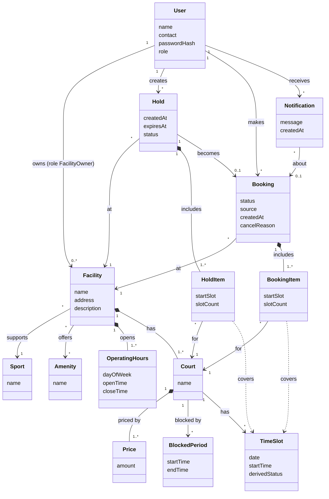

# 4.1 Domain Model (3.3.1)

- **Mã đối tượng truy vết:** `DM-01` (Sơ đồ miền tổng thể), `DM-ENT-01`..`DM-ENT-13` (Các khái niệm miền) và `DM-INV-01`..`DM-INV-06` (Ràng buộc miền)
- **Issue liên quan:** `#17` — 3.3.1 Xây dựng domain model
- **Người chịu trách nhiệm chính:** Nguyễn Minh Trí (`@nmt1206`)
- **Người kiểm tra:** Khôi (`@KhoiVuong2210` — đối chiếu dữ liệu); Vĩ (`@Lysivi2005` — kiểm tra ánh xạ sang lớp).

---

## 1. Sơ đồ Mô hình Miền (`DM-01`)

Mô hình miền (domain model) thể hiện các khái niệm nghiệp vụ của hệ thống đặt sân và quan hệ giữa chúng. Mô hình dùng thuật ngữ trong bảng thuật ngữ của PA2 và không chứa lớp cài đặt. Tên thuộc tính là thuộc tính khái niệm, chưa có kiểu dữ liệu hay khóa.

*Hình 4.1 — Mô hình miền của hệ thống đặt sân thể thao (`DM-01`)*

---

## 2. Đặc tả Thực thể Miền (`DM-ENT`)

| Mã đối tượng | Thực thể | Mô tả | Thuộc tính chính | Truy vết PA2 |
| :--- | :--- | :--- | :--- | :--- |
| **`DM-ENT-01`** | **User** | Một tài khoản có đúng một vai trò `role` là `Player` hoặc `FacilityOwner` . Khách (guest) chưa có tài khoản nên không phải thực thể. | `name`, `contact` (điện thoại hoặc email), `passwordHash`, `role` | FR-01, FR-24, NFR-05 |
| **`DM-ENT-02`** | **Facility** | Một cơ sở thuộc về một chủ sân (`FacilityOwner`), mỗi chủ sân có `0..*` cơ sở. Chuỗi nhiều chi nhánh thì mỗi chi nhánh là một `Facility` độc lập. Hỗ trợ một môn thể thao . | `name`, `address`, `description` | FR-03, FR-04, FR-17, BR-10 |
| **`DM-ENT-03`** | **Court** | Một sân con có tên hoặc số hiệu được định danh riêng trong cơ sở. | `name` | FR-06, FR-17 |
| **`DM-ENT-04`** | **Sport, Amenity** | Môn thể thao cơ sở hỗ trợ (đúng một) và các tiện ích đi kèm (`*`). Dùng cho tìm kiếm và lọc. | `name` | FR-04, FR-05 |
| **`DM-ENT-05`** | **OperatingHours** | Giờ mở cửa và đóng cửa của cơ sở theo ngày trong tuần . | `dayOfWeek`, `openTime`, `closeTime` | FR-18, FR-29, BR-11 |
| **`DM-ENT-06`** | **Price** | Giá của một sân. Cấu trúc giá (một mức hay theo khung giờ) chưa chốt . | `amount` | FR-07, FR-19 |
| **`DM-ENT-07`** | **TimeSlot** | Một khoảng 30 phút của một sân trong một ngày. `derivedStatus` là **giá trị suy ra** (`available`, `held`, `booked`, `unavailable`) từ lịch chung, không phải dữ liệu nhập tay (xem mục 3). | `date`, `startTime`, `derivedStatus` | FR-08, FR-22, BR-13 |
| **`DM-ENT-08`** | **Hold** | Giữ chỗ tạm thời cho một người dùng tại đúng một cơ sở, tối đa 5 phút, không gia hạn. Gồm `1..*` `HoldItem`. Chỉ trở thành `Booking` khi xác nhận thành công. | `createdAt`, `expiresAt`, `status` | FR-10, FR-13, FR-14, FR-25, FR-31, BR-01..07 |
| **`DM-ENT-09`** | **Booking** | Một đặt chỗ đã xác nhận tại một cơ sở. Do người chơi đặt trên ứng dụng hoặc do chủ sân nhập cho khách tại quầy. | `status`, `source`, `createdAt`, `cancelReason` | FR-02, FR-11, FR-12, FR-15, FR-16, FR-21, FR-28, FR-29 |
| **`DM-ENT-10`** | **BookingItem** | Một sân của booking cùng dãy slot 30 phút liên tiếp. Các sân khác nhau có thể có giờ bắt đầu và độ dài khác nhau. | `startSlot`, `slotCount` | FR-09, FR-28, BR-03, BR-09 |
| **`DM-ENT-11`** | **BlockedPeriod** | Khoảng thời gian chủ sân làm cho một sân không khả dụng (tạo trước ít nhất 24 giờ). Không có thao tác gỡ hay sửa trong baseline . | `startTime`, `endTime` | FR-20, FR-29, BR-11, BR-12 |
| **`DM-ENT-12`** | **Notification** | Thông báo trong ứng dụng gửi cho người dùng, ví dụ khi chủ sân hủy booking (nêu rõ lý do, booking và sân/slot bị ảnh hưởng). Không có trạng thái "đã đọc" trong baseline . | `message`, `createdAt` | FR-30, NFR-09, BR-16 |
| **`DM-ENT-13`** | **HoldItem** | Một sân của hold cùng dãy slot 30 phút liên tiếp; khi hold được xác nhận, các item này trở thành `BookingItem` của booking. | `startSlot`, `slotCount` | FR-09, FR-13, BR-03, BR-05 |

---

## 3. Ràng buộc miền (`DM-INV`)

| Mã | Ràng buộc | Truy vết |
| :--- | :--- | :--- |
| **`DM-INV-01`** | Mọi `HoldItem`/`BookingItem` của một `Hold`/`Booking` thuộc `Court` của đúng `Facility` mà `Hold`/`Booking` đó gắn với. | FR-09, BR-03, AC-14 |
| **`DM-INV-02`** | Trong một `Hold`/`Booking`, mỗi `Court` có tối đa một item, và item đó phủ một dải slot 30 phút liên tiếp (giờ bắt đầu và số slot có thể khác nhau giữa các sân). | BR-03, AC-13 |
| **`DM-INV-03`** | Một `TimeSlot` không được đồng thời thuộc hai `Hold` đang hoạt động, một `Hold` và một `Booking` đã xác nhận, hoặc một `BlockedPeriod`. | NFR-02, BR-02, BR-13, FR-22 |
| **`DM-INV-04`** | `Hold.expiresAt = createdAt + 5 phút` và không đổi sau khi tạo (không gia hạn, tải lại trang không đặt lại). | BR-01, BR-07, FR-25, FR-31 |
| **`DM-INV-05`** | `Hold` chỉ được tạo cho người đã đăng nhập, sau khi toàn bộ lựa chọn hợp lệ; một phần không hợp lệ thì không có hold nào. | BR-04, BR-05, FR-13, FR-23 |
| **`DM-INV-06`** | `Booking` chỉ sinh ra từ một `Hold` hợp lệ, ngay ở trạng thái `Confirmed`; không có trạng thái chờ duyệt. | BR-06, FR-11, FR-12 |

`derivedStatus` của `TimeSlot` được tính theo thứ tự ưu tiên: **unavailable** nếu nằm ngoài `OperatingHours`, trong một `BlockedPeriod` hoặc sân đã bị xóa; **booked** nếu thuộc `Booking` ở trạng thái `Confirmed`; **held** nếu thuộc `Hold` chưa kết thúc (chưa nhả); còn lại là **available**. Việc lưu sẵn hay tính khi truy vấn là quyết định của Khôi (3.1.2).

---

## 4. Các quyết định mô hình hóa

- **Lịch chung (Shared Schedule):** Lịch chung không được lưu thành một thực thể riêng. Nó là kết quả tổng hợp của `Booking`, `Hold`, `BlockedPeriod` và `OperatingHours` trên từng sân, nhờ đó một slot không thể vừa được đặt vừa bị khóa từ hai nguồn khác nhau (FR-22, BR-13). Vì vậy `TimeSlot.derivedStatus` là giá trị suy ra, không phải thuộc tính cập nhật tay.
- **Cấu trúc booking và hold:** Một `Booking` (và `Hold`) thuộc đúng một cơ sở. `BookingItem` và `HoldItem` có cùng cấu trúc: mỗi item trỏ tới một sân và phủ một dãy slot 30 phút liên tiếp (quan hệ phụ thuộc `covers`, không lưu danh sách slot). Điều này thể hiện luật một đơn đặt chỉ gồm một cơ sở và không cho phép hủy lẻ từng sân (FR-09, FR-28, BR-03, BR-09).
- **Hold và Booking:** `Hold` chỉ trở thành `Booking` khi xác nhận thành công (FR-11, FR-12), thể hiện bằng quan hệ `Hold → Booking (0..1)`. Vì vậy `Booking` bắt đầu ngay ở trạng thái `Confirmed`, không có trạng thái chờ (`Pending`).
- **Vai trò người dùng:** Dùng một thuộc tính `role` thay vì kế thừa `Player`/`FacilityOwner`, vì PA2 chỉ phân biệt hai vai trò theo quyền, không có thuộc tính riêng cho từng vai trò .

---

## 5. Bảng bao phủ yêu cầu PA2 trong Mục 4.1 (`DM-TRC`)

| Thực thể / Quan hệ (`DM-01`) | Yêu cầu chức năng (FR) | Quy tắc nghiệp vụ (BR) | Tiêu chí chấp nhận (AC) |
| :--- | :--- | :--- | :--- |
| `User` (`role`) | FR-01, FR-02, FR-03, FR-23, FR-24 | BR-10, BR-14 | AC-01 .. AC-08 |
| `Facility`, `Sport`, `Amenity`, `OperatingHours` | FR-03, FR-04, FR-05, FR-17, FR-18, FR-29 | BR-10, BR-11 | AC-07 .. AC-10, AC-34 |
| `Court`, `Price`, `BlockedPeriod`, `TimeSlot` | FR-06, FR-07, FR-08, FR-17, FR-19, FR-20, FR-22, FR-29 | BR-11, BR-12, BR-13 | AC-11, AC-28 .. AC-31, AC-33, AC-34 |
| `Hold`, `HoldItem` | FR-09, FR-10, FR-13, FR-14, FR-25, FR-26, FR-31, FR-32 | BR-01 .. BR-05, BR-07, BR-08 | AC-12 .. AC-25, AC-35, AC-37 .. AC-39 |
| `Booking`, `BookingItem` | FR-11, FR-12, FR-15, FR-16, FR-21, FR-28, FR-29 | BR-03, BR-06, BR-09, BR-13, BR-15 | AC-19, AC-25 .. AC-30, AC-33, AC-36 |
| `Notification` | FR-30 | BR-16 | AC-28, AC-32 |

---

## 6. Thông tin gửi kèm Review (Theo Working Agreement Mục 5.3)

- **Danh sách sản phẩm:** `docs/design/domain/domain-model.md` và ảnh sơ đồ `docs/design/domain/domain-model.png` (Mã đối tượng: `DM-01`, `DM-ENT-01`..`13`, `DM-INV-01`..`06`).
- **Kết quả tự kiểm tra:**
  - [x] Không trộn các lớp kỹ thuật (Controller, Service, DTO, bảng nối vật lý) vào Domain Model.
  - [x] Sơ đồ và phần chữ nhất quán: `Hold` và `Booking` đều gắn với `Facility`, đều có item riêng; `Hold` có quan hệ `becomes` tới `Booking`; vai trò chỉ biểu diễn bằng `role`.
  - [x] `TimeSlot.derivedStatus` là giá trị suy ra, khớp với quyết định lịch chung không lưu thành thực thể.
  - [x] Không còn thuộc tính hay quan hệ ngoài baseline: đã bỏ `isRead`, `BlockedPeriod.reason`, `Price.timeRange`; Facility chỉ một môn.
  - [x] Đã đối chiếu thuật ngữ với bảng thuật ngữ trong bản SRS PA2 đã nộp.
  - [x] Đã xuất lại `domain-model.png` từ nguồn Mermaid mới.
- **Các quyết định thiết kế chính:**
  1. Không tách `SharedSchedule` thành thực thể lưu trữ riêng; tổng hợp qua `TimeSlot` của từng `Court`.
  2. Tách `Booking`/`BookingItem` và `Hold`/`HoldItem` để biểu diễn một đơn nhiều sân với giờ bắt đầu và số slot liên tiếp khác nhau trên từng sân (BR-03), và để giữ cùng cấu trúc khi hold chuyển thành booking.
  3. Một thuộc tính `role` thay cho kế thừa.
- **Điểm còn mở cần người kiểm tra xác nhận:**
  - `@KhoiVuong2210`: đối chiếu cách ánh xạ `HoldItem`/`BookingItem` và `derivedStatus` sang bảng vật lý trong ERD (3.1.2); .
  - `@Lysivi2005`: xác nhận ánh xạ các khái niệm `DM-ENT-01`..`13` sang lớp trong Class Diagram (3.3.2); 
