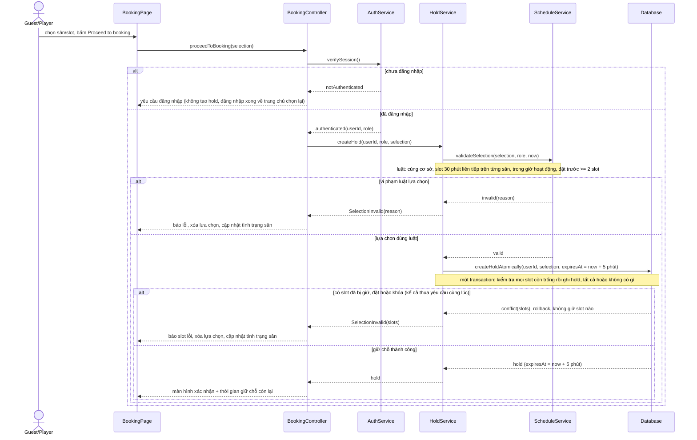
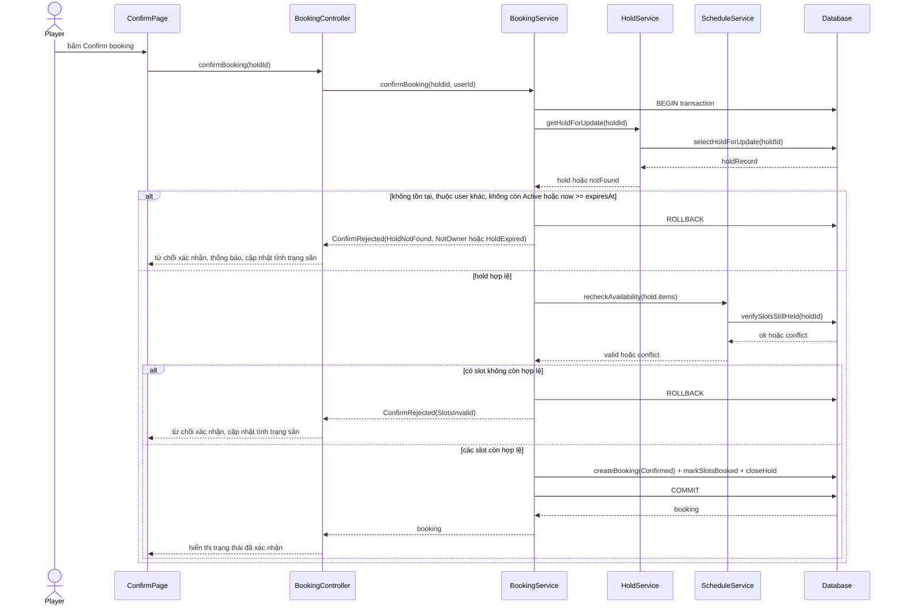
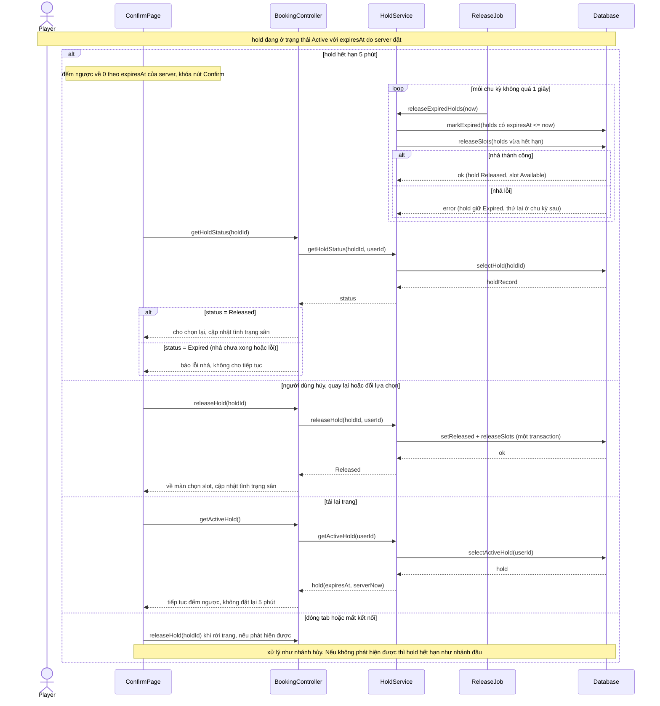
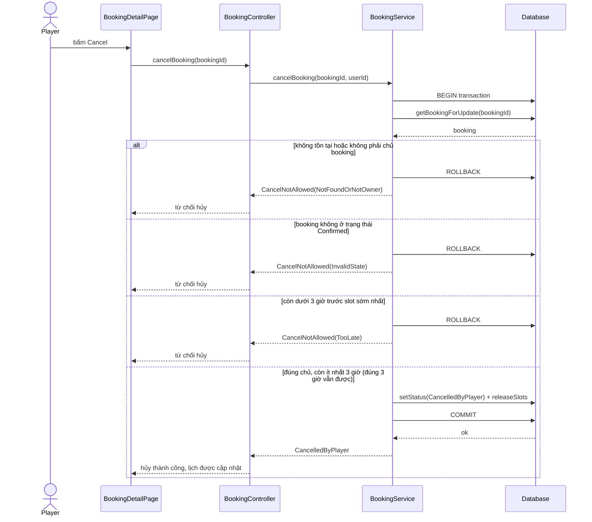
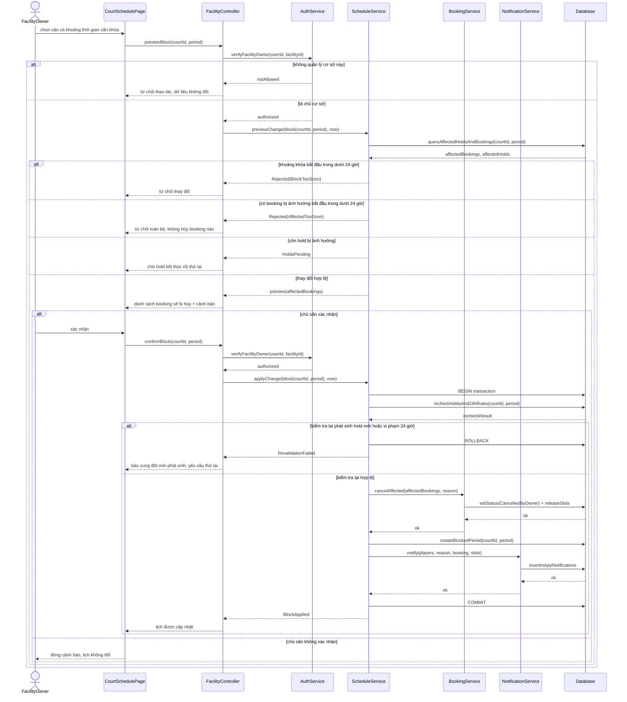
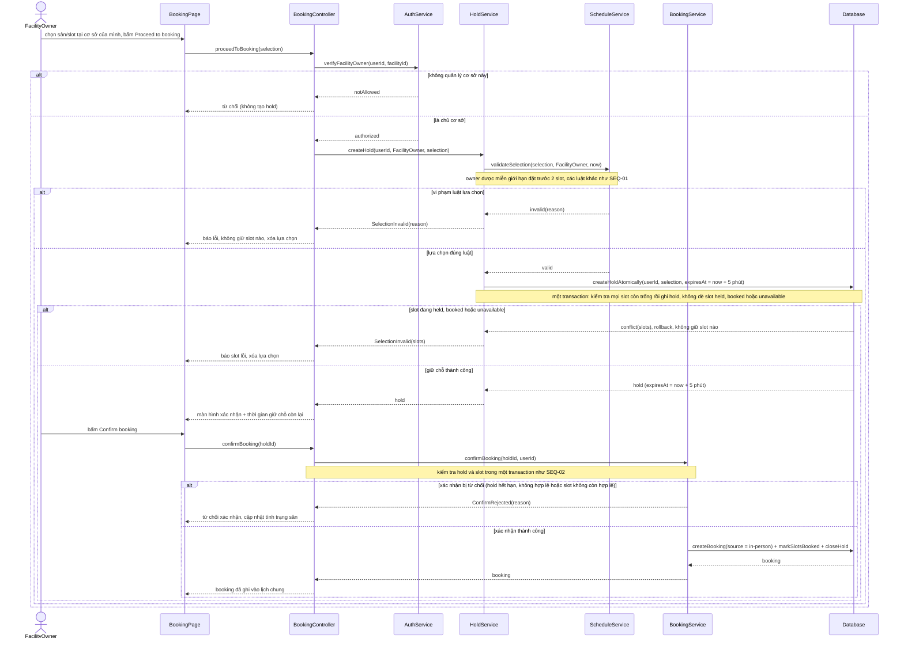

# 4.4 Sequence Diagrams (3.3.3)

* **Mã đối tượng truy vết:** `SEQ-01` (UC-05), `SEQ-02` (UC-06), `SEQ-02B` (hết hạn và nhả hold, UC-06), `SEQ-03` (UC-08), `SEQ-04` (UC-11), `SEQ-04B` (So sánh UC-12), `SEQ-05` (UC-13), `SEQ-OPS` (bảng operation)

* **Issue liên quan:** `#19` — 3.3.3 Thiết kế sequence cho các use case trọng yếu

* **Người chịu trách nhiệm chính:** Nguyễn Minh Trí (`@nmt1206`)

* **Người kiểm tra:** Vĩ (`@Lysivi2005` — kiểm tra thao tác lớp); Khôi (`@KhoiVuong2210` — kiểm tra API/giao dịch/xung đột).

Năm sơ đồ tuần tự (sequence diagram) chính bao quát các use case có rủi ro thiết kế cao nhất: tạo hold (UC-05), xác nhận booking (UC-06), hủy booking (UC-08), khóa slot (UC-11) và nhập booking tại quầy (UC-13). Thêm một sơ đồ phụ `SEQ-02B` cho vòng đời hold (hết hạn, nhả, hủy, tải lại, đóng tab) vì đây là yêu cầu kiến trúc `ASR-G2`. UC-12 dùng chung luồng của UC-11 và được nêu ở phần so sánh `SEQ-04B`. Mỗi sơ đồ thể hiện luồng chính và các luồng thay thế do luật nghiệp vụ đòi hỏi. Mọi đường trả về đi qua đúng tầng `Database -> Service -> Controller -> Page`.

**Quy ước chung:**

* Tên Service/operation là **tạm**, chờ đối chiếu với Class Diagram (3.3.2). Sơ đồ chỉ nêu kết quả nghiệp vụ, không cố định mã HTTP (chờ 3.1.4).
* "Một transaction" là yêu cầu: kiểm tra và ghi nằm trong cùng một thao tác nguyên tử, tất cả hoặc không có gì. Cơ chế chống trùng (ràng buộc dữ liệu, khóa, mức cô lập) do Khôi quyết ở 3.1.2.
* Luật nghiệp vụ (cùng cơ sở, slot liên tiếp, hạn chót đặt, 24 giờ, 3 giờ) nằm ở backend. Đồng hồ là của máy chủ.
* Kiểm tra xác thực (`verifySession`) chỉ vẽ ở `SEQ-01`; các sơ đồ sau coi như đã đăng nhập.

## 1. `SEQ-01` (SD-1): UC-05 Chọn sân và tiến hành giữ chỗ

* **Truy vết:** UC-05, FR-01, FR-09, FR-10, FR-13, FR-23, FR-27, FR-32, BR-02..05, BR-08, BR-14, NFR-02, AC-02, AC-03, AC-12..18, AC-24, AC-37.

Chọn slot chưa tạo hold; chỉ khi bấm `Proceed to booking` hệ thống mới kiểm tra và giữ chỗ. Khách chưa đăng nhập được chuyển đến đăng nhập trước và không tạo hold; sau khi đăng nhập, người dùng quay về trang chủ và chọn lại (FR-23). Với người đã đăng nhập, `ScheduleService` kiểm tra luật lựa chọn (cùng cơ sở, slot liên tiếp trên từng sân, đặt trước ít nhất 2 slot tức 60 phút). Nếu đúng luật, việc **kiểm tra xung đột và ghi hold** diễn ra trong một transaction duy nhất: nếu bất kỳ slot nào đã bị giữ, đặt hoặc khóa (kể cả do yêu cầu khác thắng cùng lúc) thì không giữ slot nào.

*Hình 4.4.1 — Sơ đồ tuần tự cho UC-05 (`SEQ-01`)*

## 2. `SEQ-02` (SD-2): UC-06 Xác nhận booking

* **Truy vết:** UC-06, FR-11, FR-12, FR-14, FR-15, FR-31, BR-01, BR-06, BR-15, NFR-02, NFR-03, AC-19, AC-35, AC-36, AC-38, AC-39.

Người chơi xác nhận khi hold còn hiệu lực. Toàn bộ việc đọc hold, kiểm tra và ghi nằm trong **một transaction**: hold được khóa để đọc, kiểm tra quyền sở hữu, trạng thái `Active` và `now < expiresAt`, rồi kiểm tra lại các slot. Việc từ chối khi hết hạn dựa trên `expiresAt`, **không** chờ tác vụ nhả chạy (xem `SEQ-02B`). Nếu hợp lệ, booking được tạo ở trạng thái `Confirmed`, các slot chuyển sang `Booked` và hold đóng. Nếu xác nhận và nhả hết hạn xảy ra cùng lúc thì chỉ một bên thắng nhờ khóa trên hold.

*Hình 4.4.2 — Sơ đồ tuần tự cho UC-06 (`SEQ-02`)*

## 3. `SEQ-02B`: Vòng đời hold — hết hạn, hủy, tải lại, đóng tab

* **Truy vết:** UC-06, FR-14, FR-25, FR-26, FR-31, BR-01, BR-07, NFR-03, AC-20..23, AC-39; `ASR-G2`.

Sơ đồ này thể hiện bốn tình huống của một hold đang `Active`:

* **Hết hạn 5 phút:** hold chuyển `Expired` (từ chối xác nhận ngay), tác vụ nền nhả slot trong vòng 5 giây rồi hold sang `Released`. Nếu nhả lỗi, hold giữ `Expired`, tác vụ thử lại ở chu kỳ sau và giao diện báo lỗi, không cho tiếp tục như thể đã nhả (FR-14).
* **Người dùng hủy, quay lại hoặc đổi lựa chọn:** hold sang `Released` ngay và slot được nhả.
* **Tải lại trang:** hold giữ nguyên `expiresAt`, giao diện đếm ngược tiếp, không đặt lại 5 phút (FR-25).
* **Đóng tab hoặc mất kết nối:** giao diện cố gắng gửi yêu cầu nhả khi rời trang; nếu không phát hiện được thì hold hết hạn như tình huống đầu (FR-26).

*Hình 4.4.2B — Sơ đồ tuần tự vòng đời hold (`SEQ-02B`)*

## 4. `SEQ-03` (SD-3): UC-08 Hủy booking

* **Truy vết:** UC-08, FR-02, FR-16, FR-28, BR-09, NFR-04, AC-05, AC-26, AC-27.

Người chơi chỉ được hủy toàn bộ booking của mình (không hủy lẻ từng sân), và chỉ khi slot sớm nhất bắt đầu sau ít nhất 3 giờ nữa. Hủy đúng 3 giờ trước vẫn được chấp nhận. Đọc booking, kiểm tra và ghi nằm trong một transaction.

*Hình 4.4.3 — Sơ đồ tuần tự cho UC-08 (`SEQ-03`)*

## 5. `SEQ-04` (SD-4): UC-11 Khóa slot (không khả dụng)

* **Truy vết:** UC-11, FR-03, FR-20, FR-22, FR-29, FR-30, BR-10..13, BR-16, NFR-04, NFR-08, NFR-09, AC-07, AC-28..32.

Quyền sở hữu cơ sở được kiểm tra ở cả bước xem trước lẫn bước xác nhận. Luật 24 giờ và luật chờ hold nằm ở `ScheduleService`: bước xem trước (`previewChange`) từ chối nếu bản thân khoảng khóa hoặc bất kỳ booking bị ảnh hưởng nào bắt đầu trong dưới 24 giờ, và yêu cầu chờ nếu còn hold bị ảnh hưởng. Sau khi chủ sân xác nhận, `applyChange` kiểm tra lại rồi **trong cùng một transaction** hủy toàn bộ booking bị ảnh hưởng, tạo `BlockedPeriod` và ghi thông báo; nếu kiểm tra lại thất bại thì rollback, không đổi gì. Nếu chủ sân không xác nhận thì lịch không đổi (A1).

*Hình 4.4.4 — Sơ đồ tuần tự cho UC-11 (`SEQ-04`)*

## 6. `SEQ-05` (SD-5): UC-13 Nhập booking tại quầy

* **Truy vết:** UC-13, FR-03, FR-10, FR-11, FR-12, FR-21, FR-22, FR-27, BR-03, BR-08, BR-10, BR-13, NFR-02..04, NFR-08, AC-07, AC-25, AC-33.

Chủ sân đặt thay khách tại quầy theo đúng luồng của người chơi: chọn sân và slot, giữ chỗ, rồi xác nhận (UC-05 và UC-06). Khác biệt: hệ thống kiểm tra chủ sân có quản lý cơ sở đó, chủ sân được miễn giới hạn đặt trước 2 slot (FR-27), nhưng vẫn không được đè lên slot đang held hoặc booked (BR-13). Booking được ghi vào lịch chung với nguồn là `in-person` (không lưu thông tin khách). Hold hết hạn, nhả, tải lại và đóng tab xử lý như `SEQ-02B`.

*Hình 4.4.5 — Sơ đồ tuần tự cho UC-13 (`SEQ-05`)*

## 7. `SEQ-04B`: UC-12 so với UC-11

UC-12 (đổi giờ hoạt động hoặc xóa sân) không có sơ đồ riêng vì dùng chung luồng của `SEQ-04`. Phần dùng chung và khác biệt như sau:

| Hạng mục | Nội dung |
| ----- | ----- |
| **Dùng chung** | Kiểm tra quyền chủ sở hữu cơ sở (cả lúc xem trước và lúc xác nhận); xem trước các booking và hold bị ảnh hưởng; chờ hold kết thúc; từ chối toàn bộ nếu một booking bị ảnh hưởng bắt đầu trong dưới 24 giờ (đúng 24 giờ vẫn được); cảnh báo; xác nhận rồi kiểm tra lại; hủy toàn bộ booking bị ảnh hưởng và ghi thay đổi lịch cùng thông báo trong một transaction (BR-11, FR-03, FR-29, FR-30). |
| **Khác biệt** | Tham số `change` của `previewChange`/`applyChange` là thay đổi giờ hoạt động hoặc việc xóa sân, không phải `block(courtId, period)`. Tập bị ảnh hưởng là các booking tương lai có slot nằm ngoài giờ mới (đổi giờ) hoặc mọi booking tương lai của sân (xóa sân). Không áp quy tắc "khoảng khóa phải bắt đầu sau 24 giờ" của BR-12 vì không có khoảng khóa; chỉ áp luật 24 giờ của FR-29 cho booking bị ảnh hưởng. Bước ghi cuối cập nhật giờ hoạt động hoặc xóa sân (cách lưu do 3.1.2 quyết định) thay vì tạo `BlockedPeriod`. Nếu không có booking nào bị ảnh hưởng thì không hủy gì (A1), và chủ sân có thể hủy thao tác trước khi xác nhận (A2). |
| **Operation** | Dùng lại `verifyFacilityOwner`, `previewChange`, `applyChange`, `cancelAffected` và `notify`; chỉ khác hai điểm vào ở `FacilityController` (xem trước/xác nhận thay đổi giờ hoạt động hoặc xóa sân) và thao tác ghi cuối. |

## 8. Các operation dùng trong sơ đồ tuần tự (`SEQ-OPS`)

| Lớp | Operation | Truy vết sơ đồ |
| ----- | ----- | ----- |
| **BookingController** | `proceedToBooking(selection)`; `confirmBooking(holdId)`; `cancelBooking(bookingId)`; `releaseHold(holdId)`; `getActiveHold()`; `getHoldStatus(holdId)` | `SEQ-01`, `SEQ-02`, `SEQ-02B`, `SEQ-03`, `SEQ-05` |
| **FacilityController** | `previewBlock(courtId, period)`; `confirmBlock(courtId, period)` (và hai điểm vào tương ứng cho đổi giờ hoạt động, xóa sân) | `SEQ-04`, `SEQ-04B` |
| **AuthService** | `verifySession()`; `verifyFacilityOwner(userId, facilityId)` | `SEQ-01`, `SEQ-04`, `SEQ-05` |
| **HoldService** | `createHold(userId, role, selection)`; `getHoldForUpdate(holdId)`; `releaseHold(holdId, userId)`; `getActiveHold(userId)`; `getHoldStatus(holdId, userId)`; `releaseExpiredHolds(now)` | `SEQ-01`, `SEQ-02`, `SEQ-02B`, `SEQ-05` |
| **ScheduleService** | `validateSelection(selection, role, now)`; `recheckAvailability(items)`; `previewChange(change, now)`; `applyChange(change, now)` | `SEQ-01`, `SEQ-02`, `SEQ-04`, `SEQ-04B`, `SEQ-05` |
| **BookingService** | `confirmBooking(holdId, userId)`; `cancelBooking(bookingId, userId)`; `cancelAffected(bookings, reason)` | `SEQ-02`, `SEQ-03`, `SEQ-04`, `SEQ-05` |
| **NotificationService** | `notify(players, reason, booking, slots)` | `SEQ-04`, `SEQ-04B` |
| **ReleaseJob** (tác vụ nền) | gọi `releaseExpiredHolds(now)` theo chu kỳ không quá 1 giây | `SEQ-02B` |
| **Database** (hành động ghi nguyên tử) | `createHoldAtomically(userId, selection, expiresAt)` | `SEQ-01`, `SEQ-05` |

## 9. Thông tin gửi kèm Review (Theo Working Agreement Mục 5.3)

* **Danh sách sản phẩm:** `docs/design/sequences/sequence-diagrams.md` và bộ ảnh `sd-1-uc05.png`, `sd-2-uc06.png`, `sd-2b-hold-lifecycle.png`, `sd-3-uc08.png`, `sd-4-uc11.png`, `sd-5-uc13.png` (Mã đối tượng: `SEQ-01`..`SEQ-05`, `SEQ-02B`, `SEQ-04B`, `SEQ-OPS`).

* **Kết quả tự kiểm tra:**

  * \[x\] Đã bao phủ đủ UC-05, UC-06, UC-08, UC-11, UC-13 và bảng so sánh UC-12; có luồng `alt` ở mọi sơ đồ.

  * \[x\] Bước kiểm tra xung đột và ghi hold (`SEQ-01`, `SEQ-05`) và bước kiểm tra, ghi khi xác nhận (`SEQ-02`) nằm trong cùng một transaction; có nhánh thua yêu cầu cùng lúc.

  * \[x\] `SEQ-02B` thể hiện hết hạn, nhả (kể cả nhả lỗi), hủy, tải lại và đóng tab; mọi operation trong `SEQ-OPS` đều được sơ đồ dùng.

  * \[x\] `SEQ-04` có nhánh không phải chủ sân, kiểm tra quyền lại ở bước xác nhận, luật 24 giờ và chờ hold ở `ScheduleService`, hủy booking, tạo `BlockedPeriod` và ghi thông báo trong một transaction, nhánh không xác nhận (A1).

  * \[x\] Mọi thông điệp trả về đi qua đúng thứ tự `Database -> Service -> Controller -> Page`.

  * \[ x\] Đã mở từng khối Mermaid trên preview GitHub (hoặc mermaid.live) và không có lỗi cú pháp.

  * \[ x\] Đã xuất lại toàn bộ ảnh `sd-*.png` từ nguồn Mermaid mới.

* **Các quyết định thiết kế chính:**

  1. `ScheduleService` kiểm tra luật lựa chọn, `HoldService` quản lý vòng đời giữ chỗ 5 phút, `BookingService` xác nhận/hủy đơn đặt; việc ghi hold, xác nhận và áp dụng thay đổi lịch đều nguyên tử.

  2. Mẫu 2 bước (`previewChange` -> `applyChange` kèm kiểm tra lại trong transaction) cho UC-11 và UC-12, với `change` là tham số chung.

  3. Từ chối xác nhận dựa vào `expiresAt` chứ không phụ thuộc tác vụ nhả; tác vụ nền chỉ nhả slot.

* **Điểm còn mở cần người kiểm tra xác nhận:**

  * `@Lysivi2005`: xác nhận bảng `SEQ-OPS` (Mục 8), gồm `ReleaseJob` thuộc thành phần nào, khớp tên lớp và phương thức trong Class Diagram (3.3.2).

  * `@KhoiVuong2210`: xác nhận ranh giới transaction ở `createHoldAtomically`, `confirmBooking`, `cancelBooking`, `applyChange`; cách `applyChange` bảo đảm không có hold mới chen vào giữa lúc áp dụng; chu kỳ nhả không quá 1 giây đạt mốc 5 giây (cần thử nghiệm 2.3.1); các kết quả lỗi nghiệp vụ trong đặc tả API (3.1.4).
