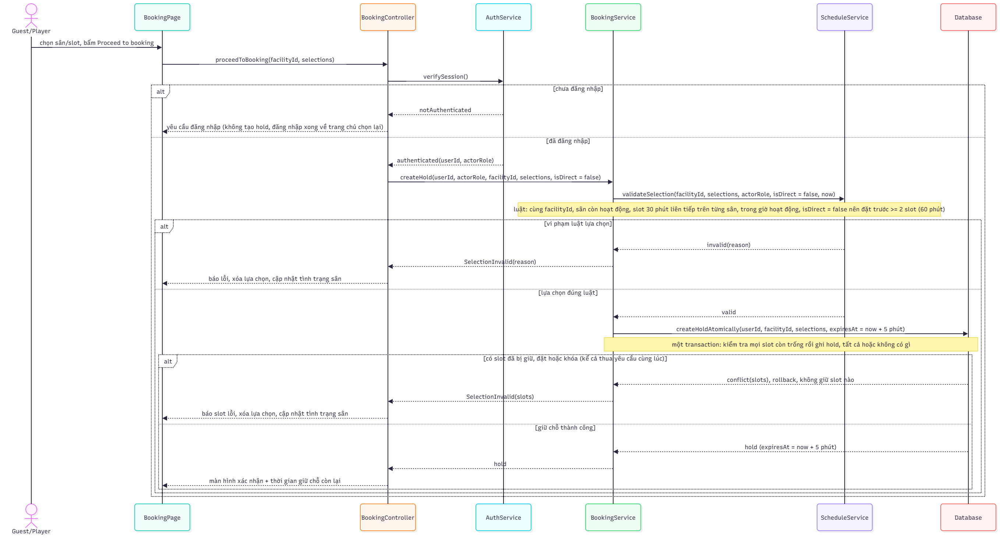
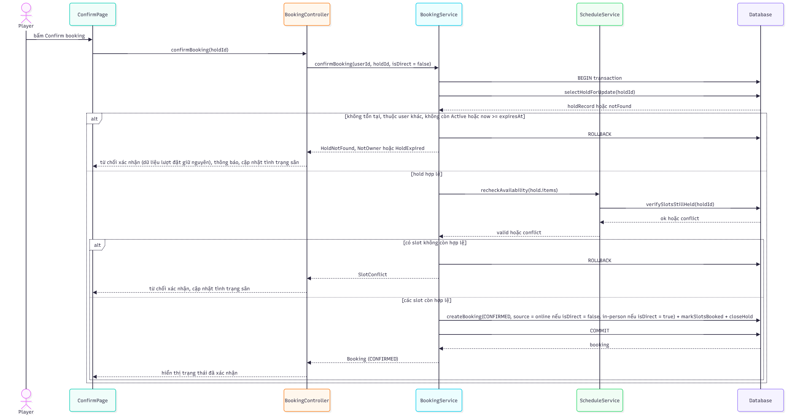
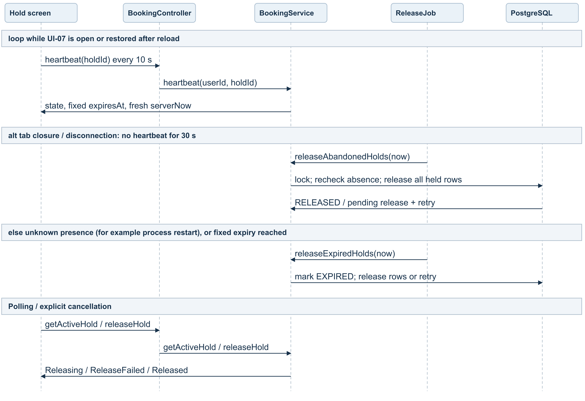
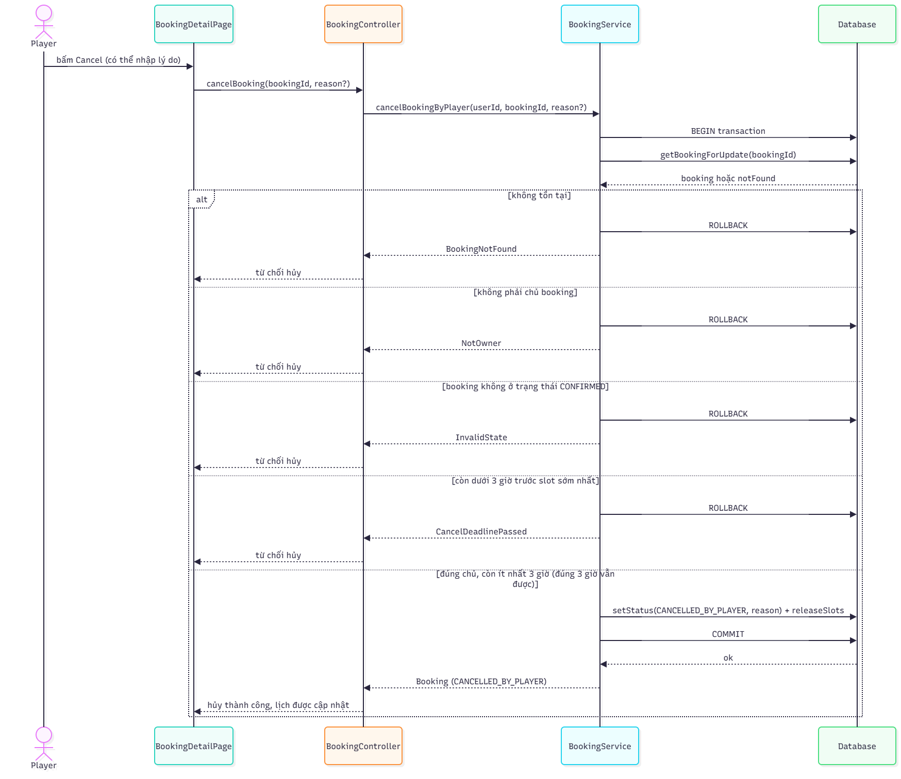
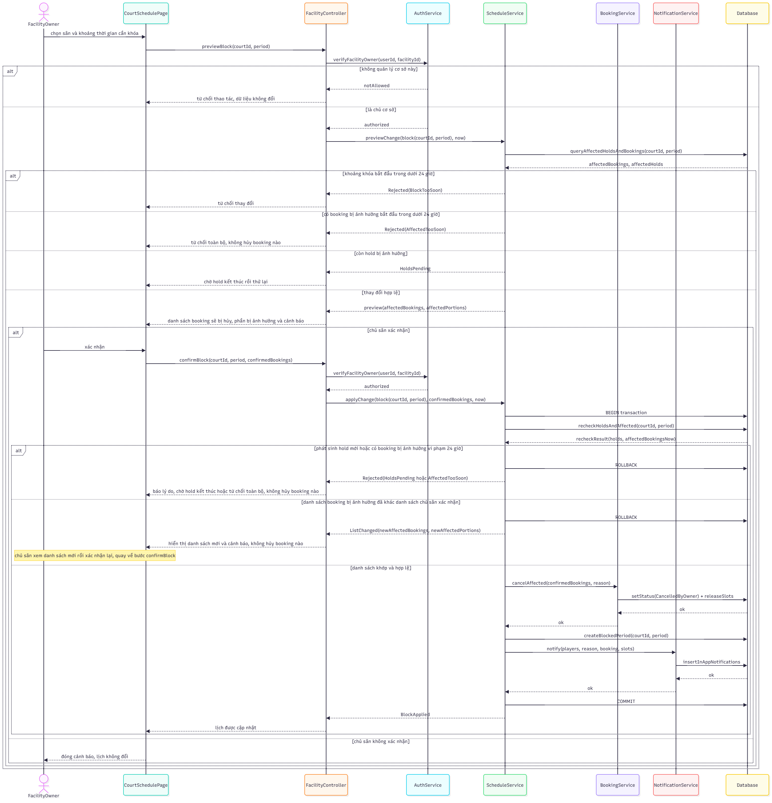
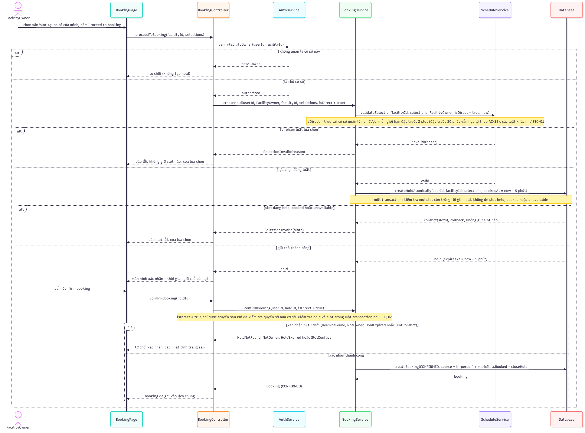

## Sequence Diagrams

Five main sequence diagrams cover UC-05, UC-06, UC-08, UC-11 and UC-13. The hold lifecycle supports UC-06, and the UC-12 variant reuses the owner schedule-change workflow.

### SEQ-01 • Select slots and acquire a hold (UC-05)

Selecting slots alone does not create a hold. Proceed to booking requires sign-in. A guest signs in, returns to Home and selects again. BookingService checks the whole selection for one facility, active courts, consecutive 30-minute slots, operating hours and the player’s 60-minute lead time. If any slot conflicts, the whole selection is rejected.

Traceability: FR-09, FR-10, FR-13, FR-23, FR-27, FR-32 and NFR-02.

Figure 4.4. SEQ-01 • Select slots and acquire a hold (UC-05).

### SEQ-02 • Confirm a booking (UC-06)

BookingService checks hold ownership, availability and server time in one transaction. If now is at or past expiresAt, it rejects immediately and leaves booking data unchanged. Successful confirmation creates a confirmed booking, changes slots to Booked and closes the hold.

Traceability: FR-11, FR-12, FR-14, FR-15 and AC-35.

Figure 4.5. SEQ-02 • Confirm a booking (UC-06).

### SEQ-02B • Release, expiry and reload (UC-06)

Reload restores the same hold and fixed expiry. When time runs out, confirmation is disabled immediately. The UI waits for Releasing, shows ReleaseFailed if release fails and allows a new selection after Released. Manual cancellation follows the release response. Early detection of tab closure or disconnection falls back to expiry when unavailable.

Traceability: FR-14, FR-25, FR-26, FR-31 and NFR-03. The five-second release target remains to be measured.

Figure 4.6. SEQ-02B • Release, expiry and reload (UC-06).

### SEQ-03 • Cancel a booking (UC-08)

The service checks that the caller owns the booking, its stored status is Confirmed and the earliest slot starts at least three hours later. Cancellation releases all slots in one transaction. Exactly three hours is allowed. An optional reason can be passed.

Traceability: FR-16, FR-28, BR-09 and AC-26–27.

Figure 4.7. SEQ-03 • Cancel a booking (UC-08).

### SEQ-04 • Block time on the owner schedule (UC-11)

The owner previews a block starting at least 24 hours ahead. If an affected hold is active, the owner waits and retries. All impacted bookings must begin at least 24 hours ahead. On confirmation the service rechecks the entire affected set and returns the updated list for confirmation if any booking was added or removed. Once checks pass, it cancels the affected bookings in full, updates the schedule and creates in-app notices.

Traceability: FR-20, FR-29, FR-30 and BR-11–13.

Figure 4.8. SEQ-04 • Block time on the owner schedule (UC-11).

### SEQ-05 • Enter an in-person booking (UC-13)

The server verifies that the owner manages the selected facility before using the counter-booking context. The owner first acquires a hold, then confirms. The 60-minute minimum is waived only for this authorised workflow. Occupied or blocked slots are still rejected and the confirmed booking uses the shared schedule.

Traceability: FR-21, FR-22, FR-27, BR-08, BR-13 and AC-25.

Figure 4.9. SEQ-05 • Enter an in-person booking (UC-13).

### SEQ-04B • Change operating hours or delete a court (UC-12)

This variant uses the same preview, warning, owner confirmation and revalidation steps as SEQ-04. The affected set covers future bookings outside proposed operating hours or on the court being deleted. The 24-hour rule applies to the impacted bookings. The schedule change updates operating hours or removes the court from availability. When no bookings are affected, the owner can apply the change with no cancellations.

Traceability: FR-17, FR-18, FR-22, FR-29, FR-30 and BR-11.
