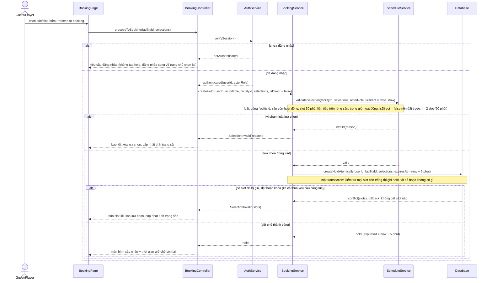
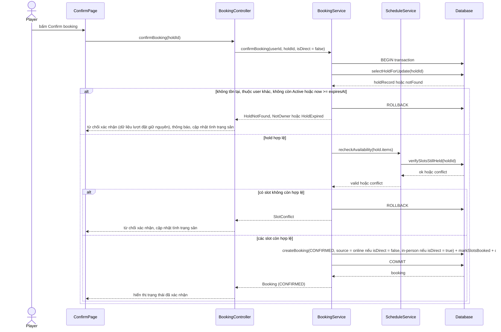
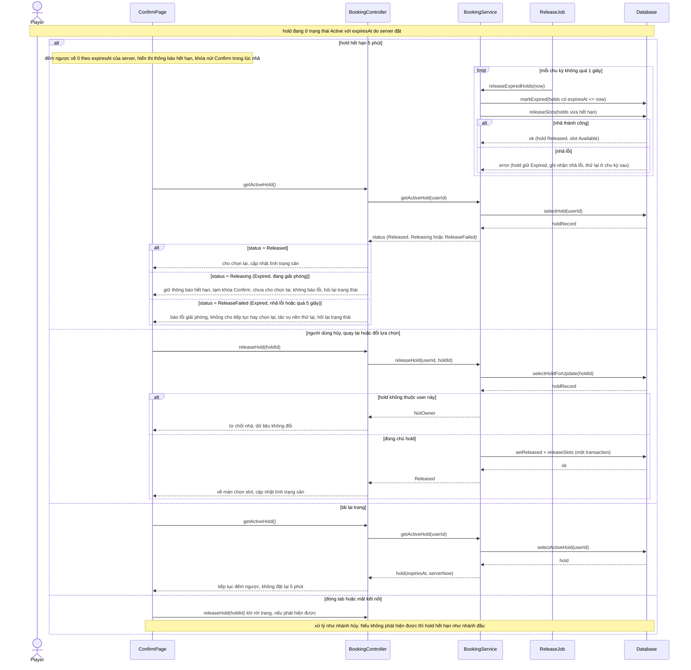
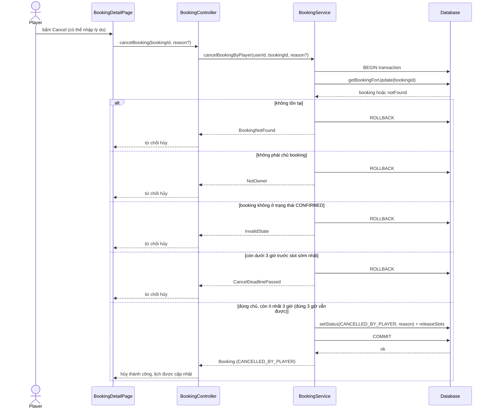
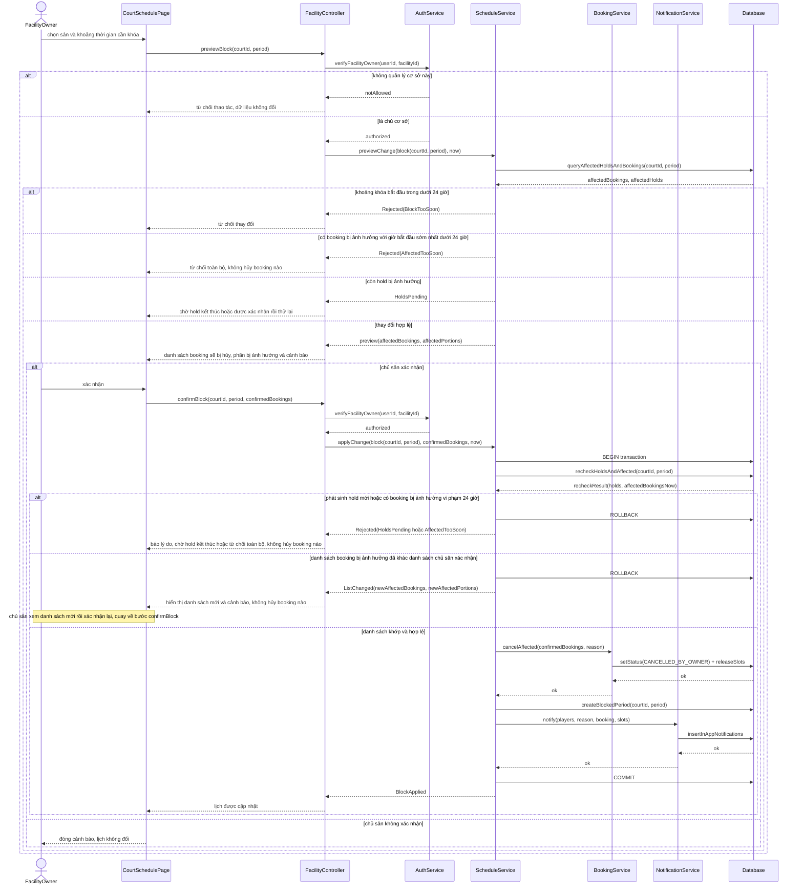
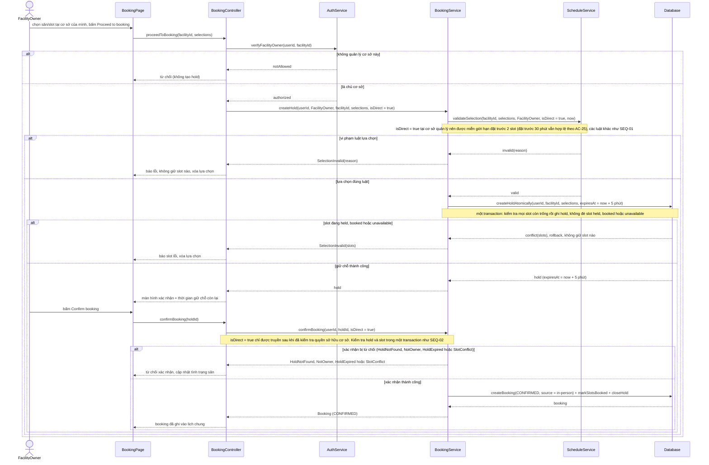

# 4.4 Sequence Diagrams (3.3.3)

* **Mã đối tượng truy vết:** `SEQ-01` (UC-05), `SEQ-02` (UC-06), `SEQ-02B` (hết hạn và nhả hold, UC-06), `SEQ-03` (UC-08), `SEQ-04` (UC-11), `SEQ-04B` (So sánh UC-12), `SEQ-05` (UC-13), `SEQ-OPS` (bảng operation)

* **Issue liên quan:** `#19` — 3.3.3 Thiết kế sequence cho các use case trọng yếu

* **Người chịu trách nhiệm chính:** Nguyễn Minh Trí (`@nmt1206`)

* **Người kiểm tra:** Khoa (`@buikhoa130406` — kiểm tra luồng nghiệp vụ và thử nghiệm kết nối `#7`); Vĩ (`@Lysivi2005` — đối chiếu thao tác lớp `#31`, hợp đồng API `#12` và trạng thái giao diện `#29`).

Năm sơ đồ tuần tự (sequence diagram) chính bao quát các use case có rủi ro thiết kế cao nhất: tạo hold (UC-05), xác nhận booking (UC-06), hủy booking (UC-08), khóa slot (UC-11) và nhập booking tại quầy (UC-13). Thêm một sơ đồ phụ `SEQ-02B` cho vòng đời hold (hết hạn, nhả, hủy, tải lại, đóng tab) vì đây là yêu cầu kiến trúc `ASR-G2`. UC-12 dùng chung luồng của UC-11 và được nêu ở phần so sánh `SEQ-04B`. Mỗi sơ đồ thể hiện luồng chính và các luồng thay thế do luật nghiệp vụ đòi hỏi. Mọi đường trả về đi qua đúng tầng `Database -> Service -> Controller -> Page`.

**Quy ước chung:**

* Tên lớp và chữ ký phương thức của các thao tác giữ chỗ, xác nhận, nhả chỗ và hủy lượt đặt đã được đối chiếu đồng bộ với Class Diagram (3.3.2 — PR `#31`, mục 3.2 `CLS-08`) theo chuẩn **tham số đầu là `userId`** (thống nhất với `createHold(userId, ...)`) và do `BookingService` thực hiện trực tiếp, không qua lớp trung gian `HoldService`. Sơ đồ chỉ nêu kết quả nghiệp vụ, không cố định mã HTTP (đối chiếu với đặc tả API 3.1.4 — `#12`).
* "Một transaction" là yêu cầu: kiểm tra và ghi nằm trong cùng một thao tác nguyên tử, tất cả hoặc không có gì. Cơ chế chống trùng (ràng buộc dữ liệu, khóa, mức cô lập) được thiết kế chi tiết tại 3.1.2 (`#10`).
* Luật nghiệp vụ (cùng cơ sở, slot liên tiếp, hạn chót đặt, 24 giờ, 3 giờ) nằm ở backend. Đồng hồ là của máy chủ.
* Kiểm tra xác thực (`verifySession`) chỉ vẽ ở `SEQ-01`; các sơ đồ sau coi như đã đăng nhập.

## 1. `SEQ-01` (SD-1): UC-05 Chọn sân và tiến hành giữ chỗ

* **Truy vết:** UC-05, FR-01, FR-09, FR-10, FR-13, FR-23, FR-27, FR-32, BR-02..05, BR-08, BR-14, NFR-02, AC-02, AC-03, AC-12..18, AC-24, AC-37.

Chọn slot chưa tạo hold; chỉ khi bấm `Proceed to booking` hệ thống mới kiểm tra và giữ chỗ. Khách chưa đăng nhập được chuyển đến đăng nhập trước và không tạo hold; sau khi đăng nhập, người dùng quay về trang chủ và chọn lại (FR-23). Với người đã đăng nhập, `BookingController` gọi `BookingService.createHold(userId, actorRole, facilityId, selections, isDirect = false)` (đồng bộ với `CLS-08` ở PR `#31`). `ScheduleService` kiểm tra luật lựa chọn (cùng cơ sở `facilityId`, sân còn hoạt động, slot liên tiếp trên từng sân, trong giờ hoạt động, và vì `isDirect = false` nên bắt buộc đặt trước ít nhất 2 slot tức 60 phút). Nếu đúng luật, việc **kiểm tra xung đột và ghi hold** diễn ra trong một transaction duy nhất: nếu bất kỳ slot nào đã bị giữ, đặt hoặc khóa (kể cả do yêu cầu khác thắng cùng lúc) thì không giữ slot nào.

*Hình 4.4.1 — Sơ đồ tuần tự cho UC-05 (`SEQ-01`)*

## 2. `SEQ-02` (SD-2): UC-06 Xác nhận booking

* **Truy vết:** UC-06, FR-11, FR-12, FR-14, FR-15, FR-31, BR-01, BR-06, BR-15, NFR-02, NFR-03, AC-19, AC-35, AC-36, AC-38, AC-39.

Người chơi xác nhận khi hold còn hiệu lực qua `BookingService.confirmBooking(userId, holdId, isDirect)`; `isDirect` mặc định `false` với người chơi. Toàn bộ việc đọc hold, kiểm tra và ghi nằm trong **một transaction**: hold được khóa để đọc, kiểm tra quyền sở hữu, trạng thái `Active` và `now < expiresAt`, rồi kiểm tra lại các slot. Việc từ chối khi hết hạn dựa trên `expiresAt`, **không** chờ tác vụ nhả chạy (xem `SEQ-02B`): người dùng xác nhận sau khi lượt giữ hết hạn (`now >= expiresAt`) phải nhận kết quả từ chối `HoldExpired` và dữ liệu lượt đặt giữ nguyên (FR-11, AC-35). Nếu hợp lệ, booking được tạo ở trạng thái `CONFIRMED`, các slot chuyển sang `Booked` và hold đóng. Nếu xác nhận và nhả hết hạn xảy ra cùng lúc thì chỉ một bên thắng nhờ khóa trên hold.

*Hình 4.4.2 — Sơ đồ tuần tự cho UC-06 (`SEQ-02`)*

## 3. `SEQ-02B`: Vòng đời hold — hết hạn, hủy, tải lại, đóng tab

* **Truy vết:** UC-06, FR-14, FR-25, FR-26, FR-31, BR-01, BR-07, NFR-03, AC-20..23, AC-39; `ASR-G2`.

Sơ đồ này thể hiện bốn tình huống của một hold đang `Active`:

* **Hết hạn 5 phút:** hold chuyển `Expired` (từ chối xác nhận ngay, giao diện hiển thị thông báo hết hạn và khóa nút xác nhận trong lúc nhả), tác vụ nền nhả slot trong vòng 5 giây rồi hold sang `Released`. Trong trạng thái `Expired`, giao diện đọc trực tiếp **ba trạng thái khác nhau** từ phản hồi API `#12` (`releaseHold` / `getActiveHold`) (FR-14, AC-20):
  * `Releasing`: đang giải phóng. Giao diện vẫn hiển thị thông báo hết hạn, tạm khóa nút xác nhận, **chưa** cho chọn lại và **không** báo lỗi; tiếp tục hỏi lại trạng thái.
  * `ReleaseFailed`: giải phóng thất bại (tác vụ nhả báo lỗi, hoặc quá 5 giây sau `expiresAt` mà hold vẫn chưa `Released`). Chỉ khi đó giao diện mới báo lỗi giải phóng và không cho tiếp tục như thể đã nhả; tác vụ nền thử lại ở chu kỳ sau.
  * `Released`: giải phóng thành công. Chỉ lúc này giao diện mới cho chọn lại và cập nhật tình trạng sân.
* **Người dùng hủy, quay lại hoặc đổi lựa chọn:** hold sang `Released` ngay và slot được nhả.
* **Tải lại trang:** hold giữ nguyên `expiresAt`, giao diện đếm ngược tiếp, không đặt lại 5 phút (FR-25).
* **Đóng tab hoặc mất kết nối:** giao diện cố gắng gửi yêu cầu nhả khi rời trang; nếu không phát hiện được thì hold hết hạn như tình huống đầu (FR-26).

*Hình 4.4.2B — Sơ đồ tuần tự vòng đời hold (`SEQ-02B`)*

## 4. `SEQ-03` (SD-3): UC-08 Hủy booking

* **Truy vết:** UC-08, FR-02, FR-16, FR-28, BR-09, NFR-04, AC-05, AC-26, AC-27.

Người chơi chỉ được hủy toàn bộ booking của mình (không hủy lẻ từng sân), và chỉ khi slot sớm nhất bắt đầu sau ít nhất 3 giờ nữa. Hủy đúng 3 giờ trước vẫn được chấp nhận. Đọc booking, kiểm tra và ghi nằm trong một transaction.

*Hình 4.4.3 — Sơ đồ tuần tự cho UC-08 (`SEQ-03`)*

## 5. `SEQ-04` (SD-4): UC-11 Khóa slot (không khả dụng)

* **Truy vết:** UC-11, FR-03, FR-20, FR-22, FR-29, FR-30, BR-10..13, BR-16, NFR-04, NFR-08, NFR-09, AC-07, AC-28..32.

Quyền sở hữu cơ sở được kiểm tra ở cả bước xem trước lẫn bước xác nhận. Luật 24 giờ và luật chờ hold nằm ở `ScheduleService`: bước xem trước (`previewChange`) trả về danh sách booking bị hủy cùng phần bị ảnh hưởng của từng booking (UC-11 bước 3), từ chối nếu bản thân khoảng khóa hoặc bất kỳ booking bị ảnh hưởng nào bắt đầu trong dưới 24 giờ, và yêu cầu chờ nếu còn hold bị ảnh hưởng. Khi chủ sân xác nhận, yêu cầu mang theo **danh sách booking chủ sân đã thấy và xác nhận** (`confirmedBookings`). `applyChange` mở một transaction, kiểm tra lại hold, luật 24 giờ và **tính lại danh sách booking bị ảnh hưởng**. Nếu có hold mới hoặc booking mới vi phạm 24 giờ thì rollback và từ chối. Nếu danh sách tính lại khác danh sách đã xác nhận (ví dụ có thêm một booking mới đủ điều kiện 24 giờ) thì rollback, **không hủy booking nào** và trả danh sách mới để chủ sân xem và xác nhận lại. Chỉ khi danh sách khớp mới hủy đúng danh sách đã xác nhận và đã kiểm tra lại, tạo `BlockedPeriod` và ghi thông báo, **trong cùng một transaction**. Nếu chủ sân không xác nhận thì lịch không đổi (A1).

*Hình 4.4.4 — Sơ đồ tuần tự cho UC-11 (`SEQ-04`)*

## 6. `SEQ-05` (SD-5): UC-13 Nhập booking tại quầy

* **Truy vết:** UC-13, FR-03, FR-10, FR-11, FR-12, FR-21, FR-22, FR-27, BR-03, BR-08, BR-10, BR-13, NFR-02..04, NFR-08, AC-07, AC-25, AC-33.

Chủ sân đặt thay khách tại quầy theo đúng luồng của người chơi: chọn sân và slot, giữ chỗ, rồi xác nhận (UC-05 và UC-06). Khác biệt: hệ thống kiểm tra chủ sân có quản lý cơ sở đó (`verifyFacilityOwner(userId, facilityId)`), sau đó `BookingController` gọi `BookingService.createHold(userId, FacilityOwner, facilityId, selections, isDirect = true)` (đồng bộ với `CLS-08` ở PR `#31`). Chỉ khi `actorRole = FacilityOwner` đã qua kiểm tra quyền sở hữu `facilityId` và `isDirect = true`, chủ sân mới được miễn giới hạn đặt trước 2 slot (60 phút) để đặt được khung giờ bắt đầu sau 30 phút (FR-27, AC-25), nhưng vẫn không được đè lên slot đang held, booked hoặc unavailable (BR-13). Khi xác nhận, `BookingService.confirmBooking(userId, holdId, isDirect = true)` được gọi với `isDirect = true` sau khi đã kiểm tra quyền sở hữu cơ sở. Booking được ghi vào lịch chung với nguồn là `in-person` (không lưu thông tin khách, `ASM-09`). Hold hết hạn, nhả, tải lại và đóng tab xử lý như `SEQ-02B`.

*Hình 4.4.5 — Sơ đồ tuần tự cho UC-13 (`SEQ-05`)*

## 7. `SEQ-04B`: UC-12 so với UC-11

UC-12 (đổi giờ hoạt động hoặc xóa sân) không có sơ đồ riêng vì dùng chung luồng của `SEQ-04`. Phần dùng chung và khác biệt như sau:

| Hạng mục | Nội dung |
| ----- | ----- |
| **Dùng chung** | Kiểm tra quyền chủ sở hữu cơ sở (cả lúc xem trước và lúc xác nhận); xem trước các booking và hold bị ảnh hưởng; chờ hold kết thúc; từ chối toàn bộ nếu một booking bị ảnh hưởng bắt đầu trong dưới 24 giờ (đúng 24 giờ vẫn được); cảnh báo; xác nhận rồi kiểm tra lại (kể cả so danh sách bị ảnh hưởng với danh sách chủ sân đã xác nhận, khác thì trả danh sách mới để xác nhận lại); hủy toàn bộ booking bị ảnh hưởng và ghi thay đổi lịch cùng thông báo trong một transaction (BR-11, FR-03, FR-29, FR-30). |
| **Khác biệt** | Tham số `change` của `previewChange`/`applyChange` là thay đổi giờ hoạt động hoặc việc xóa sân, không phải `block(courtId, period)`. Tập bị ảnh hưởng là các booking tương lai có slot nằm ngoài giờ mới (đổi giờ) hoặc mọi booking tương lai của sân (xóa sân). Không áp quy tắc "khoảng khóa phải bắt đầu sau 24 giờ" của BR-12 vì không có khoảng khóa; chỉ áp luật 24 giờ của FR-29 cho booking bị ảnh hưởng. Bước ghi cuối cập nhật giờ hoạt động hoặc xóa sân (cách lưu xóa mềm tại 3.1.2 `#10`, `ASM-08`) thay vì tạo `BlockedPeriod`. Màn hình xem trước nêu cả phần bị ảnh hưởng của từng booking (UC-12 bước 3). Nếu không có booking nào bị ảnh hưởng thì không hủy gì (A1), và chủ sân có thể hủy thao tác trước khi xác nhận (A2). |
| **Operation** | Dùng lại `verifyFacilityOwner`, `previewChange`, `applyChange`, `cancelAffected` và `notify`; chỉ khác hai điểm vào ở `FacilityController` (xem trước/xác nhận thay đổi giờ hoạt động hoặc xóa sân) và thao tác ghi cuối. |

## 8. Các operation dùng trong sơ đồ tuần tự (`SEQ-OPS`)

### 8.1 Bảng thống nhất 4 thao tác trọng tâm (Đồng bộ với Mục 3.2 `CLS-08` của PR `#31`)

Chuẩn chung: **tham số đầu là `userId`** (thống nhất với `createHold(userId, ...)`) và `BookingService` thực hiện trực tiếp (không cần lớp trung gian `HoldService`; nếu `SEQ` giữ tên `HoldService` thì ánh xạ 1-1 sang `BookingService`).

| Thao tác | Lớp & Chữ ký chốt | Nguồn / Ghi chú | Kết quả thành công | Kết quả thất bại |
| ----- | ----- | ----- | ----- | ----- |
| **Giữ chỗ** | `BookingService.createHold(userId, actorRole, facilityId, selections, isDirect)` | Gọi `ScheduleService.validateSelection` rồi ghi nguyên tử. `isDirect` mặc định `false` với người chơi; chủ sân đã qua `verifyFacilityOwner(userId, facilityId)` gọi với `actorRole = FacilityOwner, isDirect = true` thì đặt tại quầy được khi khung giờ bắt đầu sau 30 phút (AC-25). | `Hold` (`status = Active`, `expiresAt = now + 5 phút`) | `SelectionInvalid(reason)` hoặc `SelectionInvalid(slots)` (rollback toàn bộ, không giữ slot nào) |
| **Xác nhận lượt đặt** | `BookingService.confirmBooking(userId, holdId, isDirect)` | `isDirect` mặc định `false` với người chơi; với đặt tại quầy được truyền `true` từ tầng đặt tại quầy sau khi đã kiểm tra quyền sở hữu (hoặc đối chiếu khớp với `SlotHold`). Phối hợp `ScheduleService.recheckAvailability`. | `Booking` (`CONFIRMED`) | `HoldNotFound`, `NotOwner`, `HoldExpired`, `SlotConflict` (rollback, dữ liệu giữ nguyên, không tạo booking) |
| **Nhả chỗ** | `BookingService.releaseHold(userId, holdId)` | UI (`UI-07`) đọc 3 trạng thái `Releasing`, `ReleaseFailed`, `Released` trực tiếp từ phản hồi API `#12` (`releaseHold` / `getActiveHold`). Tác vụ nền `ReleaseJob` gọi `BookingService.releaseExpiredHolds(now)`. | `Released` (hold sang `Released`, slot về `Available`) | `Releasing` (đang xử lý, chờ), `ReleaseFailed` (báo lỗi, giữ màn hình), `NotOwner` |
| **Người chơi hủy lượt đặt** | `BookingService.cancelBookingByPlayer(userId, bookingId, reason?)` | `reason` là tham số **tùy chọn** (`reason?: String`), có thể bỏ trống. Hủy toàn bộ đơn, đúng mốc $\ge 3$ giờ (FR-28, AC-26, AC-27). Chủ sân hủy do khóa slot đi qua `cancelAffected(confirmedBookings, reason)` ($\ge 24$ giờ, FR-29, AC-28, AC-29). | `Booking` (`CANCELLED_BY_PLAYER`) | `BookingNotFound`, `NotOwner`, `CancelDeadlinePassed` ($< 3$ giờ), `InvalidState` (booking không ở `CONFIRMED`) |

### 8.2 Danh sách đầy đủ các operation theo lớp

| Lớp | Operation | Truy vết sơ đồ |
| ----- | ----- | ----- |
| **BookingController** | `proceedToBooking(facilityId, selections)`; `confirmBooking(holdId)`; `cancelBooking(bookingId, reason?)`; `releaseHold(holdId)`; `getActiveHold()` | `SEQ-01`, `SEQ-02`, `SEQ-02B`, `SEQ-03`, `SEQ-05` |
| **FacilityController** | `previewBlock(courtId, period)`; `confirmBlock(courtId, period, confirmedBookings)` (và hai điểm vào tương ứng cho đổi giờ hoạt động, xóa sân) | `SEQ-04`, `SEQ-04B` |
| **AuthService** | `verifySession()`; `verifyFacilityOwner(userId, facilityId)` | `SEQ-01`, `SEQ-04`, `SEQ-05` |
| **BookingService** | `createHold(userId, actorRole, facilityId, selections, isDirect)`; `confirmBooking(userId, holdId, isDirect)`; `releaseHold(userId, holdId)`; `getActiveHold(userId)` (trả `Released`, `Releasing` hoặc `ReleaseFailed`); `releaseExpiredHolds(now)`; `cancelBookingByPlayer(userId, bookingId, reason?)`; `cancelAffected(confirmedBookings, reason)` | `SEQ-01`, `SEQ-02`, `SEQ-02B`, `SEQ-03`, `SEQ-04`, `SEQ-05` |
| **ScheduleService** | `validateSelection(facilityId, selections, actorRole, isDirect, now)`; `recheckAvailability(items)`; `previewChange(change, now)`; `applyChange(change, confirmedBookings, now)` | `SEQ-01`, `SEQ-02`, `SEQ-04`, `SEQ-04B`, `SEQ-05` |
| **NotificationService** | `notify(players, reason, booking, slots)` | `SEQ-04`, `SEQ-04B` |
| **ReleaseJob** (tác vụ nền) | gọi `releaseExpiredHolds(now)` theo chu kỳ không quá 1 giây | `SEQ-02B` |
| **Database** (hành động ghi nguyên tử) | `createHoldAtomically(userId, facilityId, selections, expiresAt)` | `SEQ-01`, `SEQ-05` |

## 9. Thông tin gửi kèm Review (Theo Working Agreement Mục 5.3)

* **Danh sách sản phẩm:** `docs/design/sequences/sequence-diagrams.md` và bộ ảnh `sd-1-uc05.png`, `sd-2-uc06.png`, `sd-2b-hold-lifecycle.png`, `sd-3-uc08.png`, `sd-4-uc11.png`, `sd-5-uc13.png` (Mã đối tượng: `SEQ-01`..`SEQ-05`, `SEQ-02B`, `SEQ-04B`, `SEQ-OPS`).

* **Kết quả tự kiểm tra:**

  * \[x\] Đã bao phủ đủ UC-05, UC-06, UC-08, UC-11, UC-13 và bảng so sánh UC-12; có luồng `alt` ở mọi sơ đồ.

  * \[x\] Bước kiểm tra xung đột và ghi hold (`SEQ-01`, `SEQ-05`) và bước kiểm tra, ghi khi xác nhận (`SEQ-02`) nằm trong cùng một transaction; có nhánh thua yêu cầu cùng lúc và nhánh từ chối xác nhận khi hết hạn giữ nguyên dữ liệu lượt đặt (FR-11, AC-35).

  * \[x\] `SEQ-02B` thể hiện hết hạn, nhả (kể cả nhả lỗi), hủy, tải lại và đóng tab; mọi operation trong `SEQ-OPS` đều được sơ đồ dùng.

  * \[x\] `SEQ-04` có nhánh không phải chủ sân, kiểm tra quyền lại ở bước xác nhận, luật 24 giờ và chờ hold ở `ScheduleService`, hủy booking, tạo `BlockedPeriod` và ghi thông báo trong một transaction, nhánh không xác nhận (A1).

  * \[x\] Mọi thông điệp trả về đi qua đúng thứ tự `Database -> Service -> Controller -> Page`.

  * \[x\] Đã mở từng khối Mermaid trên preview GitHub (hoặc mermaid.live) và không có lỗi cú pháp.

* **Các quyết định thiết kế chính:**

  1. Đồng bộ điểm vào tạo hold tại `BookingService.createHold(userId, actorRole, facilityId, selections, isDirect)` (khớp `CLS-08` ở PR `#31`), phối hợp `ScheduleService` kiểm tra luật lựa chọn; `BookingService` thực hiện trực tiếp cả vòng đời giữ chỗ 5 phút / giải phóng (không còn lớp trung gian `HoldService`), mọi thao tác theo chuẩn tham số đầu là `userId`; việc ghi hold, xác nhận và áp dụng thay đổi lịch đều nguyên tử (đối chiếu với `#10`).

  2. Mẫu 2 bước (`previewChange` -> `applyChange` kèm kiểm tra lại trong transaction) cho UC-11 và UC-12, với `change` là tham số chung. Chỉ hủy đúng danh sách đã được chủ sân xác nhận và kiểm tra lại; danh sách đổi thì trả danh sách mới để xác nhận lại.

  3. Từ chối xác nhận dựa vào `expiresAt` chứ không phụ thuộc tác vụ nhả; tác vụ nền chỉ nhả slot.

* **Điểm còn mở và liên kết đối chiếu :**

  * `@Lysivi2005` (phụ trách Class Diagram `#31`, API `#12`, UI `#29`):
    * Đã thống nhất chữ ký `BookingService.createHold(userId, actorRole, facilityId, selections, isDirect)`, `confirmBooking(userId, holdId, isDirect)`, `releaseHold(userId, holdId)`, `cancelBookingByPlayer(userId, bookingId, reason?)` và bảng 4 thao tác tại Mục 8.1 với Mục 3.2 (`CLS-08`) của PR `#31`.
    * Đối chiếu cách trả ba kết quả giải phóng giữ chỗ (`Releasing`, `ReleaseFailed`, `Released`) qua `releaseHold` / `getActiveHold` trong đặc tả giao tiếp API `#12` (Task 3.1.4) và cách UI ở PR `#29` (Task 3.2.1) xử lý từng kết quả (giao diện chỉ cho chọn lại sau khi nhận `Released`).
  * Thiết kế dữ liệu `#10` (Task 3.1.2 — `@nmt1206` phụ trách): đã đối chiếu ranh giới giao dịch ở `createHoldAtomically`, `confirmBooking`, `cancelBooking`, `applyChange` tại mục `DB-TXN-01`..`05`.
  * `@buikhoa130406` (phụ trách thử kết nối `#7` — Task 2.3.1): kiểm chứng chu kỳ nhả không quá 1 giây; mốc giải phóng 5 giây cần bằng chứng đo riêng.