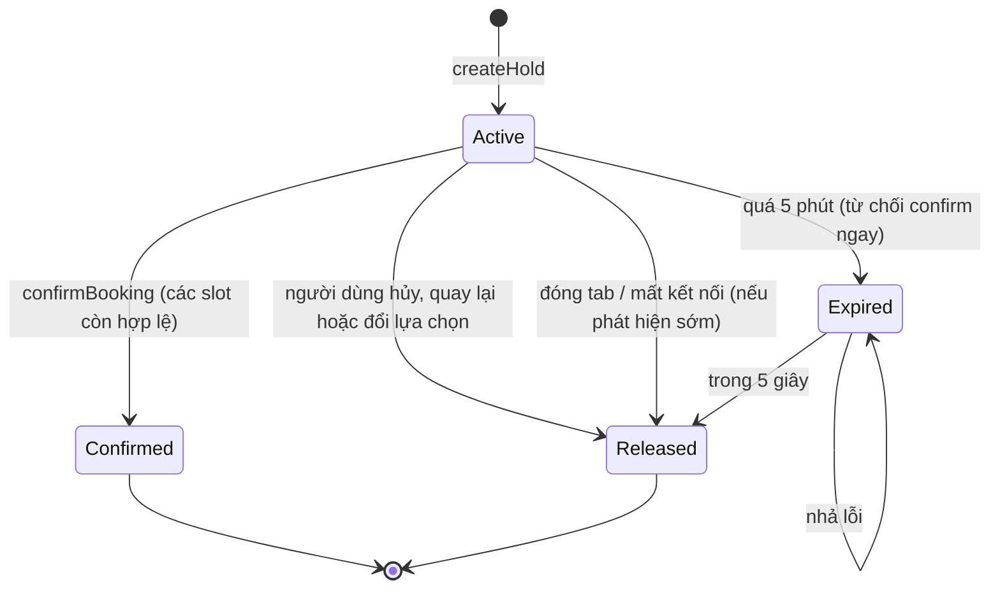
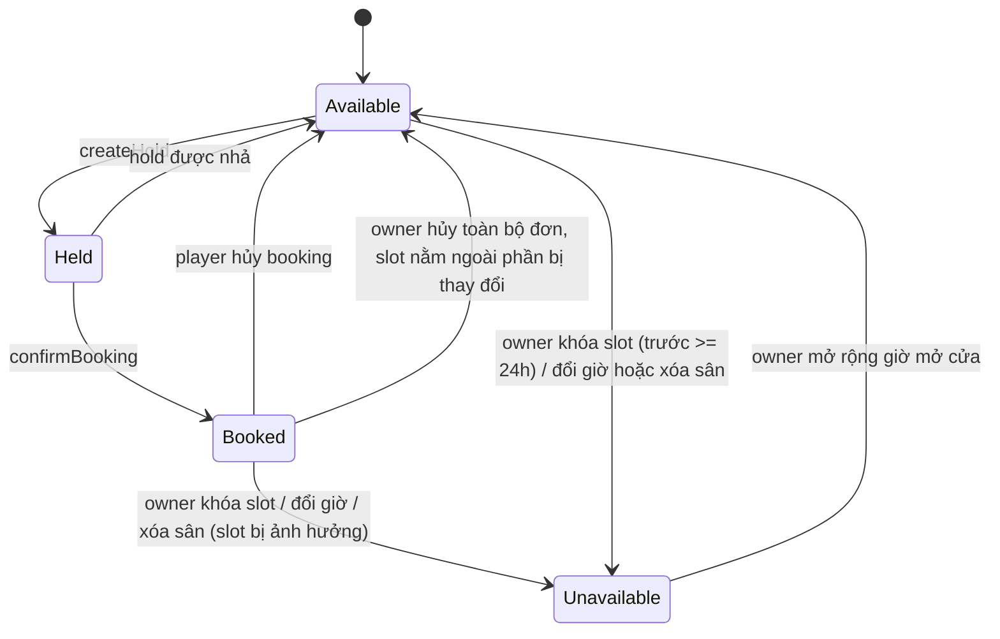
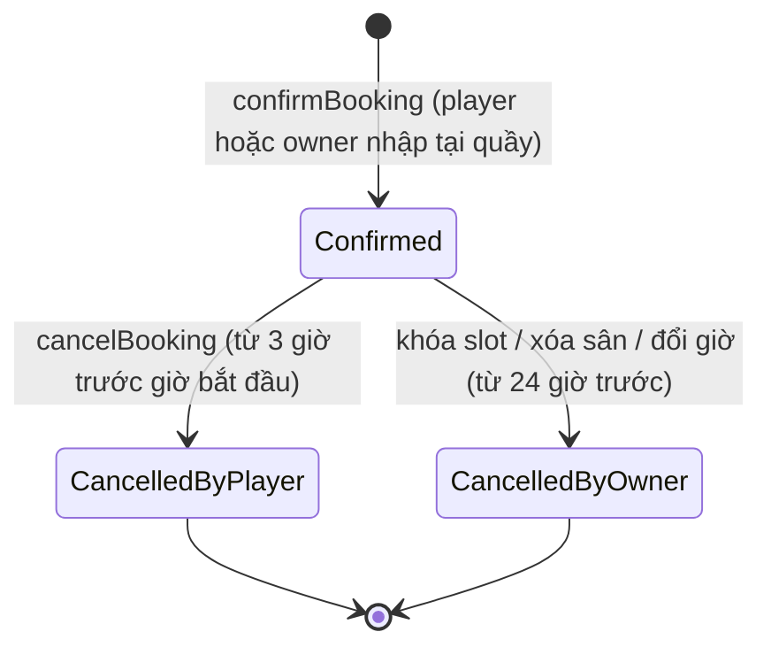

# 4.5 State Machine Diagrams (3.3.4)

- **Mã đối tượng truy vết:** `STM-01` (Vòng đời `Hold`), `STM-02` (Vòng đời `TimeSlot`), `STM-03` (Vòng đời `Booking`)
- **Issue liên quan:** `#20` — 3.3.4 Thiết kế vòng đời và chuyển trạng thái
- **Người chịu trách nhiệm chính:** Nguyễn Minh Trí (`@nmt1206`)
- **Người kiểm tra:** Khôi (`@KhoiVuong2210` — kiểm tra tác động dữ liệu); Vĩ (`@Lysivi2005` — kiểm tra lớp/UI).

---

Ba đối tượng có hành vi phụ thuộc vào trạng thái: `Hold`, `TimeSlot` và `Booking`. Mỗi đối tượng được thể hiện bằng sơ đồ trạng thái kèm bảng chuyển trạng thái và luật kích hoạt. Các chuyển trạng thái khớp với sơ đồ tuần tự: `STM-01` với `SEQ-01`, `SEQ-02`, `SEQ-02B`; `STM-03` với `SEQ-02`, `SEQ-03`, `SEQ-04`.

Các đối tượng khác không có state machine: `User` (baseline không có kích hoạt hay khóa tài khoản), `Notification` (không có trạng thái đã đọc, ), `BlockedPeriod` (không có thao tác gỡ hay sửa, ).

---

## 1. `STM-01`: Hold

- **Truy vết:** FR-09, FR-10, FR-11, FR-13, FR-14, FR-23, FR-25, FR-26, FR-27, FR-31, NFR-02, NFR-03, BR-01..08, AC-12, AC-15..25, AC-35..39.

Bốn trạng thái: `Active` (đang giữ), `Confirmed` (đã thành booking), `Released` (đã nhả slot), `Expired` (đã quá 5 phút nhưng slot **chưa** nhả xong). Khi ở `Expired`, mọi yêu cầu xác nhận bị từ chối và slot vẫn tính là `Held` cho tới khi hold sang `Released`.

*Hình 4.5.1 — Sơ đồ trạng thái của Hold (`STM-01`)*

| Từ | Sự kiện | Điều kiện | Đến | Truy vết |
| :--- | :--- | :--- | :--- | :--- |
| `(bắt đầu)` | `createHold` | Người dùng đã đăng nhập; toàn bộ lựa chọn hợp lệ (cùng cơ sở, slot liên tiếp, đạt hạn chót đặt trước 2 slot hoặc là chủ sân đặt tại quầy); kiểm tra xung đột và ghi hold thành công trong một transaction | `Active` | FR-09, FR-10, FR-13, FR-21, FR-27 |
| `(bắt đầu)` | `createHold` | Có slot xung đột, không hợp lệ hoặc thua yêu cầu cùng lúc | Không tạo hold, không giữ slot nào | FR-13, FR-32, AC-17, AC-18, AC-37 |
| `Active` | `reloadPage` | Chưa hết hạn (`now < expiresAt`) — giữ nguyên thời gian còn lại, không gia hạn 5 phút | `Active` | FR-25, FR-31, AC-22 |
| `Active` | `confirmBooking` | `now < expiresAt`, đúng chủ sở hữu hold và các slot còn hợp lệ | `Confirmed` | FR-11, FR-12, AC-19, AC-36 |
| `Active` | Người dùng hủy, quay lại hoặc đổi lựa chọn | Đúng chủ sở hữu hold | `Released` | FR-14, AC-21 |
| `Active` | Đóng tab hoặc mất kết nối | Hệ thống phát hiện sớm; nếu không thì chờ hết hạn 5 phút (FR-26) | `Released` | FR-26, AC-23 |
| `Active` | Quá 5 phút | `now >= expiresAt`; mọi yêu cầu xác nhận bị từ chối ngay, khóa nút xác nhận | `Expired` | FR-14, NFR-03, AC-20, AC-35, AC-39 |
| `Expired` | Tác vụ nhả chạy | Hoàn tất giải phóng slot trong 5 giây kể từ khi hết hạn | `Released` | FR-14, NFR-03, AC-20 |
| `Expired` | Nhả thất bại | Báo lỗi cho người dùng và không cho tiếp tục như thể đã nhả (FR-14); tác vụ nhả thử lại ở chu kỳ sau | `Expired` | FR-14, AC-20 |

**Chuyển trạng thái không hợp lệ** (bị từ chối, dữ liệu không đổi): `confirmBooking` khi hold đang `Expired`, `Released` hoặc `Confirmed` (AC-35, AC-39); `confirmBooking` hold của người khác (AC-36); gia hạn hold ở bất kỳ trạng thái nào (FR-31); đưa hold từ `Released` hoặc `Expired` quay lại `Active`.

**Ghi chú:** `Active` mà `now >= expiresAt` (tác vụ nền chưa kịp chuyển sang `Expired`) vẫn **không** được xác nhận; điều kiện xác nhận dựa trên `expiresAt`, không dựa trên việc tác vụ nền đã chạy. Nếu xác nhận và hết hạn xảy ra cùng lúc, chỉ một bên thắng (yêu cầu với dữ liệu, xem `STM-OPEN`).

---

## 2. `STM-02`: TimeSlot

- **Truy vết:** FR-08, FR-10, FR-12, FR-14, FR-18, FR-20, FR-21, FR-22, FR-28, FR-29, BR-11..13, NFR-08, AC-11, AC-15..21, AC-26..33.

Trạng thái của `TimeSlot` là giá trị **suy ra** từ lịch chung (xem `DM-INV` ở domain model), không phải dữ liệu cập nhật tay. Sơ đồ mô tả các chuyển trạng thái mà người dùng nhìn thấy (FR-08).

*Hình 4.5.2 — Sơ đồ trạng thái của TimeSlot (`STM-02`)*

| Từ | Sự kiện | Điều kiện | Đến | Truy vết |
| :--- | :--- | :--- | :--- | :--- |
| `Available` | `createHold` | Lựa chọn hợp lệ và thắng yêu cầu cùng lúc | `Held` | FR-10, AC-15, AC-16 |
| `Held` | `confirmBooking` | Hold còn hợp lệ và đúng chủ sở hữu | `Booked` | FR-11, FR-12, AC-19 |
| `Held` | Hold chuyển sang `Released` (người dùng hủy, đóng tab, hoặc nhả sau khi hết hạn) | Slot chỉ về `Available` khi việc nhả hoàn tất; hold `Expired` mà chưa nhả xong thì slot vẫn `Held` (tối đa 5 giây) | `Available` | FR-14, NFR-03, AC-20, AC-21 |
| `Booked` | Người chơi hủy booking | Còn ít nhất 3 giờ trước giờ bắt đầu sớm nhất (FR-28) | `Available` | FR-28, BR-09, AC-26 |
| `Booked` | Chủ sân khóa slot, đổi giờ mở cửa hoặc xóa sân làm hủy toàn bộ booking, với slot **nằm ngoài** phần bị thay đổi | Không còn hold bị ảnh hưởng và mọi booking bị ảnh hưởng bắt đầu sau ít nhất 24 giờ (FR-29, BR-11) | `Available` | FR-29, BR-11, AC-28 |
| `Booked` | Chủ sân khóa slot, đổi giờ mở cửa hoặc xóa sân, với slot **bị ảnh hưởng** | Như trên | `Unavailable` | FR-29, BR-11, AC-28 |
| `Available` | Chủ sân khóa slot (`BlockedPeriod`) | Khoảng khóa bắt đầu sau ít nhất 24 giờ (FR-20, BR-12) và không vướng hold đang hoạt động | `Unavailable` | FR-20, FR-29, BR-12, AC-30, AC-31 |
| `Available` | Chủ sân đổi giờ hoạt động hoặc xóa sân | Không vướng hold đang hoạt động và không có booking nào bị ảnh hưởng bắt đầu trong dưới 24 giờ (FR-18, FR-29, BR-11) | `Unavailable` | FR-17, FR-18, FR-29, BR-11, AC-29, AC-30 |
| `Unavailable` | Chủ sân mở rộng giờ mở cửa | Slot nằm trong giờ hoạt động mới và sân còn hoạt động | `Available` | FR-18, FR-22 |

**Quy tắc kèm theo:**

- Không có chuyển `Held → Unavailable`: chủ sân phải chờ hold kết thúc rồi thử lại (FR-29, AC-30).
- Baseline không có thao tác gỡ khóa `BlockedPeriod` , nên slot bị khóa chỉ khả dụng lại khi giờ hoạt động được mở rộng.
- Slot `Held`, `Booked`, `Unavailable` không chọn được.

---

## 3. `STM-03`: Booking

- **Truy vết:** FR-11, FR-12, FR-15, FR-16, FR-21, FR-28, FR-29, FR-30, BR-06, BR-09, BR-11, AC-19, AC-25..29, AC-32, AC-33.

*Hình 4.5.3 — Sơ đồ trạng thái của Booking (`STM-03`)*

| Từ | Sự kiện | Điều kiện | Đến | Truy vết |
| :--- | :--- | :--- | :--- | :--- |
| `(bắt đầu)` | `confirmBooking` (người chơi, hoặc chủ sân nhập booking tại quầy theo cùng luồng hold, FR-21) | Hold còn hiệu lực, đúng chủ sở hữu và các slot còn hợp lệ | `Confirmed` | FR-11, FR-12, FR-21, BR-06 |
| `Confirmed` | `cancelBooking` | Đúng chủ sở hữu booking và còn ít nhất 3 giờ trước giờ bắt đầu của slot sớm nhất (đúng 3 giờ vẫn được); hủy toàn bộ, không hủy lẻ từng sân | `CancelledByPlayer` | FR-28, BR-09, AC-26, AC-27 |
| `Confirmed` | Chủ sân khóa slot, xóa sân hoặc đổi giờ | Không vướng hold đang hoạt động và mọi booking bị ảnh hưởng có giờ bắt đầu sớm nhất từ 24 giờ trở lên (đúng 24 giờ vẫn được); kèm thông báo trong ứng dụng | `CancelledByOwner` | FR-29, FR-30, BR-11, AC-28, AC-29 |

**Chuyển trạng thái không hợp lệ:** hủy khi còn dưới 3 giờ (AC-26); hủy lẻ từng sân (AC-27); hủy booking đã bị hủy; đưa booking từ `CancelledByPlayer`/`CancelledByOwner` về `Confirmed` (muốn đổi thì hủy rồi đặt mới); chủ sân thay đổi lịch khi có booking bị ảnh hưởng bắt đầu trong dưới 24 giờ (AC-29, từ chối toàn bộ).

**Ghi chú thiết kế về trạng thái Booking:**
- `Booking` bắt đầu ngay ở trạng thái `Confirmed` vì PA2 quy định xác nhận tự động sau lần kiểm tra tình trạng sân cuối cùng, không có bước thanh toán trực tuyến hay chờ chủ sân duyệt (FR-12, BR-06, BR-15).
- Cơ sở dữ liệu chỉ lưu 3 trạng thái: `Confirmed`, `CancelledByPlayer` và `CancelledByOwner`. Việc phân biệt một booking `Confirmed` là "Sắp diễn ra" hay "Đã hoàn thành" (Completed) trên giao diện được **suy ra từ thời gian** (so sánh thời điểm hiện tại với giờ kết thúc của slot muộn nhất thuộc các sân trong booking: `now >= latestEndTime`), nhờ đó không cần tác vụ nền chỉ để đổi trạng thái sau khi ca chơi kết thúc.

---

## 4. Yêu cầu đối với dữ liệu và lớp (`STM-OPEN`)

Đây là **đề nghị**, người sở hữu task quyết định.

| Cho | Nội dung | Căn cứ |
| :--- | :--- | :--- |
| `@KhoiVuong2210` (3.1.2) | `Hold.status` có 4 giá trị (`Active`, `Confirmed`, `Released`, `Expired`) cùng `expiresAt`; truy vấn tìm hold hết hạn cần nhanh (index theo trạng thái và `expiresAt`) | `STM-01`, ASR-G2 |
| `@KhoiVuong2210` | `Booking.status` có 3 giá trị; không xóa vật lý booking đã hủy để giữ lịch sử (FR-16) | `STM-03` |
| `@KhoiVuong2210` | Chuyển trạng thái phải nguyên tử: xác nhận và nhả hết hạn không thể cùng thắng; hủy booking, ghi thay đổi lịch và tạo thông báo trong một transaction | `STM-01`, `STM-03`, `SEQ-04` |
| `@Lysivi2005` (3.3.2, 3.2.1) | `Hold`, `Booking` có thao tác chuyển trạng thái kiểm tra điều kiện; trạng thái `TimeSlot` là kết quả truy vấn; UI phân biệt `Active` (đếm ngược, Confirm bật), `Expired` (Confirm tắt, đang nhả, báo lỗi nếu nhả thất bại) và `Released` (cho chọn lại) | `STM-01`, `STM-02` |

---

## 5. Giá trị biên để PA4 kiểm thử

| Mốc | Trường hợp | Kết quả mong đợi |
| :--- | :--- | :--- |
| Hạn chót đặt (2 slot) | Slot 18:00, Proceed lúc 17:00 | Nhận, hold `Active` |
| | Slot 18:00, Proceed lúc 17:01 | Từ chối, không có hold (người chơi) |
| Hold 5 phút | Confirm trước `expiresAt` | Booking `Confirmed` |
| | Confirm tại hoặc sau `expiresAt` | Từ chối, kể cả khi hold chưa chuyển `Expired` |
| Nhả hết hạn | Sau `expiresAt` | Hold về `Released`, slot `Available` trong tối đa 5 giây |
| Hủy 3 giờ | Booking 18:00, hủy lúc 15:00 | Nhận, `CancelledByPlayer` |
| | Booking 18:00, hủy lúc 15:01 | Từ chối, trạng thái không đổi |
| Owner 24 giờ | Booking bị ảnh hưởng bắt đầu đúng 24 giờ nữa | Cho phép sau khi chủ sân xác nhận, `CancelledByOwner` |
| | Một booking bị ảnh hưởng bắt đầu dưới 24 giờ | Từ chối toàn bộ, không hủy booking nào |

---

## 6. Thông tin gửi kèm Review (Theo Working Agreement Mục 5.3)

- **Danh sách sản phẩm:** `docs/design/states/state-machines.md` và bộ ảnh `stm-1-hold.png`, `stm-2-timeslot.png`, `stm-3-booking.png` (Mã đối tượng: `STM-01`, `STM-02`, `STM-03`, `STM-OPEN`).
- **Kết quả tự kiểm tra:**
  - [x] Mỗi mũi tên trong 3 sơ đồ có một dòng trong bảng chuyển trạng thái, kèm truy vết PA2.
  - [x] Đã tách rõ điều kiện 24 giờ của `TimeSlot` (`Available -> Unavailable`): chỉ áp BR-12 (khoảng khóa trước 24h) cho `BlockedPeriod`, còn đổi giờ mở cửa/xóa sân chỉ xét FR-29 (booking bị ảnh hưởng bắt đầu >= 24h).
  - [x] Đã tách rõ `Booked -> Available` (người chơi hủy; chủ sân hủy đơn với slot ngoài phần bị thay đổi) và `Booked -> Unavailable` (slot bị ảnh hưởng).
  - [x] Đã bỏ chuyển "gỡ khóa" (không có trong baseline); `Unavailable -> Available` chỉ qua mở rộng giờ hoạt động.
  - [x] Tập giá trị `Hold.status` nhất quán giữa sơ đồ và phần review (4 giá trị).
  - [x] Khớp với sơ đồ tuần tự: `STM-01` với `SEQ-01`, `SEQ-02`, `SEQ-02B`; `STM-03` với `SEQ-02`, `SEQ-03`, `SEQ-04`.
  - [x] Đã mở khối Mermaid trên preview GitHub và không có lỗi cú pháp; đã xuất lại ảnh `stm-*.png`.
- **Các quyết định thiết kế chính:**
  1. Lưu `Booking.status` gồm `Confirmed`, `CancelledByPlayer`, `CancelledByOwner`; `Hold.status` gồm `Active`, `Confirmed`, `Released`, `Expired`.
  2. Trạng thái "Đã hoàn thành" của Booking suy ra từ thời gian (`status == Confirmed && now >= latestEndTime`).
  3. Hold `Expired` là trạng thái "hết hạn nhưng chưa nhả xong": từ chối xác nhận ngay, slot vẫn `Held` cho tới khi `Released`.
- **Điểm còn mở cần người kiểm tra xác nhận:**
  - `@KhoiVuong2210`: xác nhận tập giá trị cột `status` của bảng `Hold` và `Booking` trong schema PostgreSQL (3.1.2) và các yêu cầu ở `STM-OPEN`.
  - `@Lysivi2005`: xác nhận hiển thị nhãn trạng thái trên SC-06 (theo trạng thái hold) và danh sách booking SC-07 (theo điều kiện suy dẫn thời gian) (3.2.1).
