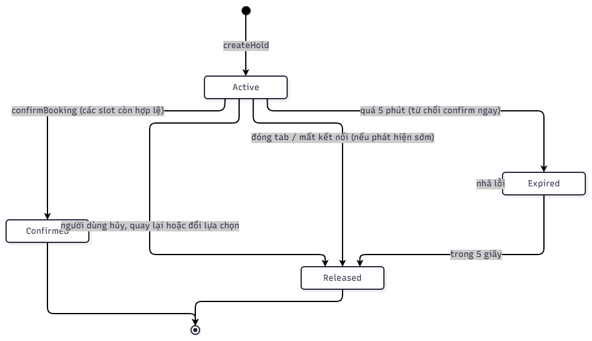
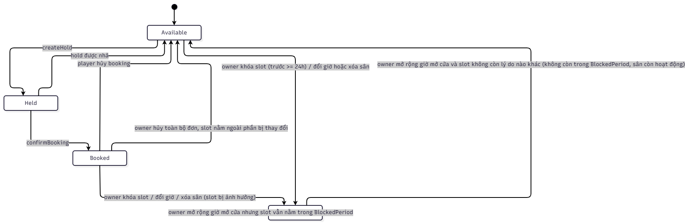
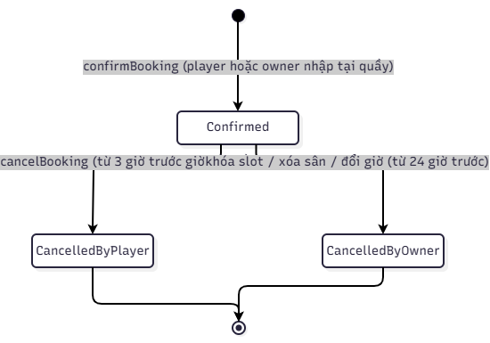

## State Machine Diagrams

The state models describe a hold, a slot and a booking. A hold is Active until it is confirmed, released or expires. At expiry, confirmation is refused immediately. The interface distinguishes releasing, release failed and released. Slot availability changes only when the underlying schedule changes.

### Hold lifecycle

Figure 4.10. STM-01 • Hold lifecycle.

### Time-slot lifecycle

A slot can be available, held, booked or unavailable. When operating hours are extended, a slot becomes available only if the court remains active and the slot is outside all blocked periods. A slot that is still blocked remains unavailable.

Figure 4.11. STM-02 • Time-slot lifecycle.

### Booking lifecycle

A valid booking starts as Confirmed. Player cancellation and owner cancellation are distinct terminal states. The design proposal derives the Completed display label for a confirmed booking from the end time of its latest slot. The label changes when the current time reaches that end time.

Figure 4.12. STM-03 • Booking lifecycle.
