# User Interface and User Experience Design

## Screen List and Screen Flow

CourtConnect has public browsing and authentication screens, player booking screens, and owner management screens. The screen IDs below come from the PA3 UI specification and are distinct from the PA2 SC identifiers in Section 7.

| ID | Screen | Description | Use case | Reference |
| --- | --- | --- | --- | --- |
| UI-01 | Home | Search entry point for guests and players. | UC-03 | Mockup |
| UI-02 | Search and filters | Filter facilities by sport, location and amenities. | UC-03 | Mockup |
| UI-03 | Sign in | Authenticate when proceeding as a guest. | UC-02 | Mockup |
| UI-04 | Registration | Create an account and return to sign in. | UC-01 | Mockup |
| UI-05 | Facility details | View facilities, individual courts and pricing. | UC-04 | Mockup |
| UI-06 | Court and slot selection | View and select consecutive 30-minute slots. | UC-04, UC-05 | Mockup |
| UI-07 | Hold and confirmation | Review selections and remaining hold time. | UC-05, UC-06 | Mockup |
| UI-08 | Booking confirmed | Display the confirmed booking result. | UC-06 | Mockup |
| UI-09 | My bookings | List a player's bookings and their current state. | UC-07 | Mockup |
| UI-10 | Booking detail and cancellation | View detail and request full cancellation. | UC-07, UC-08 | Mockup |
| UI-11 | In-app notifications | View booking notices inside the application. | UC-07 | Mockup |
| UI-12 | Owner dashboard | Navigate to facility and schedule tools. | F05 | Mockup |
| UI-13 | Facilities, courts and pricing | Manage owned facilities, courts and prices. | UC-09, UC-10 | Mockup |
| UI-14 | Court schedule | Review availability and proposed schedule changes. | UC-11, UC-12 | Mockup |
| UI-15 | In-person booking | Enter a booking at the counter on the shared schedule. | UC-13 | Mockup |

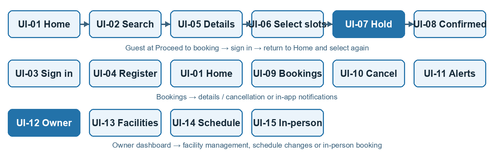

Figure 6.1. UI-FLOW-01 • Main navigation.

## Screen Specifications

Figures are PA2 reference mockups. The control specifications define PA3 behavior; payment wording in the mockups is outside the requirements baseline.

### UI-02 Search and filters

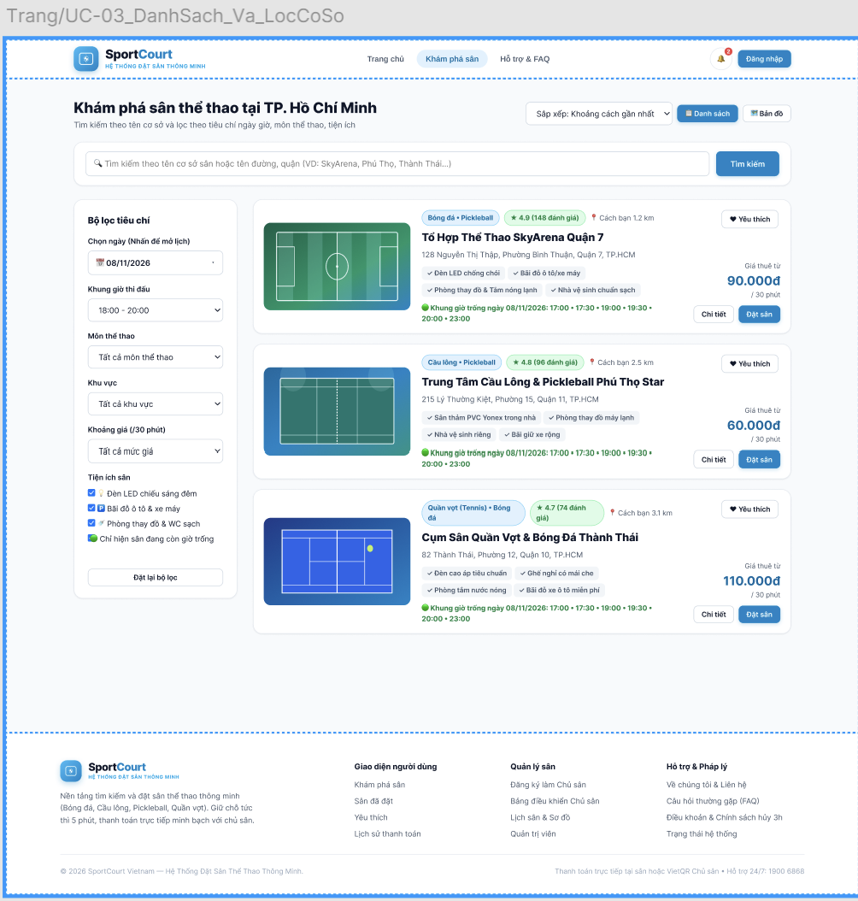

Figure 6.2. UI-02 • PA2 reference mockup.

| # | Control | Type | Description / validation | Event handling |
| --- | --- | --- | --- | --- |
| 1 | Search | Text input | Search by sport and location without signing in. | Submit |
| 2 | Sport, location, amenities | Filters | Refresh the matching facilities. Allow the user to clear filters when there are no results. | Change |
| 3 | Date | Date picker | Choose the date for checking availability. | Select |

### UI-06 Court and slot selection

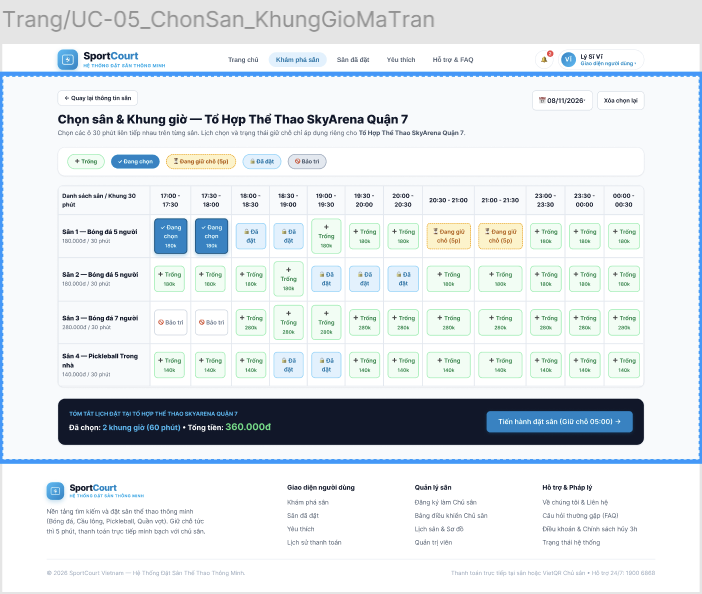

Figure 6.3. UI-06 • PA2 reference mockup.

| # | Control | Type | Description / validation | Event handling |
| --- | --- | --- | --- | --- |
| 1 | Date | Date picker | Load the 30-minute schedule for the chosen date. | Change |
| 2 | Court and slot grid | Buttons | Distinguish available, held, booked and unavailable. Accept consecutive slots per court. Selecting alone creates no hold. | Select |
| 3 | Proceed to booking | Primary button | Guests sign in and select again from Home. The server revalidates the whole selection and holds zero slots on conflict, identifying the affected slot. | Submit |

### UI-07 Temporary hold and confirmation

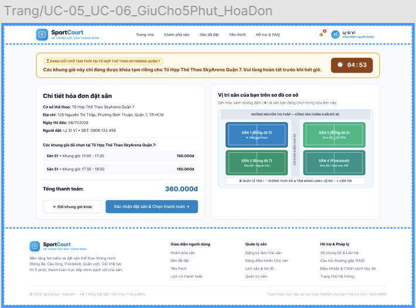

Figure 6.4. UI-07 • PA2 reference mockup.

| # | Control | Type | Description / validation | Event handling |
| --- | --- | --- | --- | --- |
| 1 | Countdown | Status | Compute remaining time from expiresAt and serverNow. Reload restores the same hold. | Load / tick |
| 2 | Confirm booking | Primary button | Confirm after revalidation. At expiry, show the expiry notice and disable confirmation immediately. | Submit |
| 3 | Cancel or choose again | Secondary button | Show progress while releasing. Report failure if release fails. Return to selection after release succeeds. | Submit |

### UI-10 Booking detail and cancellation

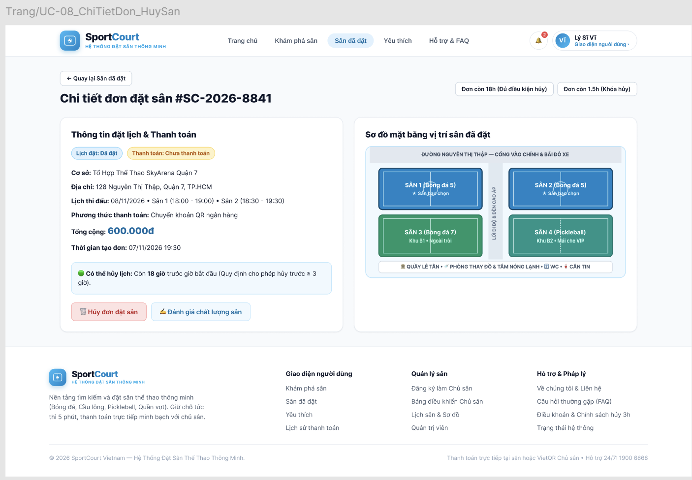

Figure 6.5. UI-10 • PA2 reference mockup.

| # | Control | Type | Description / validation | Event handling |
| --- | --- | --- | --- | --- |
| 1 | Booking details | Read-only view | Show the facility, courts, times and booking status. | Load |
| 2 | Cancel booking | Button | Cancel the entire booking. Exactly three hours before its earliest slot is allowed. Show rejection under three hours. | Submit |

### UI-14 Owner court schedule

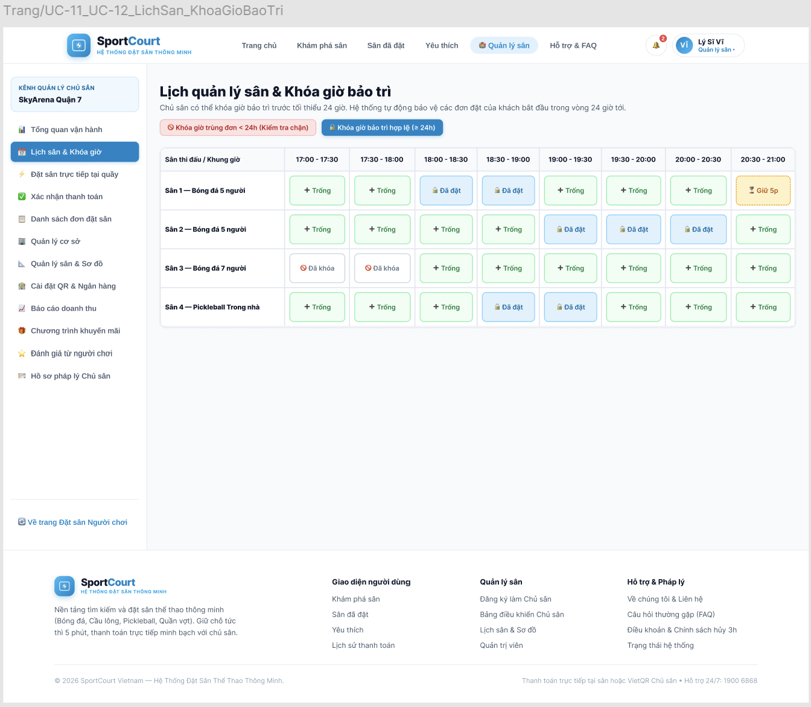

Figure 6.6. UI-14 • PA2 reference mockup.

| # | Control | Type | Description / validation | Event handling |
| --- | --- | --- | --- | --- |
| 1 | Court, date and range | Schedule grid | Show the shared schedule of an owned facility and select the affected range. | Select |
| 2 | Preview changes | Action | Check eligibility. Wait for affected holds to end or be confirmed, then retry. Display affected bookings and a warning. | Preview |
| 3 | Confirm change | Action | Revalidate on confirmation. If the affected list changes, show the new list and ask the owner to confirm again. API-OWN returns the updated affectedBookings and expectedBookingIds when the set changes. | Confirm |

### UI-15 In-person booking

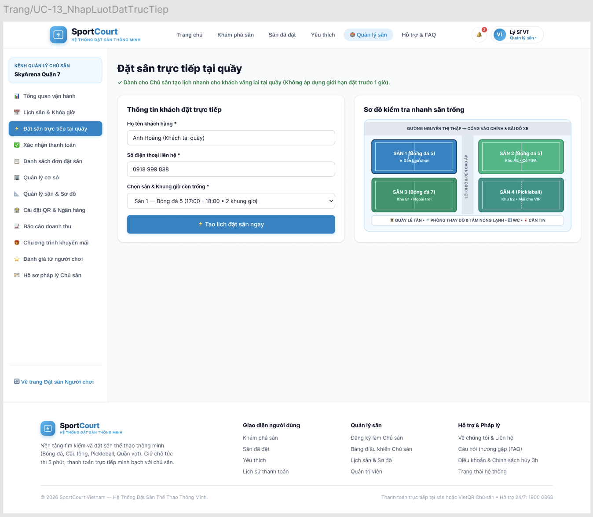

Figure 6.7. UI-15 • PA2 reference mockup.

| # | Control | Type | Description / validation | Event handling |
| --- | --- | --- | --- | --- |
| 1 | Court and times | Schedule grid | Select times for an owned facility. Blocked, held and booked slots are unavailable. | Select |
| 2 | In-person booking | Action | Apply the hold and confirmation workflow on the shared schedule. An authorised counter booking is exempt from the player’s 60-minute cut-off. | Submit |

### UI-01 Home and search

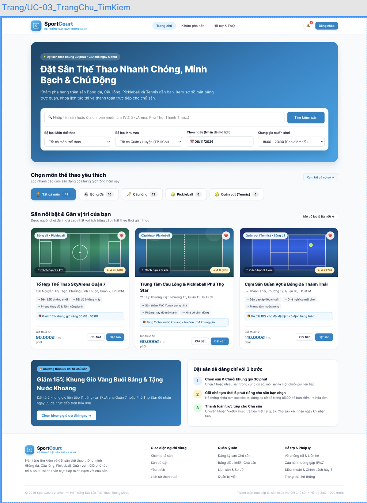

Figure 6.8. UI-01 • PA2 reference mockup.

### UI-03 Sign in

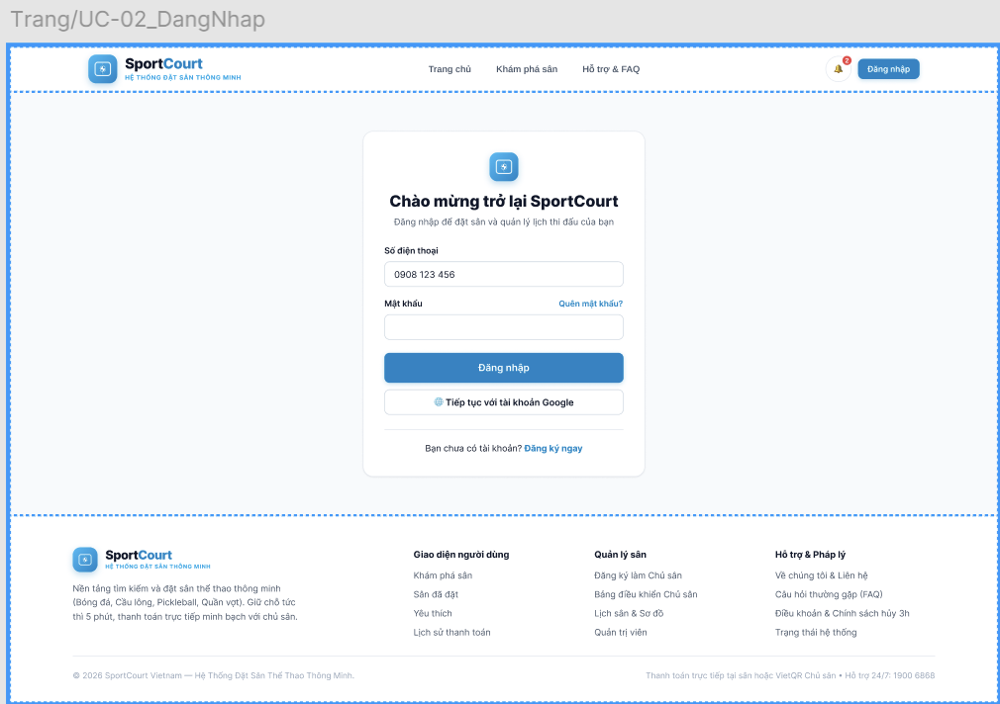

Figure 6.9. UI-03 • PA2 reference mockup.

### UI-04 Register

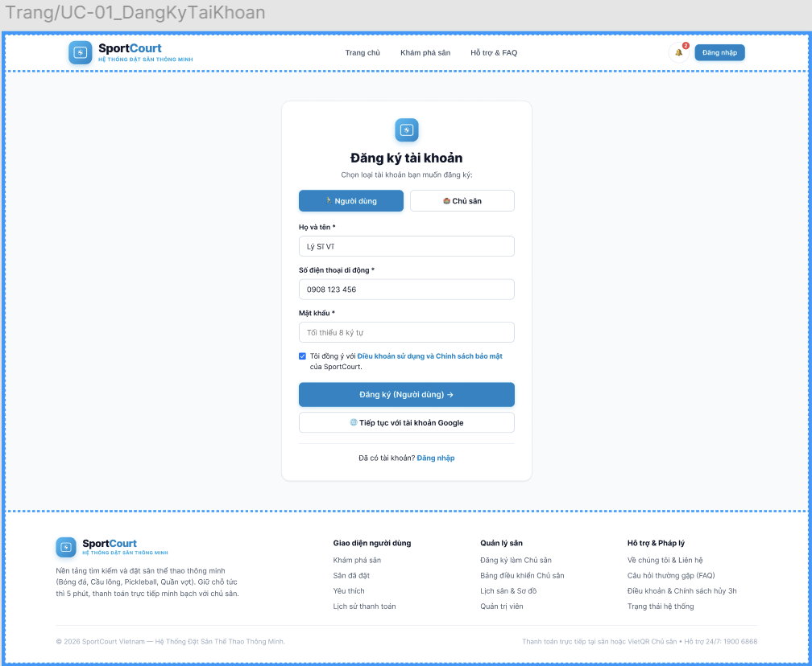

Figure 6.10. UI-04 • PA2 reference mockup.

### UI-05 Facility details and prices

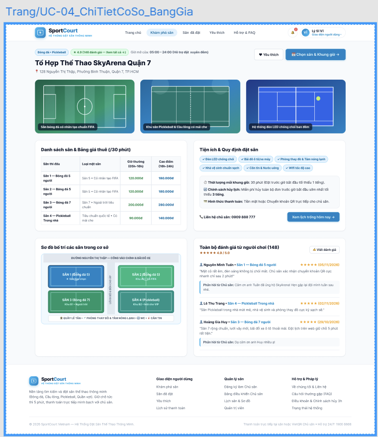

Figure 6.11. UI-05 • PA2 reference mockup.

### UI-08 Booking confirmation

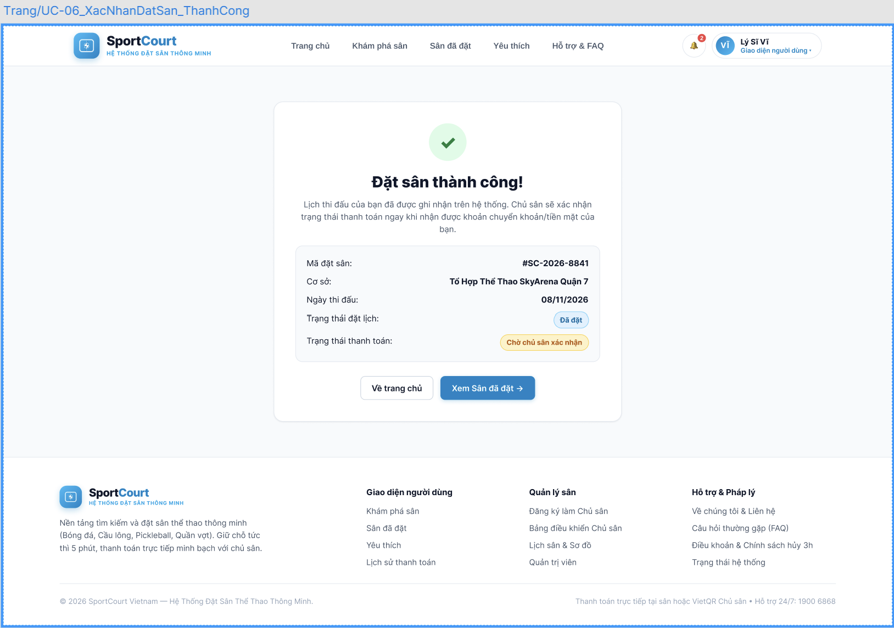

Figure 6.12. UI-08 • PA2 reference mockup.

### UI-09 My bookings

Figure 6.13. UI-09 • PA2 reference mockup.

### UI-11 In-app notifications

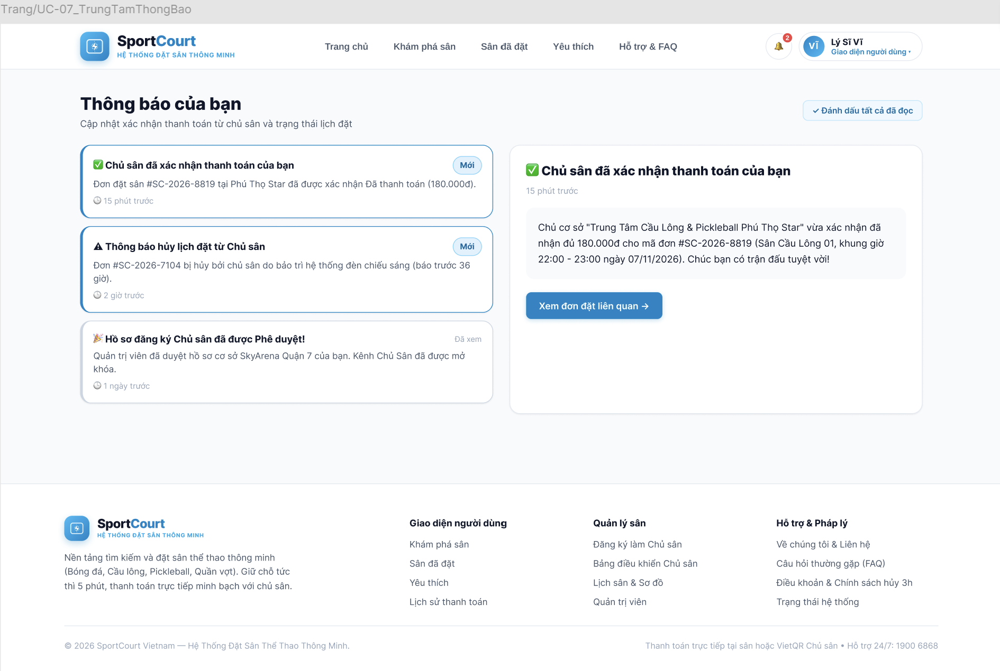

Figure 6.14. UI-11 • PA2 reference mockup.

### UI-12 Owner dashboard

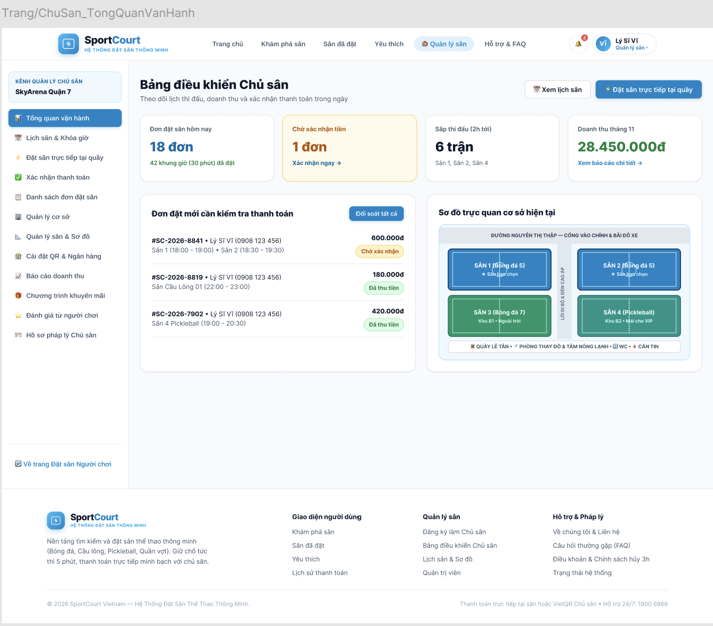

Figure 6.15. UI-12 • PA2 reference mockup.

### UI-13 Courts and prices

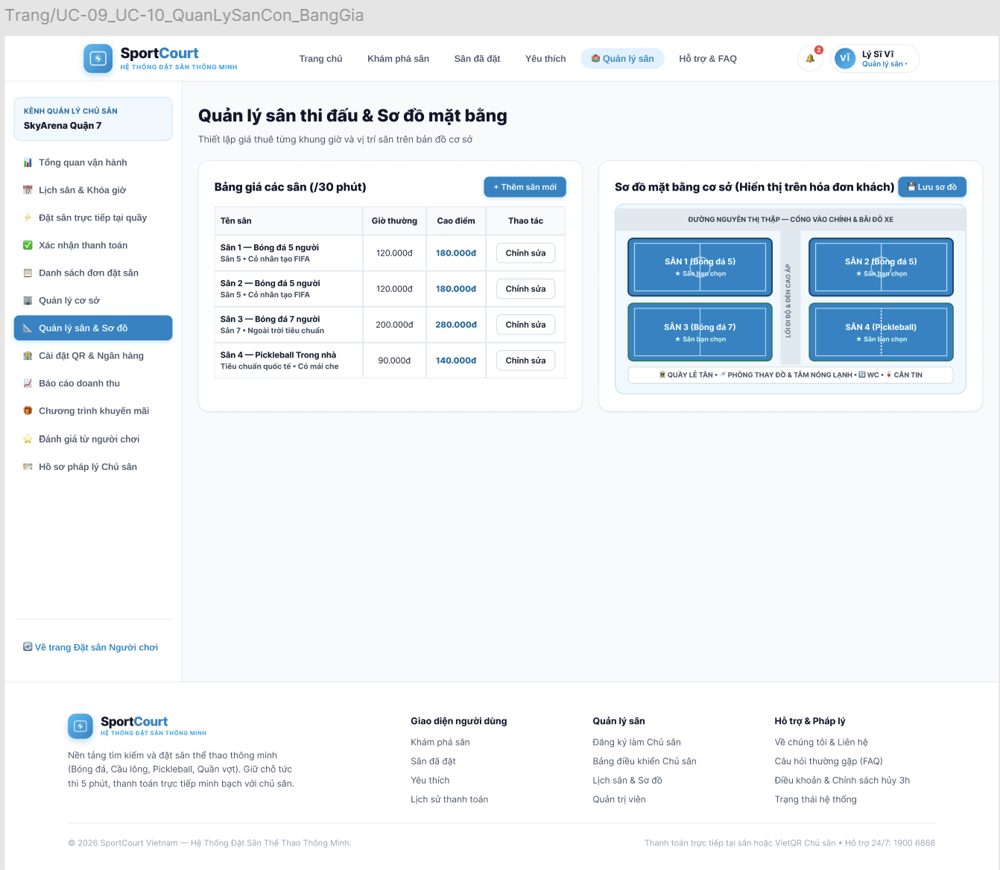

Figure 6.16. UI-13 • PA2 reference mockup.

## Accessibility Checklist (UI-ACC-01)

Contrast: target 4.5:1 or higher. Use text and icons to identify slot states.

Keyboard and focus: check keyboard operation and visible focus.

Labels and errors: label each control and tell users how to fix errors.

Responsive layout: check the slot grid on narrow screens and test Chrome and Safari.

Check these targets in implementation and test the three-minute booking flow.
