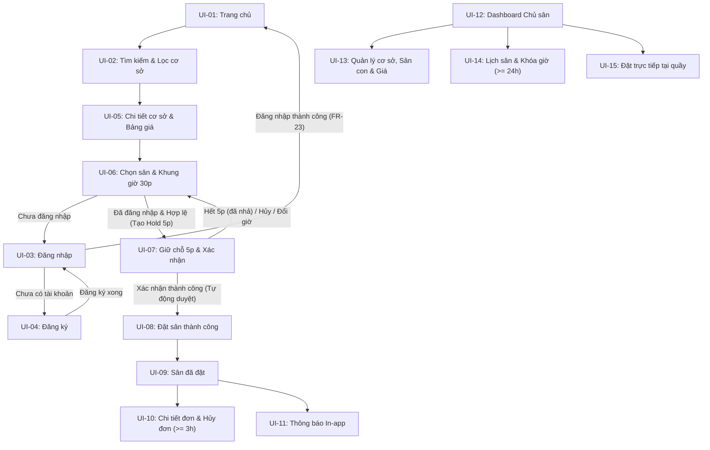

# Đặc tả Thiết kế UI/UX và Trạng thái Giao diện (Task 3.2.1 — Issue #13)

- **Mã đối tượng truy vết:** `UI-SPEC-01` (Tổng thể), `UI-01`..`UI-15` (Danh sách màn hình), `UI-FLOW-01` (Luồng chuyển màn hình), `UI-ACC-01` (Accessibility & Responsive)
- **Người thực hiện:** Lý Sĩ Vĩ (`@Lysivi2005`)
- **Người kiểm tra:** Trí (`@nmt1206` — luồng & ngoại lệ), Khôi (`@KhoiVuong2210` — dữ liệu & phản hồi API)
- **Tài liệu đầu vào:** Baseline PA2 (`pa/PA2/T04-PA2-SoftwareRequirementsSpecification.docx`), Bộ mockup `docs/requirements/UI_Picture/`, State Machines (`docs/design/states/state-machines.md`)

> **Lưu ý phạm vi (Baseline PA2):**
> - Các chức năng **In-Scope** bám sát 5 nhóm tính năng bắt buộc (F01–F05) và 13 Use Case (UC-01–UC-13).
> - Thanh toán trực tuyến, đặt cọc, đánh giá công khai và cổng Admin **không thuộc baseline PA2**; các thành phần liên quan xuất hiện trong ảnh mockup cũ chỉ mang tính tham khảo giao diện.
> - Kết quả đặt sân và thông báo hủy chỉ hiển thị **trực tiếp trong ứng dụng web** (`NFR-09`, không gửi email/SMS).

---

## 1. Danh sách Màn hình (Screen List — `UI-01`..`UI-15`)

Toàn bộ ảnh giao diện tham chiếu được lưu tại `docs/requirements/UI_Picture/` và phân theo 4 nhóm luồng chính:

| Mã | Tên màn hình / Frame | Vai trò | Use Case | Đường dẫn ảnh |
|---|---|---|---|---|
| **UI-01** | Trang chủ & Tìm kiếm nhanh | Khách / Người chơi | UC-03 | `../../requirements/UI_Picture/01_Khach_Va_XacThuc/Trang_UC-03_TrangChu_TimKiem.png` |
| **UI-02** | Danh sách & Bộ lọc cơ sở | Khách / Người chơi | UC-03 | `../../requirements/UI_Picture/01_Khach_Va_XacThuc/Trang_UC-03_DanhSach_Va_LocCoSo.png` |
| **UI-03** | Đăng nhập | Khách | UC-02 | `../../requirements/UI_Picture/01_Khach_Va_XacThuc/Trang_UC-02_DangNhap.png` |
| **UI-04** | Đăng ký tài khoản | Khách | UC-01 | `../../requirements/UI_Picture/01_Khach_Va_XacThuc/Trang_UC-01_DangKyTaiKhoan.png` |
| **UI-05** | Chi tiết cơ sở & Bảng giá | Khách / Người chơi | UC-04 | `../../requirements/UI_Picture/02_NguoiChoi_DatSan/Trang_UC-04_ChiTietCoSo_BangGia.png` |
| **UI-06** | Chọn sân & Khung giờ 30 phút | Khách / Người chơi | UC-04, UC-05 | `../../requirements/UI_Picture/02_NguoiChoi_DatSan/Trang_UC-05_ChonSan_KhungGioMaTran.png` |
| **UI-07** | Giữ chỗ 5 phút & Xác nhận đơn | Người chơi | UC-05, UC-06 | `../../requirements/UI_Picture/02_NguoiChoi_DatSan/Trang_UC-05_UC-06_GiuCho5Phut_HoaDon.png` |
| **UI-08** | Đặt sân thành công | Người chơi | UC-06 | `../../requirements/UI_Picture/02_NguoiChoi_DatSan/Trang_UC-06_XacNhanDatSan_ThanhCong.png` |
| **UI-09** | Danh sách sân đã đặt | Người chơi | UC-07 | `../../requirements/UI_Picture/02_NguoiChoi_DatSan/Trang_UC-07_SanDaDat_TatCa .png` |
| **UI-10** | Chi tiết đơn & Hủy đơn | Người chơi | UC-07, UC-08 | `../../requirements/UI_Picture/02_NguoiChoi_DatSan/Trang_UC-08_ChiTietDon_HuySan.png` |
| **UI-11** | Trung tâm thông báo In-app | Người chơi | UC-07 | `../../requirements/UI_Picture/02_NguoiChoi_DatSan/Trang_UC-07_TrungTamThongBao.png` |
| **UI-12** | Tổng quan vận hành Chủ sân | Chủ sân | F05 | `../../requirements/UI_Picture/04_ChuSan_QuanLy/Trang_ChuSan_TongQuanVanHanh.png` |
| **UI-13** | Quản lý cơ sở & Sân con / Giá | Chủ sân | UC-09, UC-10 | `../../requirements/UI_Picture/04_ChuSan_QuanLy/Trang_UC-09_UC-10_QuanLySanCon_BangGia.png` |
| **UI-14** | Lịch sân & Khóa giờ bảo trì ($\ge$ 24h) | Chủ sân | UC-11, UC-12 | `../../requirements/UI_Picture/04_ChuSan_QuanLy/Trang_UC-11_UC-12_LichSan_KhoaGioBaoTri.png` |
| **UI-15** | Nhập lượt đặt trực tiếp tại quầy | Chủ sân | UC-13 | `../../requirements/UI_Picture/04_ChuSan_QuanLy/Trang_UC-13_NhapLuotDatTrucTiep.png` |

> **Ghi chú hiển thị trạng thái trên `UI-09` (SC-07 — Sân đã đặt, đồng bộ `STM-03`):** Danh sách hiển thị các trạng thái `Đã xác nhận (Sắp diễn ra)`, `Đã hoàn thành`, `Đã hủy bởi người chơi` và `Đã hủy bởi chủ sân`. Trong đó nhãn **“Đã hoàn thành”** được **suy diễn từ thời gian** khi đơn đang ở `Confirmed` và `now >= latestEndTime` (giờ kết thúc của slot muộn nhất trong đơn), không lưu thành trạng thái cứng trong DB (`FR-15`, `FR-16`).

---

## 2. Sơ đồ Luồng Chuyển Màn hình (`UI-FLOW-01`)

---

## 3. Đặc tả Chi tiết các Màn hình Trọng yếu

### 3.1. `UI-02`: Tìm kiếm và Lọc cơ sở (UC-03)
- **Ảnh minh họa:** `../../requirements/UI_Picture/01_Khach_Va_XacThuc/Trang_UC-03_DanhSach_Va_LocCoSo.png`
- **Control, Event & Validation:**

| Control | Loại | Event | Validation & Phản hồi API / Trạng thái |
|---|---|---|---|
| Ô tìm kiếm tên/địa chỉ | Text Input | `onChange` / `onSubmit` | Cho phép tìm không cần đăng nhập (FR-04). Phản hồi P95 $\le 2$ giây (NFR-06). |
| Bộ lọc Môn thể thao & Vị trí | Select / Dropdown | `onChange` | Lọc danh sách cơ sở khớp môn thể thao và khu vực (AC-09). |
| Bộ lọc Tiện ích | Checkbox / Chip | `onToggle` | Chỉ giữ lại các cơ sở có đủ tiện ích đã chọn (AC-10). |
| Chọn ngày | Date Picker Popup | `onSelectDate` | Mở lịch chọn ngày trực quan, không cho chọn ngày quá khứ. |
| Trạng thái rỗng (Empty) | Banner thông báo | — | Hiển thị *"Không tìm thấy cơ sở phù hợp"* kèm nút *Xóa bộ lọc*. |

---

### 3.2. `UI-06`: Chọn sân & Khung giờ 30 phút (UC-04, UC-05)
- **Ảnh minh họa:** `../../requirements/UI_Picture/02_NguoiChoi_DatSan/Trang_UC-05_ChonSan_KhungGioMaTran.png`
- **Control, Event & Validation:**

| Control | Loại | Event | Validation & Phản hồi API / Trạng thái |
|---|---|---|---|
| Bộ chọn ngày | Date Picker | `onChange` | Tải lại ma trận khung 30 phút của từng sân con theo ngày chọn (FR-08). |
| Ô khung giờ 30 phút | Grid Cell Button | `onClick` | Phân biệt 4 trạng thái: `Trống`, `Đang giữ`, `Đã đặt`, `Không khả dụng`. Chỉ cho chọn ô `Trống`. Trên cùng 1 sân con, các ô phải **liên tiếp nhau** (BR-03). **Lưu ý:** Chọn ô chưa tạo Hold (BR-04). |
| Nút *Tiến hành đặt sân* | Primary Button | `onClick` | 1. Nếu là Khách $\rightarrow$ chuyển sang `UI-03` Đăng nhập, không tạo Hold; đăng nhập xong về `UI-01` chọn lại (FR-23). 2. Kiểm tra mốc thời gian: phải trước khung bắt đầu sớm nhất $\ge 2$ khung (60 phút) (FR-27, BR-08). 3. Gửi API tạo Hold (*All-or-Nothing*): nếu có $\ge 1$ ô xung đột $\rightarrow$ **không giữ ô nào**, báo rõ khung gặp vấn đề, xóa lựa chọn hiện tại và làm mới ma trận (FR-13, FR-32). |

---

### 3.3. `UI-07`: Giữ chỗ tạm thời 5 phút & Xác nhận đặt sân (UC-05, UC-06)
- **Ảnh minh họa:** `../../requirements/UI_Picture/02_NguoiChoi_DatSan/Trang_UC-05_UC-06_GiuCho5Phut_HoaDon.png`
- **Trạng thái giao diện đồng bộ `STM-01` (`HoldStatus`):**
  - `ACTIVE`: Hiển thị đồng hồ đếm ngược (tính từ `expiresAt` của server), bật nút *Xác nhận đặt sân*.
  - `EXPIRED` (hết giờ nhưng chưa nhả xong): Khóa ngay nút *Xác nhận đặt sân*, hiển thị trạng thái *"Đang giải phóng chỗ..."*; nếu giải phóng thất bại $\rightarrow$ báo lỗi cụ thể và **không cho tiếp tục như thể đã nhả xong** (`FR-14`, `AC-20`).
  - `RELEASED`: Hoàn tất nhả slot (trong $\le 5$ giây khi hết hạn hoặc ngay khi người chơi bấm hủy), cho phép quay lại `UI-06` để chọn giờ mới.
- **Control, Event & Validation:**

| Control | Loại | Event | Validation & Phản hồi API / Trạng thái |
|---|---|---|---|
| Đồng hồ đếm ngược 05:00 | Timer Badge | `onTick` (1s) | Hiển thị thời gian giữ còn lại dựa trên `expiresAt` của server. **Tải lại trang (F5) giữ nguyên thời gian còn lại**, không reset 5 phút (FR-25). Không tự gia hạn (FR-31). |
| Nút *Xác nhận đặt sân* | Primary Button | `onClick` | Gọi API kiểm tra lại (Recheck) quyền sở hữu Hold, `now < expiresAt` và tình trạng sân. Nếu hợp lệ $\rightarrow$ **tự động xác nhận đơn** (không chờ chủ sân duyệt, FR-12) và chuyển `UI-08`. Nếu hết hạn tại thời điểm bấm $\rightarrow$ từ chối ngay (`AC-35`, `AC-39`). |
| Nút *Hủy / Chọn lại giờ* | Secondary Button | `onClick` | Gửi yêu cầu nhả Hold ngay lập tức sang `RELEASED` và quay về `UI-06` (FR-14, AC-21). |
| Rời trang / Đóng tab | Browser Lifecycle | `beforeunload` / `pagehide` | Gửi tín hiệu `sendBeacon` cố gắng nhả Hold sớm; nếu mất kết nối không gửi được thì hết 5 phút hệ thống tự giải phóng (FR-26, AC-23). |

---

### 3.4. `UI-10`: Chi tiết đơn đặt & Hủy đơn (UC-07, UC-08)
- **Ảnh minh họa:** `../../requirements/UI_Picture/02_NguoiChoi_DatSan/Trang_UC-08_ChiTietDon_HuySan.png`
- **Control, Event & Validation:**

| Control | Loại | Event | Validation & Phản hồi API / Trạng thái |
|---|---|---|---|
| Thông tin đơn đặt | Read-only Card | `onLoad` | Hiển thị cơ sở, danh sách sân con, khung giờ và trạng thái đơn (FR-16). |
| Nút *Hủy toàn bộ đơn* | Danger Button | `onClick` | Kiểm tra thời gian hiện tại so với khung bắt đầu sớm nhất trong đơn: **còn $\ge 3$ giờ mới cho phép hủy** (đúng 3 giờ vẫn được, FR-28, BR-09). Nếu $< 3$ giờ $\rightarrow$ vô hiệu hóa hoặc báo từ chối hủy. Không cho hủy lẻ từng sân con (AC-27). |

---

### 3.5. `UI-14`: Lịch sân & Khóa giờ bảo trì $\ge 24\text{h}$ (UC-11, UC-12)
- **Ảnh minh họa:** `../../requirements/UI_Picture/04_ChuSan_QuanLy/Trang_UC-11_UC-12_LichSan_KhoaGioBaoTri.png`
- **Control, Event & Validation:**

| Control | Loại | Event | Validation & Phản hồi API / Trạng thái |
|---|---|---|---|
| Lịch ma trận & Chọn khoảng chặn | Grid / Time Range | `onSelect` | Chỉ cho phép chủ sân thao tác trên cơ sở thuộc quyền sở hữu của mình (FR-03, NFR-04). |
| Nút *Khóa khung giờ / Đổi giờ* | Primary Button | `onClick` | 1. Nếu là *Khóa khung giờ* (`UC-11`): khung chặn phải bắt đầu cách hiện tại $\ge 24$ giờ (`BR-12`). 2. Kiểm tra ảnh hưởng (bước xem trước): nếu có Hold đang hoạt động bị ảnh hưởng $\rightarrow$ yêu cầu chờ Hold kết thúc rồi thử lại (`FR-29`, `AC-30`). 3. Nếu có đơn đặt bị ảnh hưởng có giờ bắt đầu $< 24$ giờ $\rightarrow$ **từ chối toàn bộ thao tác** (`BR-11`, `AC-29`). 4. Nếu mọi đơn bị ảnh hưởng đều $\ge 24$ giờ $\rightarrow$ hiển thị danh sách đơn sẽ bị hủy + cảnh báo; khi chủ sân xác nhận $\rightarrow$ hủy đơn, cập nhật lịch chung và gửi thông báo In-app kèm lý do cho người chơi (`FR-30`). |

---

### 3.6. `UI-15`: Nhập lượt đặt trực tiếp tại quầy (UC-13)
- **Ảnh minh họa:** `../../requirements/UI_Picture/04_ChuSan_QuanLy/Trang_UC-13_NhapLuotDatTrucTiep.png`
- **Control, Event & Validation:**

| Control | Loại | Event | Validation & Phản hồi API / Trạng thái |
|---|---|---|---|
| Ma trận chọn sân & khung giờ | Grid Matrix | `onClick` | Dùng chung **Lịch chung (Shared Schedule)** với người chơi (FR-22). **Không được chèn** lên khung `Đang giữ` hoặc `Đã đặt` (BR-13). |
| Nút *Tạo đơn trực tiếp* | Primary Button | `onClick` | Chủ sân được **miễn giới hạn đặt trước 2 khung (60 phút)** (FR-21, BR-08). Vẫn áp dụng cơ chế Hold/Confirm nguyên tử để tránh trùng lịch. |

---

## 4. Tiêu chuẩn Accessibility & Responsive (`UI-ACC-01` — NFR-01, NFR-07)

1. **Tương thích thiết bị & Trình duyệt (NFR-01):** Thiết kế hỗ trợ đầy đủ bố cục Desktop (`1440px` / `1512px`) và Mobile (`375px`–`430px`) trên Google Chrome và Apple Safari. Ma trận khung giờ cho phép cuộn ngang mượt mà trên màn hình nhỏ mà không làm vỡ layout chung.
2. **Độ tương phản & Nhận diện trạng thái:**
   - Tỷ lệ tương phản chữ/nền đạt chuẩn WCAG AA ($\ge 4.5:1$).
   - 4 trạng thái khung giờ (`Trống`, `Đang giữ`, `Đã đặt`, `Không khả dụng`) không chỉ phân biệt bằng màu sắc mà còn kết hợp **biểu tượng (icon)** và **nhãn chữ** rõ ràng cho người khiếm thị màu.
3. **Kích thước vùng chạm (Touch Target):** Các nút bấm chính và ô khung giờ 30 phút có chiều cao tối thiểu `40px–44px` giúp thao tác chính xác trên điện thoại và hoàn tất luồng đặt sân trong $\le 3$ phút (NFR-07).
4. **Thông báo & Phản hồi lỗi:** Mọi lỗi nghiệp vụ (xung đột slot, hết 5 phút giữ chỗ, vi phạm mốc 3 giờ / 24 giờ) đều hiển thị thông báo rõ nguyên nhân và hướng xử lý tiếp theo ngay trong giao diện.

---

## 5. Thông tin gửi kèm Review (Theo Working Agreement Mục 5.3)

- **Danh sách sản phẩm:** `docs/design/ui/ui-design-specification.md` (Mã đối tượng: `UI-SPEC-01`, `UI-01`..`UI-15`, `UI-FLOW-01`, `UI-ACC-01`).
- **Kết quả tự kiểm tra:**
  - [x] Bao phủ đủ 15 màn hình từ bộ ảnh `UI_Picture`, có flow chuyển màn hình và đặc tả chi tiết 6 màn trọng yếu (`UI-02`, `UI-06`, `UI-07`, `UI-10`, `UI-14`, `UI-15`).
  - [x] Khớp các điểm đồng bộ với `STM-01` (phân biệt `ACTIVE`, `EXPIRED`, `RELEASED` trên `UI-07`) và `STM-03` (suy diễn nhãn `Đã hoàn thành` trên `UI-09`).
  - [x] Giữ đúng baseline PA2: không đưa thanh toán trực tuyến hay thông báo Email/SMS vào luồng chính.
- **Điểm cần người kiểm tra xác nhận:**
  - `@nmt1206`: xác nhận luồng ngoại lệ trên `UI-06`, `UI-07`, `UI-10`, `UI-14` và nhãn trạng thái trên `UI-07`, `UI-09` đã khớp `STM-01`/`STM-03` và `SEQ-01..05`.
  - `@KhoiVuong2210`: xác nhận các thông tin phản hồi API (khung lỗi khi All-or-Nothing thất bại, `expiresAt` khi F5, danh sách đơn bị ảnh hưởng ở bước preview 24h) khớp đặc tả giao tiếp (`3.1.4`).
